# 2026 梯子推荐与机场推荐清单（18 条资料，每日自动更新）

   

> 本仓库是公开资料整理与 GitHub 镜像示例。价格、优惠码、线路和可用性会变化，购买前请在官网核验，并优先月付试用。
>
> 订阅链接等同账号密钥，请勿公开粘贴或提交到 Issues、日志和截图中。请遵守你所在地的法律法规及服务条款。

**数据更新时间：2026-10-27（Asia/Shanghai）** · [主站](https://clash-jichang.com/) · [Telegram](https://t.me/JLYCloud)

这是一个围绕 **2026 机场推荐、梯子推荐、稳定专线、平价月付、ChatGPT / Claude 节点、Clash、Sing-box、V2Ray、Shadowsocks、Trojan、IEPL / IPLC** 等搜索需求整理的 GitHub 资料页。表格用于快速对比价格、协议、线路和适用场景，具体可用性以官网和自行测试为准。
每家资料均配有独立配色的线路概览图和 AI / 流媒体状态图，图片只用于阅读导航和版式展示。

## 📋 目录

- [本期摘要](#摘要) · [TOP 推荐](#top) · [快速选购指南](#guide) · [全部资料](#全部资料)
- [高端专线](#高端专线) · [平价月付](#平价月付) · [AI / 原生 IP](#ai-原生-ip) · [流媒体](#流媒体)
- [数据如何自动更新](#数据如何自动更新) · [客户端建议](#客户端建议) · [常见问题](#常见问题) · [免责声明](#免责声明)

## 📢 本期摘要

- 当前展示 **18 条资料**，其中有明确实测记录的 **0 条**。
- 排名是资料整理的参考顺序，不代表任何时段的速度、稳定性或解锁保证。

## 🏆 TOP 推荐（参考排序）

| 位置 | 名称 | 入门价格 | 线路 / 协议 | 适用场景 | 资料口径 | 入口 |
| :---: | :--- | :--- | :--- | :--- | :--- | :--- |
| 1 | [极连云](https://haozevpn.jlyvipaff.com/#/?code=KUKfOY13) | ￥15.5/月起 | IPLC / IEPL 专线 / SS / Trojan | 全能主力、晚高峰、AI 工具 | 📝 资料整理 | [官网注册](https://haozevpn.jlyvipaff.com/#/?code=KUKfOY13) |
| 2 | [光年梯（GNT）](https://gnt001.gntvipaff.cc/#/?code=j1ufpE44) | ￥18/月起 | 国际专线 / 多线优化 / SS / VLESS | 多设备、流媒体、日常主力 | 📝 资料整理 | [官网注册](https://gnt001.gntvipaff.cc/#/?code=j1ufpE44) |
| 3 | [边缘节点（EdgeNova）](https://zoio.edgenovaaff.cc/#/register?code=Oy1wZvzJ) | ￥20/月起 | 企业级 IPLC / VLESS / Hysteria 2 | AI 工具、跨境业务 | 📝 资料整理 | [官网注册](https://zoio.edgenovaaff.cc/#/register?code=Oy1wZvzJ) |

## ⚡ 快速选购指南

| 使用需求 | 优先查看 | 选择建议 |
| :--- | :--- | :--- |
| **追求晚高峰稳定** | [极连云](#极连云)、[光年梯（GNT）](#光年梯-gnt)、[速界](#速界) | 先月付，完整体验晚高峰后再考虑长期套餐 |
| **预算敏感 / 备用线路** | [可信云](#可信云)、[快狸](#快狸)、[闪电鼠](#闪电鼠) | 优先看月付价格、流量有效期和退款规则 |
| **ChatGPT / Claude / Gemini** | [边缘节点（EdgeNova）](#边缘节点-edgenova)、[云图](#云图)、[Lumina](#lumina) | 不要只看宣传，购买后逐个节点验证 |
| **Netflix / YouTube / 4K 流媒体** | [神行加速](#神行加速)、[环球梯](#环球梯) | 解锁状态会变动，优先选择可短期试用的套餐 |

> 选购纪律：新服务先月付，准备一条低价备用线路，不要公开粘贴订阅地址。

## 📊 全部资料（18 条，按参考排序）

| 排名 | 名称 | 分类 | 入门价格 | 优惠码 | 线路 | 协议 | 资料口径 | 入口 |
| :---: | :--- | :--- | :--- | :---: | :--- | :--- | :--- | :--- |
| 1 | [极连云](#极连云) | 高端专线 | ￥15.5/月起 | `JLY888` | IPLC / IEPL 专线 | SS / Trojan | 📝 资料整理 | [官网注册](https://haozevpn.jlyvipaff.com/#/?code=KUKfOY13) |
| 2 | [光年梯（GNT）](#光年梯-gnt) | 高端专线 | ￥18/月起 | `GNT80` | 国际专线 / 多线优化 | SS / VLESS | 📝 资料整理 | [官网注册](https://gnt001.gntvipaff.cc/#/?code=j1ufpE44) |
| 3 | [边缘节点（EdgeNova）](#边缘节点-edgenova) | AI / 原生 IP | ￥20/月起 | `xk808` | 企业级 IPLC | VLESS / Hysteria 2 | 📝 资料整理 | [官网注册](https://zoio.edgenovaaff.cc/#/register?code=Oy1wZvzJ) |
| 4 | [可信云](#可信云) | 平价月付 | ￥12/月起 | `kxy80` | BGP 智能中转 | Shadowsocks | 📝 资料整理 | [官网注册](https://haibing822.kosingaff.com/#/register?code=zcjBlIde) |
| 5 | [速界](#速界) | 高端专线 | ￥16/月起 | `sujie888` | IEPL 内网 | SS / Hysteria 2 | 📝 资料整理 | [官网注册](https://everett7623.speedworldaff.com/#/register?code=r7IOqoY7) |
| 6 | [云图](#云图) | AI / 原生 IP | ￥20/月起 | `yt88` | 金融级专线 | SS / Trojan | 📝 资料整理 | [官网注册](https://super.ytjcok.org/#/register?code=qPHQtI9a) |
| 7 | [云界线](#云界线) | 高端专线 | ￥18/月起 | `yjx888` | IEPL 专线 | VLESS / SS | 📝 资料整理 | [官网注册](https://yiyige163.yunjiexianaff.com/#/?code=oetFP4xi) |
| 8 | [快狸](#快狸) | 平价月付 | ￥9.9/月起 | `kl888` | BGP 优化中转 | Shadowsocks | 📝 资料整理 | [官网注册](https://yyo649929.kuailiaff.com/#/register?code=G56QwHto) |
| 9 | [神行加速](#神行加速) | 流媒体 | ￥15/月起 | `sx0077` | BGP 多线中转 | Shadowsocks | 📝 资料整理 | [官网注册](https://haozevpn01.shenxingaff.com/#/?code=c2XNz7jn) |
| 10 | [闪电鼠](#闪电鼠) | 平价月付 | ￥8.8/月起 | `sd88` | BGP 优质中转 | Shadowsocks | 📝 资料整理 | [官网注册](https://haozevpn.shandianshuaff.com/#/?code=htqQLwdu) |
| 11 | [环球梯](#环球梯) | 流媒体 | ￥14/月起 | `hq66` | BGP 跨境中继 | Shadowsocks | 📝 资料整理 | [官网注册](https://haozevpn01.huanqiutiaff.com/#/?code=2xpedcFa) |
| 12 | [榴莲云](#榴莲云) | 平价月付 | ￥10/月起 | `ll88` | BGP 优化直连 | Shadowsocks | 📝 资料整理 | [官网注册](https://haibing01.liulianyunaff.com/#/?code=0lnqSPF9) |
| 13 | [鲲鹏加速](#鲲鹏加速) | 平价月付 | ￥15/月起 | `—` | BGP 高速中转 | Trojan / SS | 📝 资料整理 | [官网注册](https://kunpengjiasu.com/#/register?code=QAo8sMhc) |
| 14 | [Lumina](#lumina) | AI / 原生 IP | ￥10/月起 | `—` | 直连 + 高速中转 | Hysteria 2 / AnyTLS | 📝 资料整理 | [官网注册](https://haozevpn.jlyvipaff.com/#/?code=KUKfOY13) |
| 15 | [瞬云](#瞬云) | 平价月付 | ￥11/月起 | `—` | ANYCAST 中转 | Shadowsocks | 📝 资料整理 | [官网注册](https://ddd.jichang.best/#/register?code=o4I4kToe) |
| 16 | [大哥云](#大哥云) | 高端专线 | ￥19.9/月起 | `dly88` | IPLC + 多线隧道 | 自研客户端 / SS | 📝 资料整理 | [官网注册](https://haozevpn.jlyvipaff.com/#/?code=KUKfOY13) |
| 17 | [龙猫云](#龙猫云) | 高端专线 | ￥15/月起 | `—` | IPLC 专线 | Shadowsocks | 📝 资料整理 | [官网注册](https://haozevpn.jlyvipaff.com/#/?code=KUKfOY13) |
| 18 | [飞鸟机场](#飞鸟机场) | 高端专线 | ￥15/月起 | `—` | 中转 + IEPL | Shadowsocks | 📝 资料整理 | [官网注册](https://haozevpn.jlyvipaff.com/#/?code=KUKfOY13) |

## 🧭 高端专线（7 条）

### 1. 极连云

**￥15.5/月起** · 线路：IPLC / IEPL 专线 · 协议：SS / Trojan · 优惠码：`JLY888`

资料中定位为专线型综合服务，适合先以月付验证线路和实际可用性。

- 适用场景：全能主力、晚高峰、AI 工具
- 资料口径：用户提供的资料，待独立核验
- 入口：[官网注册](https://haozevpn.jlyvipaff.com/#/?code=KUKfOY13)

### 2. 光年梯（GNT）

**￥18/月起** · 线路：国际专线 / 多线优化 · 协议：SS / VLESS · 优惠码：`GNT80`

资料中定位为高带宽专线服务，建议购买前确认当前套餐和优惠码。

- 适用场景：多设备、流媒体、日常主力
- 资料口径：用户提供的资料，待独立核验
- 入口：[官网注册](https://gnt001.gntvipaff.cc/#/?code=j1ufpE44)

### 5. 速界

**￥16/月起** · 线路：IEPL 内网 · 协议：SS / Hysteria 2 · 优惠码：`sujie888`

资料中定位为高带宽低抖动线路，实际体验取决于地区和运营商。

- 适用场景：游戏、低抖动、流媒体
- 资料口径：用户提供的资料，待独立核验
- 入口：[官网注册](https://everett7623.speedworldaff.com/#/register?code=r7IOqoY7)

### 7. 云界线

**￥18/月起** · 线路：IEPL 专线 · 协议：VLESS / SS · 优惠码：`yjx888`

资料中定位为跨境业务线路，企业使用前应先确认合规和售后。

- 适用场景：跨境电商、独立站
- 资料口径：用户提供的资料，待独立核验
- 入口：[官网注册](https://yiyige163.yunjiexianaff.com/#/?code=oetFP4xi)

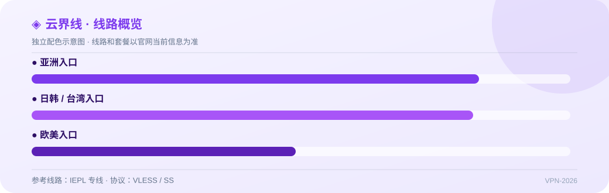

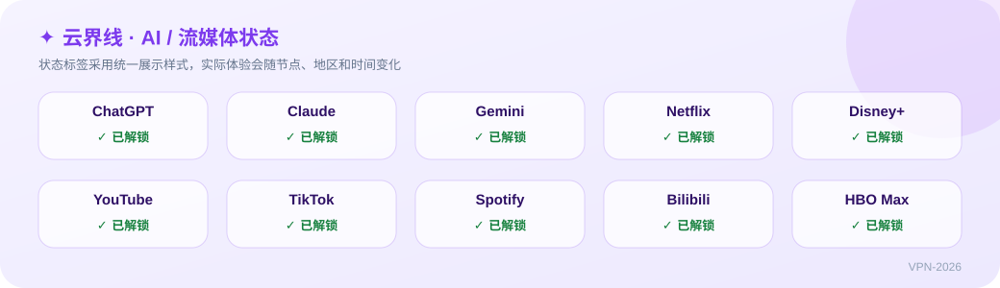

### 16. 大哥云

**￥19.9/月起** · 线路：IPLC + 多线隧道 · 协议：自研客户端 / SS · 优惠码：`dly88`

资料中定位为老牌和大带宽线路，套餐与入口可能变化。

- 适用场景：流媒体、日常主力
- 资料口径：用户提供的资料，待独立核验
- 入口：[官网注册](https://haozevpn.jlyvipaff.com/#/?code=KUKfOY13)

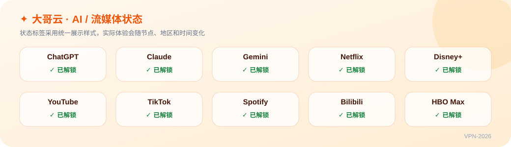

### 17. 龙猫云

**￥15/月起** · 线路：IPLC 专线 · 协议：Shadowsocks · 优惠码：`—`

资料中定位为大带宽专线服务，购买前请确认官方入口和套餐。

- 适用场景：大流量、跨境业务
- 资料口径：用户提供的资料，待独立核验
- 入口：[官网注册](https://haozevpn.jlyvipaff.com/#/?code=KUKfOY13)

### 18. 飞鸟机场

**￥15/月起** · 线路：中转 + IEPL · 协议：Shadowsocks · 优惠码：`—`

资料中定位为中转和专线混合线路，建议先购买短周期套餐。

- 适用场景：晚高峰、流媒体
- 资料口径：用户提供的资料，待独立核验
- 入口：[官网注册](https://haozevpn.jlyvipaff.com/#/?code=KUKfOY13)

## 🧭 平价月付（6 条）

### 4. 可信云

**￥12/月起** · 线路：BGP 智能中转 · 协议：Shadowsocks · 优惠码：`kxy80`

资料中定位为月付入门线路，建议关注最新套餐和售后公告。

- 适用场景：日常浏览、文献检索
- 资料口径：用户提供的资料，待独立核验
- 入口：[官网注册](https://haibing822.kosingaff.com/#/register?code=zcjBlIde)

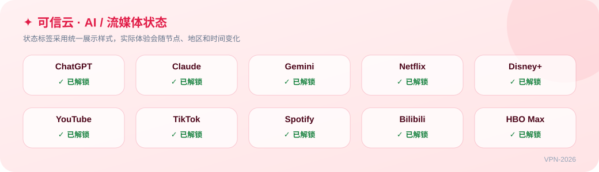

### 8. 快狸

**￥9.9/月起** · 线路：BGP 优化中转 · 协议：Shadowsocks · 优惠码：`kl888`

资料中定位为低门槛月付选项，适合作为短期体验或备用线路。

- 适用场景：网页、文献、轻量使用
- 资料口径：用户提供的资料，待独立核验
- 入口：[官网注册](https://yyo649929.kuailiaff.com/#/register?code=G56QwHto)

### 10. 闪电鼠

**￥8.8/月起** · 线路：BGP 优质中转 · 协议：Shadowsocks · 优惠码：`sd88`

资料中定位为低价备用线路，建议月付测试晚高峰表现。

- 适用场景：低价备用、轻量使用
- 资料口径：用户提供的资料，待独立核验
- 入口：[官网注册](https://haozevpn.shandianshuaff.com/#/?code=htqQLwdu)

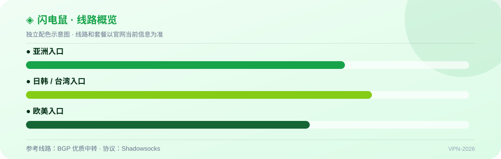

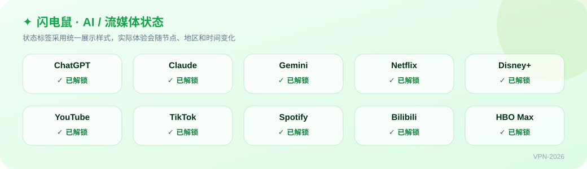

### 12. 榴莲云

**￥10/月起** · 线路：BGP 优化直连 · 协议：Shadowsocks · 优惠码：`ll88`

资料中定位为入门大流量套餐，建议核对当前价格和退款政策。

- 适用场景：大流量入门
- 资料口径：用户提供的资料，待独立核验
- 入口：[官网注册](https://haibing01.liulianyunaff.com/#/?code=0lnqSPF9)

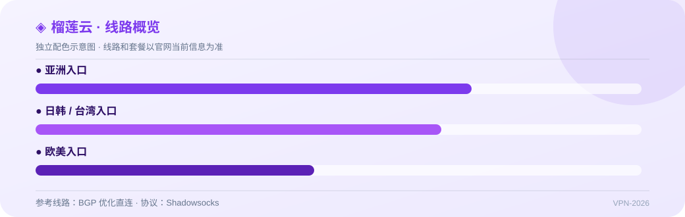

### 13. 鲲鹏加速

**￥15/月起** · 线路：BGP 高速中转 · 协议：Trojan / SS · 优惠码：`—`

资料中定位为多客户端兼容线路，协议和套餐以官网最新说明为准。

- 适用场景：多客户端、日常使用
- 资料口径：用户提供的资料，待独立核验
- 入口：[官网注册](https://kunpengjiasu.com/#/register?code=QAo8sMhc)

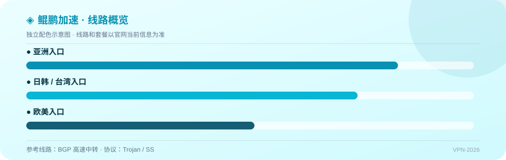

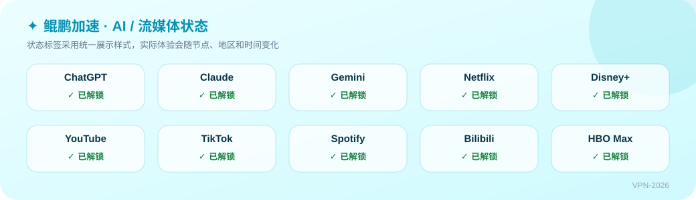

### 15. 瞬云

**￥11/月起** · 线路：ANYCAST 中转 · 协议：Shadowsocks · 优惠码：`—`

资料中定位为轻量备用方案，建议从月付开始验证可用性。

- 适用场景：轻量订阅、备用容灾
- 资料口径：用户提供的资料，待独立核验
- 入口：[官网注册](https://ddd.jichang.best/#/register?code=o4I4kToe)

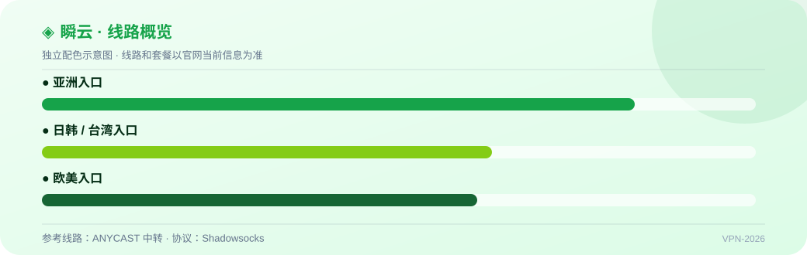

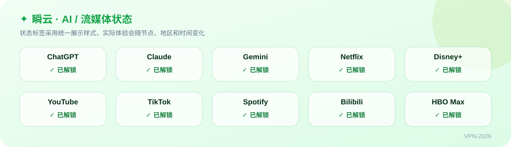

## 🧭 AI / 原生 IP（3 条）

### 3. 边缘节点（EdgeNova）

**￥20/月起** · 线路：企业级 IPLC · 协议：VLESS / Hysteria 2 · 优惠码：`xk808`

资料中强调原生 IP 和 AI 使用场景，实际可用性需要自行测试。

- 适用场景：AI 工具、跨境业务
- 资料口径：用户提供的资料，待独立核验
- 入口：[官网注册](https://zoio.edgenovaaff.cc/#/register?code=Oy1wZvzJ)

### 6. 云图

**￥20/月起** · 线路：金融级专线 · 协议：SS / Trojan · 优惠码：`yt88`

资料中强调原生 IP 和 AI 使用场景，建议自行确认解锁状态。

- 适用场景：AI、原生 IP、流媒体
- 资料口径：用户提供的资料，待独立核验
- 入口：[官网注册](https://super.ytjcok.org/#/register?code=qPHQtI9a)

### 14. Lumina

**￥10/月起** · 线路：直连 + 高速中转 · 协议：Hysteria 2 / AnyTLS · 优惠码：`—`

资料中定位为多协议大流量服务，建议验证客户端兼容性和实际落地 IP。

- 适用场景：大流量、AI、流媒体
- 资料口径：用户提供的资料，待独立核验
- 入口：[官网注册](https://haozevpn.jlyvipaff.com/#/?code=KUKfOY13)

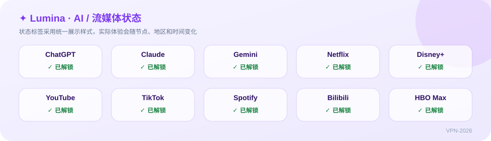

## 🧭 流媒体（2 条）

### 9. 神行加速

**￥15/月起** · 线路：BGP 多线中转 · 协议：Shadowsocks · 优惠码：`sx0077`

资料中定位为流媒体优化线路，解锁状态会随节点变化。

- 适用场景：YouTube、Netflix 等流媒体
- 资料口径：用户提供的资料，待独立核验
- 入口：[官网注册](https://haozevpn01.shenxingaff.com/#/?code=c2XNz7jn)

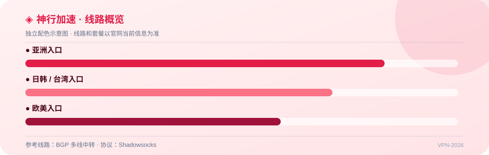

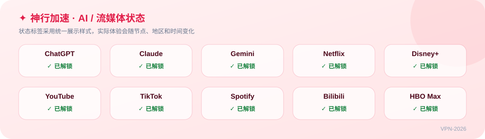

### 11. 环球梯

**￥14/月起** · 线路：BGP 跨境中继 · 协议：Shadowsocks · 优惠码：`hq66`

资料中定位为多地区节点服务，入口与设备限制请以官网为准。

- 适用场景：多地区节点、流媒体
- 资料口径：用户提供的资料，待独立核验
- 入口：[官网注册](https://haozevpn01.huanqiutiaff.com/#/?code=2xpedcFa)

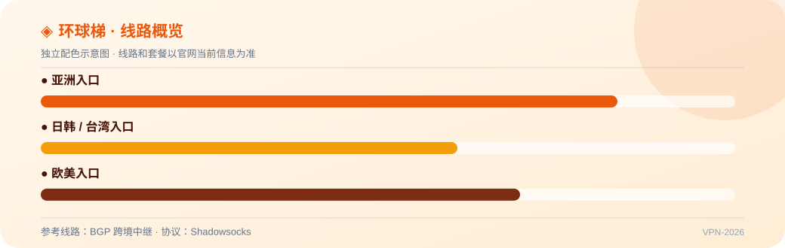

## 🔄 数据如何自动更新

1. `.github/workflows/daily-sync.yml` 按北京时间每天 00:30 运行，也支持在 Actions 页面手动运行。
2. 工作流执行 `node scripts/build-readme.mjs`。脚本优先读取 `DATA_URL` 指向的 HTTPS JSON；没有配置时使用仓库内的 `data/services.json`。
3. 脚本重新生成 `README.md`，更新日期、数量徽章和表格；文件有变化时，Actions 自动提交。

### 接入外部 JSON 接口

在 GitHub 仓库的 Settings → Secrets and variables → Actions → Variables 中添加 `DATA_URL`。接口可以直接返回数组，也可以返回 `{"updatedAt": "...", "services": [...]}`。

> 参考仓库的链接本质上是 JSON 数据里的 URL 字段被生成器写成 Markdown `[文字](https://...)`，并不是 GitHub 自动生成的特殊链接。

## 📱 客户端建议

- Windows / macOS：Clash Verge Rev、v2rayN、sing-box
- Android：Clash Meta for Android、v2rayNG
- iOS：Shadowrocket、Stash（请通过官方渠道获取）
- 导入订阅前确认链接来源，订阅地址不要公开发送。

## ❓ 常见问题

**没有外部接口可以运行吗？** 可以。保持 `DATA_URL` 未设置，脚本会使用 `data/services.json`。

**如何手动更新？** 打开仓库的 Actions，选择 `每日同步 README`，点击 `Run workflow`。

## 📌 免责声明

本清单只做公开资料整理和技术演示。价格、优惠活动、线路、IP 质量、速度、解锁状态和服务存续都可能变化；除明确标注的记录外，不应把表格内容理解为独立实测结论。部分链接可能包含推广参数，是否使用由你自行决定。

⭐ 如果这个仓库对你有帮助，欢迎 Star；发现过期资料请提交 Issue。
