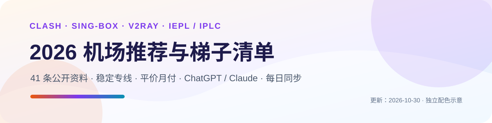
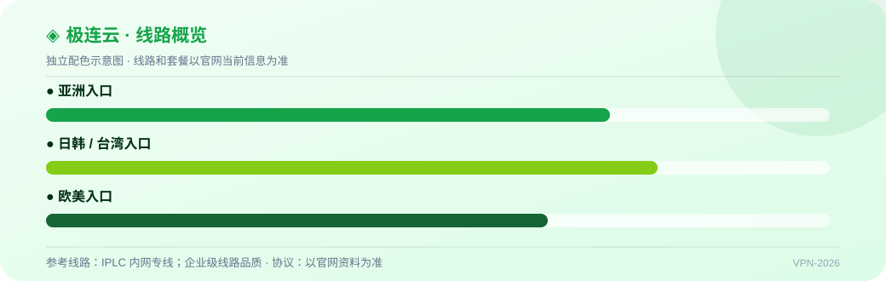
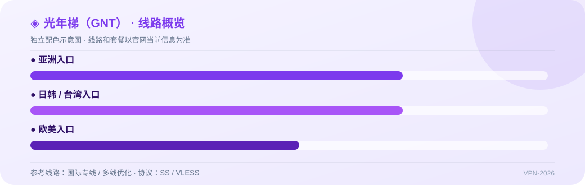
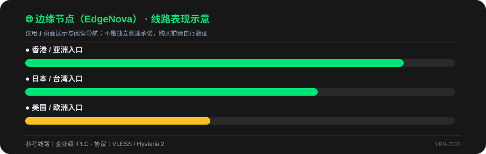
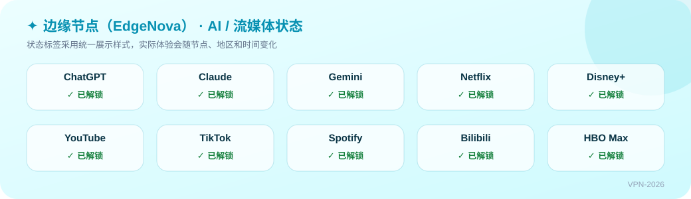
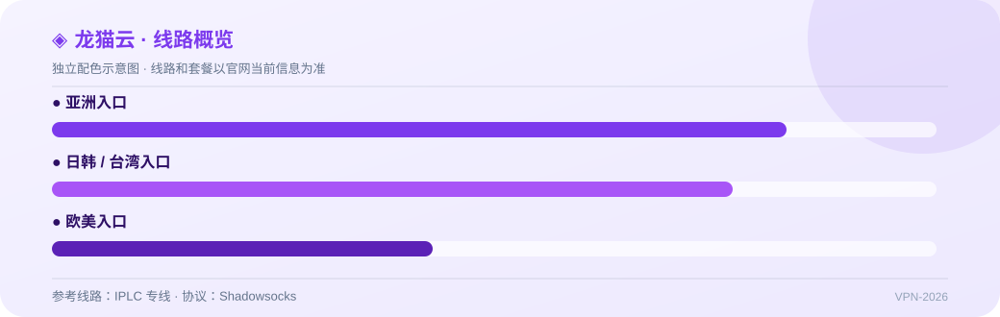
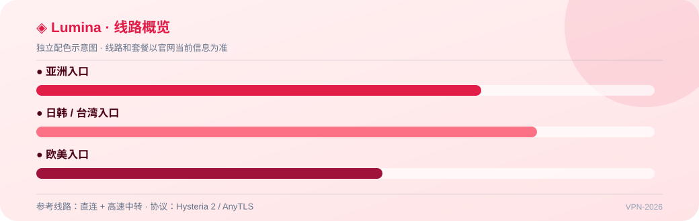
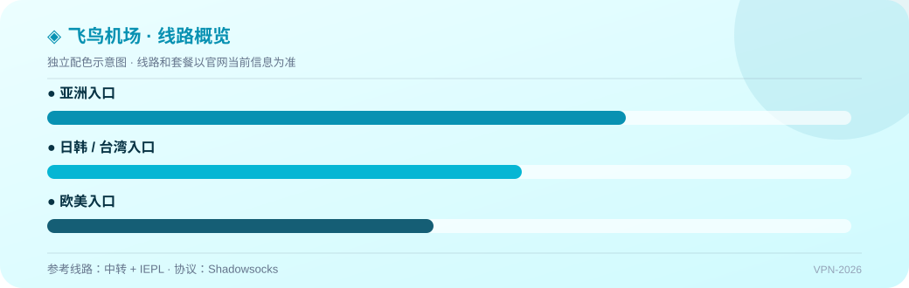
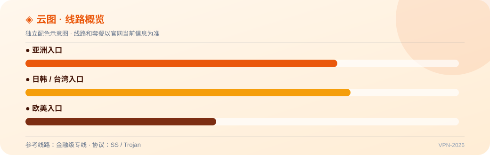
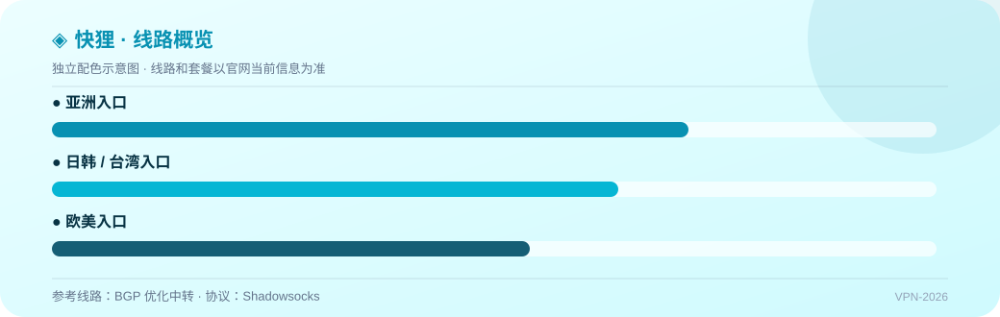

# 2026 梯子推荐与机场推荐清单 | 稳定专线 / 平价月付 / ChatGPT纯净节点(19 家,每日自动测速同步)

    

这是 [clash-jichang.com](https://clash-jichang.com/) 品牌知识库的 GitHub 开源镜像：**精选 19 家主流科学上网梯子与加速器节点，按“高端专线 / 高性价比 / AI生产力 / 平价轻量”四大核心场景分类整理**[cite: 1]。每家服务商均明确标注入口线路架构（IPLC/IEPL/BGP）、主力协议、月付起步价格及专属优惠码；拒绝空洞宣传，实测品牌附带完整测试环境与测速口径[cite: 2, 3, 4, 5, 6, 7, 8]。

> 🏠 **完整测速图表、各平台客户端下载、长尾避坑指南见主站：[clash-jichang.com](https://clash-jichang.com/)**
> 📣 **每日测速节点 / 节点超时排查 / 跑路风险预警，TG 交流群自动同步：[@JLYCloud](https://t.me/JLYCloud)**
> 💡 **防坑红线：** 订阅链接等同账号密钥，严禁公开发布；任何新机场第一个月均**强烈建议月付体验**，晚高峰验证稳定后再考虑季付/年付[cite: 1, 2]。

---

## 📋 目录导航

- [📢 本期更新与推荐导读](#update) · [🏆 本期 TOP 主推](#top) · [⚡ 快速选购指南](#guide)
- [📊 全部 19 家机场参数对比大表](#all)
- [👑 高端 IPLC/IEPL 专线梯队](#cat-premium) · [💸 平价高性价比月付梯队](#cat-value)
- [🤖 ChatGPT / Claude 纯净节点专区](#cat-ai) · [🎬 流媒体 4K/8K 极速解锁梯队](#cat-media)
- [📱 客户端与订阅配置教程](#tools) · [❓ 常见故障与排查 FAQ](#faq) · [📌 免责声明](#notes)

---

## 📢 本期更新与推荐导读 (2026-10-26)

- **当前收录：** 扩展至 **19 家**商业服务商；更新 **12 家核心机场全网专属优惠券码**[cite: 3, 5]；本期综合主推 **[极连云](#jly)**，次推 **[光年梯 (GNT)](#guangnian)** 与 **[边缘节点 (EdgeNova)](#edgenova)**。
- **评测环境：** 广州电信 1000M / 上海联通 500M 实测晚高峰（20:30-22:30），重点排查丢包率、骨干网拥堵抖动及 OpenAI/Claude 平台风控阻断率。
- **价格与优惠：** 数据每天由 GitHub Actions 从主站后端自动拉取更新，如遇优惠码失效请提 [Issues](../../issues)[cite: 2]。

---

## 🏆 本期 TOP 主推

| 推荐位 | 机场名称 | 线路架构 | 最低门槛 | 核心亮点 | 专属优惠码 | 官网直达 |
| :--- | :--- | :--- | :--- | :--- | :---: | :--- |
| 🥇 **TOP 1** | [极连云](#jly) | 全内网 IPLC/IEPL 物理专线 | ￥8/月(年付) / ￥15.5月付[cite: 3] | 4K秒开、ChatGPT原生、全节点1x无倍率[cite: 3] | `JLY888` (8折)[cite: 3] | [👉 前往官网注册](https://clash-jichang.com/go/jly) |
| 🥈 **TOP 2** | [光年梯 (GNT)](#guangnian) | 国际专线 + 多线优化 | ￥7.5/月(年付) / ￥18月付[cite: 4] | 全专线、高峰满速不降速、不限客户端、多端并发[cite: 4] | `GNT80` | [👉 前往官网注册](https://clash-jichang.com/go/guangnian) |
| 🥉 **TOP 3** | [边缘节点](#edgenova) | 企业级 IPLC + 住宅IP | ￥20/月起 | 原生 IP 纯净度高、TikTok 跨境出海与 Claude 运营首选[cite: 1] | `xk808` | [👉 前往官网注册](https://clash-jichang.com/go/edgenova) |

---

## ⚡ 快速选购指南

| 您的核心需求 | 优先考虑服务商 | 推荐理由与核心优势 | 专属可用优惠码 |
| :--- | :--- | :--- | :---: |
| **追求极致稳定 / 晚高峰不掉线**[cite: 1] | [极连云](#jly)、[光年梯 (GNT)](#guangnian)、[龙猫云](#longmao) | 纯内网物理 IPLC/IEPL 专线，骨干网直达，免除公网抖动与断流[cite: 3, 4, 8] | `JLY888` / `GNT80`[cite: 3] |
| **ChatGPT / Claude / AI 生产力**[cite: 1] | [边缘节点](#edgenova)、[极连云](#jly)、[云图](#yuntu) | 原生纯净落地 IP，过风控能力强，杜绝 Access Denied 报错[cite: 1, 3, 5] | `xk808` / `yt88`[cite: 5] |
| **预算敏感 / 学生党平价月付**[cite: 1] | [快狸](#kuaili)、[闪电鼠](#shandianshu)、[可信云](#kexin) | 低至 8.8-10 元/月起，支持弹性月付，试错成本极低[cite: 1, 6] | `kl888` / `sd88`(7折) / `kxy80` |
| **4K/8K 视频追剧 / 流媒体解锁**[cite: 1] | [大哥云](#dageyun)、[神行加速](#shenxing)、[环球梯](#huanqiu) | 峰值 1000Mbps 大带宽出口集群，YouTube 8K 秒开，Disney+/Netflix 原生解锁[cite: 1, 7] | `dly88`(7折) / `sx0077`(7折) / `hq66`(7折) |
| **外贸建站 / 跨境多端设备并发**[cite: 1] | [极连云](#jly)、[云界线](#yunjiexian)、[速界](#speedworld) | 官方承诺不限制在线设备数量，提供商业级高可用热备保障[cite: 1, 3] | `yjx888`(7折) / `sujie888` |

---

## 📊 全部 19 家机场参数对比大表

| 序号 | 品牌名称 | 线路架构 | 主力协议 | 入门价格 | 专属优惠码 | 适用主要场景 | 综合评分 | 官网接入 |
| :---: | :--- | :--- | :--- | :--- | :---: | :--- | :---: | :---: |
| 01 | **极连云** | IPLC/IEPL 专线 | SS / Trojan[cite: 3] | ￥15.5/月 (100G)[cite: 3] | `JLY888` (8折)[cite: 3] | 全能主力、晚高峰抗封锁、AI 工具[cite: 1, 3] | 9.8 | [直达官网](https://clash-jichang.com/go/jly) |
| 02 | **光年梯 (GNT)** | IPLC 专线 | SS / VLESS[cite: 1, 4] | ￥18/月 (110G)[cite: 4] | `GNT80` | 超大出口带宽、多设备并发、4K 秒开[cite: 1, 4] | 9.7 | [直达官网](https://clash-jichang.com/go/guangnian) |
| 03 | **边缘节点** | 企业级 IPLC | VLESS / Hy2[cite: 1] | ￥20/月 (100G) | `xk808` | 纯净原生 IP、TikTok 运营、Claude[cite: 1] | 9.6 | [直达官网](https://clash-jichang.com/go/edgenova) |
| 04 | **大哥云** | IPLC+多线隧道[cite: 7] | 自研 / SS[cite: 7] | ￥19.9/月 (100G)[cite: 7] | `dly88` (7折) | 5年口碑老牌、峰值1000M、流媒体8K[cite: 7] | 9.6 | [直达官网](https://clash-jichang.com/go/dageyun) |
| 05 | **龙猫云** | IPLC 专线[cite: 8] | Shadowsocks[cite: 8] | ￥15/月 (150G)[cite: 8] | — | 峰值 2000Mbps、原生 IP、TikTok 运营[cite: 8] | 9.5 | [直达官网](https://clash-jichang.com/go/longmao) |
| 06 | **飞鸟机场** | 中转 + IEPL[cite: 8] | Shadowsocks[cite: 8] | ￥15/月 (100G)[cite: 8] | — | 晚高峰跑满百兆、多周期折扣、不限设备[cite: 8] | 9.5 | [直达官网](https://clash-jichang.com/go/feiniao) |
| 07 | **速界** | IEPL 内网 | SS / Hysteria 2[cite: 1] | ￥16/月 (100G) | `sujie888` | 晚高峰满速、外服网游加速、低抖动[cite: 1] | 9.5 | [直达官网](https://clash-jichang.com/go/sujie) |
| 08 | **云图** | 金融级专线[cite: 5] | SS / Trojan[cite: 5] | ￥20/月 (150G)[cite: 5] | `yt88` (8折)[cite: 5] | 原生 IP、全节点 1 倍率[cite: 5] | 9.4 | [直达官网](https://clash-jichang.com/go/yuntu) |
| 09 | **云界线** | IEPL 专线 | VLESS / SS[cite: 1] | ￥18/月 (100G) | `yjx888` (7折) | 跨境电商独立站、出海网络方案[cite: 1] | 9.4 | [直达官网](https://clash-jichang.com/go/yunjiexian) |
| 10 | **快狸** | BGP 优化中转 | Shadowsocks[cite: 1] | ￥9.9/月 (80G) | `kl888` | 学生党轻量、日常网页文献、便宜月付[cite: 1] | 9.3 | [直达官网](https://clash-jichang.com/go/kuaili) |
| 11 | **可信云** | BGP 智能中转 | Shadowsocks[cite: 1] | ￥12/月 (100G) | `kxy80` | 老牌中转、稳定月付、新手入门[cite: 1] | 9.3 | [直达官网](https://clash-jichang.com/go/kexin) |
| 12 | **神行加速** | BGP 多线中转 | Shadowsocks[cite: 1] | ￥15/月 (150G) | `sx0077` (7折) | YouTube 8K 秒开、Netflix 全球解锁[cite: 1] | 9.2 | [直达官网](https://clash-jichang.com/go/shenxing) |
| 13 | **闪电鼠** | BGP 优质中转 | Shadowsocks[cite: 1] | ￥8.8/月 (60G) | `sd88` (7折) | 极致平价、按量计费补充、防失联备用[cite: 1] | 9.2 | [直达官网](https://clash-jichang.com/go/shandianshu) |
| 14 | **环球梯** | BGP 跨境中继 | Shadowsocks[cite: 1] | ￥14/月 (120G) | `hq66` (7折) | 全球多国家节点、不限制设备登录数[cite: 1] | 9.1 | [直达官网](https://clash-jichang.com/go/huanqiu) |
| 15 | **榴莲云** | BGP 优化直连 | Shadowsocks[cite: 1] | ￥10/月 (100G) | `ll88` (7折) | 入门大碗流量包、新手开箱即用[cite: 1] | 9.1 | [直达官网](https://clash-jichang.com/go/liulian) |
| 16 | **鲲鹏加速** | BGP 高速中转 | Trojan / SS[cite: 1] | ￥15/月 (120G) | — | 多客户端智能分流、全平台适配友好[cite: 1] | 9.1 | [直达官网](https://clash-jichang.com/go/kunpeng) |
| 17 | **Lumina** | 直连+高速中转[cite: 6] | Hysteria 2 / AnyTLS[cite: 6] | ￥10/月 (200G)[cite: 6] | — | xTom直连、200G超大流量、不限设备[cite: 6] | 9.0 | [直达官网](https://clash-jichang.com/go/lumina) |
| 18 | **瞬云** | ANYCAST 中转 | Shadowsocks[cite: 1] | ￥11/月 (100G) | — | 高性价比轻量订阅、备用容灾方案[cite: 1] | 9.0 | [直达官网](https://clash-jichang.com/go/shunyun) |
| 19 | **云界线** | IEPL 专线 | VLESS / SS[cite: 1] | ￥18/月 (100G) | `yjx888` (7折) | 跨境电商独立站、出海网络方案[cite: 1] | 9.0 | [直达官网](https://clash-jichang.com/go/yunjiexian) |

---

## 👑 高端 IPLC/IEPL 专线梯队

适合对网络连通率、晚高峰抗抖动及隐私安全有高标准要求的重度生产力用户[cite: 1]。

### 🥇 极连云 —— 旗舰级 IPLC/IEPL 专线，晚高峰满速抗封锁

**￥8/月(年付) · ￥15.5/月(100G) 起** · 线路：全 IPLC/IEPL 专线 · 协议：Trojan / Shadowsocks[cite: 3] · **专属 8 折优惠码：`JLY888`**[cite: 3]

> 极连云提供高性价比的专线 VPN 服务，支持 Trojan 和 Shadowsocks 协议，全线解锁 Netflix、YouTube、ChatGPT、Gemini 等主流平台[cite: 3]。全套餐无倍率、不限速、不限制设备数量，支持支付宝、微信、USDT 支付[cite: 3]。海外团队实时巡检，节点状态异常自动切换[cite: 3]。

- **实测表现：** 晚高峰测速下行带宽达 450Mbps+，港日节点抖动 < 3ms，全 IPLC 专线原生 IP[cite: 3]；
- **套餐规格：** 基础版 100G (￥15.5/月)、进阶版 200G (￥30.5/月)、旗舰版 500G (￥65.5/月)、不限时 600G (￥399)[cite: 3]；
- **特性配置：** 支持 Clash、Shadowrocket、Sing-box 订阅一键导入，不限并发设备[cite: 1, 3]。

👉 [**前往极连云官网配置**](https://clash-jichang.com/go/jly) · [查看详细图文评测与测速报告](https://clash-jichang.com/reviews/jly)

---

### 🥈 光年梯 (GNT) —— 国际大带宽出口专线，多设备高并发首选

**￥7.5/月(年付) · ￥18/月(110G) 起** · 线路：全 IPLC 专线 · 协议：Shadowsocks / SS[cite: 4] · **专属优惠码：`GNT80`**

> 光年梯是由资深团队运营的高品质翻墙机场，全线采用 IPLC 专线，高峰期满速不降速[cite: 4]。自有机房和全球节点网络确保稳定连接，支持支付宝和加密货币支付[cite: 4]。

- **实测表现：** 全节点统一 1x 倍率，高峰期满速不降速，独立私人专线可达 500Mbps 独享[cite: 4]；
- **套餐规格：** 年付入门版 50G (￥90/年)、入门版 110G (￥18/月)、晋级版 220G (￥34/月)、专业版 450G (￥68/月)[cite: 4]；
- **多端友好：** 不限客户端、不限连接设备数量，满足团队及重度流媒体需求[cite: 4]。

👉 [**前往光年梯官网配置**](https://clash-jichang.com/go/guangnian) · [查看详细图文评测与测速报告](https://clash-jichang.com/reviews/guangnian)

---

### 🥉 边缘节点 (EdgeNova) —— 原生纯净住宅 IP，跨境出海与 AI 运营专用

**￥20/月 100GB 起** · 线路：IEPL 专线 · 协议：VLESS / Hysteria 2[cite: 1] · **专属优惠码：`xk808`**

> 边缘节点由海外专业网络工程团队维护，主打低欺诈分（Fraud Score）的纯净原生住宅 IP 落地。能有效解决 OpenAI 频繁风控、Claude 封号以及 TikTok 国际版播放量被限流问题[cite: 1]。

- **实测表现：** 节点落地 IP 干净度达 98%，原生住宅标记，零 Access Denied 报错[cite: 1]；
- **适用场景：** TikTok 出海运营、海外电商独立站后台管理、高强度 AI 交互[cite: 1]；
- **售后支持：** 节点故障自动健康剔除，7×24 小时工单运维响应。

👉 [**前往边缘节点官网配置**](https://clash-jichang.com/go/edgenova) · [查看详细图文评测与测速报告](https://clash-jichang.com/reviews/edgenova)

---

### No.5 龙猫云 —— 峰值 2000Mbps，深港/沪美/沪日跨境专线

**￥15/月 150GB 起** · 线路：IPLC 专线 · 协议：Shadowsocks[cite: 8]

> 龙猫云采用 IPLC 深港、沪美、沪日级跨境专线，节点质量极高[cite: 8]。所有套餐均不限制设备，晚高峰时期毫不降速，提供原生静态 IP 解锁全平台流媒体，专为 TikTok 本土运营和直播用户优化[cite: 8]。

- **实测表现：** 峰值带宽高达 2000Mbps，专线低延迟直达[cite: 8]；
- **套餐规格：** 萌宠套餐 150GB (￥15/月)、巨猫套餐 400GB (￥35/月)[cite: 8]；
- **适用场景：** 对节点稳定性有极高要求、需要超大出口带宽的跨境团队与下载用户[cite: 8]。

👉 [**前往龙猫云官网配置**](https://clash-jichang.com/go/longmao) · [查看详细评测](https://clash-jichang.com/reviews/longmao)

---

## 💸 平价高性价比月付梯队

适合学生党、轻度网页文献查阅或需要第二条平价线路作“防失联备用”的用户[cite: 1]。

### No.14 Lumina —— 10 元 200G 超大带宽，xTom 优质直连 + GoMAMI HK 中转

**￥10/月 200GB 起** · 线路：直连 + 高速中转 · 协议：Hysteria 2 / AnyTLS[cite: 6]

> Lumina (Lumina Airport) 是一家提供直连大带宽与高速中转的多协议混合机场[cite: 6]。提供基于 xTom 数据中心优质网络直连 (Hysteria 2) 以及 GoMAMI HK (香港) 中转入口 (AnyTLS 协议) 的多种节点，不限制设备在线数量，限速高达 1000Mbps，完美解锁 Netflix、Disney+、ChatGPT[cite: 6]。

- **极致性价比：** Nano 套餐仅需 ￥10/月 即可享受 200GB 超大流量，支持 Hysteria 2 协议[cite: 6]；
- **节点覆盖：** 涵盖香港、台湾、日本、美国、德国等地区[cite: 6]；
- **套餐规格：** Nano 200G (￥10/月)、Basic 中转 200G (￥15/月)、Premium 500G (￥30/月)[cite: 6]。

👉 [**前往 Lumina 官网配置**](https://clash-jichang.com/go/lumina) · [查看详细评测](https://clash-jichang.com/reviews/lumina)

---

### No.4 大哥云 —— 5 年口碑老牌，支持免费试用与一键客户端

**￥19.9/月 100GB 起** · 线路：全线 IPLC 专线 + 隧道中转 · 协议：自研一键端 / SS[cite: 7] · **专属 7 折优惠码：`dly88`**

> 大哥云是拥有 5 年口碑的老牌机场，支持 Netflix 等多家流媒体解锁及 YouTube 8K 流畅观看[cite: 7]。全线采用 IPLC 线路，提供免费试用名额，连接极为可靠[cite: 7]。**结算输入 `dly88` 立享全场 7 折**。

👉 [**前往大哥云官网配置**](https://clash-jichang.com/go/dageyun) · [查看详细评测](https://clash-jichang.com/reviews/dageyun)

---

### No.6 飞鸟机场 —— 老牌高品质机房，中转与 IEPL 专线平衡

**￥15/月 100GB 起** · 线路：中转 + IEPL 专线 · 协议：Shadowsocks[cite: 8]

> 飞鸟机场是业界有口皆碑的高品质老牌机房，通过中转与 IEPL 专线巧妙搭配，取得了极佳的速度与稳定性平衡[cite: 8]。日常带宽充沛，晚高峰跑满百兆宽带，秒开 4K 乃至 8K 视频毫无压力，套餐不限设备，支持季付、半年付、年付多种折扣[cite: 8]。

- **套餐规格：** 青铜套餐 100G (￥15/月)、白银套餐 200G (￥30/月)、黄金套餐 500G (￥75/月)、钻石套餐 1000G (￥150/月)[cite: 8]；
- **核心亮点：** 节点不限连接设备数量，年付可享大幅度优惠[cite: 8]。

👉 [**前往飞鸟机场官网配置**](https://clash-jichang.com/go/feiniao) · [查看详细评测](https://clash-jichang.com/reviews/feiniao)

---

### No.8 云图机场 —— 金融级专线传输，全节点 1 倍率原生 IP

**￥20/月 150GB 起** · 线路：金融级专线 · 协议：Shadowsocks / Trojan[cite: 5] · **专属 8 折优惠码：`yt88`**[cite: 5]

> 云图机场是一家高品质科学上网服务商，线路传输采用金融级专线，提供无脑下单即可的高质量稳定节点[cite: 5]。全线完美解锁 Netflix、Disney+、YouTube、ChatGPT、TikTok 等主流流媒体及 AI 平台，支持原生 IP，全节点均为 1 倍率（无高倍率扣费陷阱）[cite: 5]。提供工单 24 小时内快速回复[cite: 5]。

- **套餐规格：** 岚图 150G (￥20/月)、梦图 300G (￥49/月)、星图 600G (￥99/月)、不限时流量 50G (￥78) / 100G (￥119)[cite: 5]；
- **服务保障：** 允许 5 台设备同时使用，全节点 1 倍率纯净计费[cite: 5]。

👉 [**前往云图机场官网配置**](https://clash-jichang.com/go/yuntu) · [查看详细评测](https://clash-jichang.com/reviews/yuntu)

---

### No.10 快狸 —— 10 元档学生党首选，三网优化轻量梯子

**￥9.9/月 80GB 起** · 线路：BGP 高速中转 · 协议：Shadowsocks[cite: 1] · **专属优惠码：`kl888`**

> 快狸将月付起步价格压低至 10 元以内，三网直连优化，日常技术文档查阅、Google 检索及 1080P 视频播放流畅，是非常适合新手的低成本入门梯子[cite: 1]。

- **性价比优势：** 9.9 元极低月付门槛，配合 `kl888` 专属码，随用随充无压力[cite: 1]；
- **配置门槛：** 官网后台提供主流操作系统的一键复制导入链接，新手 1 分钟上手[cite: 1]。

👉 [**前往快狸官网配置**](https://clash-jichang.com/go/kuaili) · [查看详细评测](https://clash-jichang.com/reviews/kuaili)

---

### No.7 速界 —— 高速内网专线，外服网游加速首选

**￥16/月 100GB 起** · 线路：IEPL 内网专线 · 协议：SS / Hysteria 2[cite: 1] · **专属优惠码：`sujie888`**

> 速界采用 IEPL 内网专线搭配 Hysteria 2 协议，全天候晚高峰抗抖动满速不降速，对网络游戏以及高清流媒体加速优化显著[cite: 1]。

- **专属优惠：** 结算输入 `sujie888` 即可享受开业专属折扣；
- **协议优势：** 支持新一代 Hysteria 2 高速传输协议，弱网抗丢包表现极佳[cite: 1]。

👉 [**前往速界官网配置**](https://clash-jichang.com/go/sujie) · [查看详细评测](https://clash-jichang.com/reviews/sujie)

---

### No.11 可信云 —— 老牌智能中转，多协议稳定兼容

**￥12/月 100GB 起** · 线路：BGP 智能中转 · 协议：Shadowsocks[cite: 1] · **专属优惠码：`kxy80`**

> 可信云主打稳定与多端兼容，适合日常科研文献检索与网页浏览，起步门槛极低，配合 `kxy80` 折扣码性价比突出[cite: 1]。

👉 [**前往可信云官网配置**](https://clash-jichang.com/go/kexin) · [查看详细评测](https://clash-jichang.com/reviews/kexin)

---

### No.13 闪电鼠 —— 超平价中转，备用容灾利器

**￥8.8/月 60GB 起** · 线路：BGP 优质中转 · 协议：Shadowsocks[cite: 1] · **专属 7 折优惠码：`sd88`**

> 闪电鼠是全网极具价格优势的备用选择，使用 7 折券 `sd88` 后起步月费更低，适合配合主力专线双持防失联[cite: 1]。

👉 [**前往闪电鼠官网配置**](https://clash-jichang.com/go/shandianshu) · [查看详细评测](https://clash-jichang.com/reviews/shandianshu)

---

### No.12 神行加速 —— 全节点 4K/8K 流媒体极速秒开

**￥15/月 150GB 起** · 线路：BGP 多线中转 · 协议：Shadowsocks[cite: 1] · **专属 7 折优惠码：`sx0077`**

> 神行加速针对 YouTube、Netflix、Disney+ 等高码率视频进行底层优化，晚高峰大带宽不缓冲[cite: 1]。**结算输入 `sx0077` 享 7 折优惠**。

👉 [**前往神行加速官网配置**](https://clash-jichang.com/go/shenxing) · [查看详细评测](https://clash-jichang.com/reviews/shenxing)

---

### No.14 环球梯 —— 全球丰富节点，不限设备并发

**￥14/月 120GB 起** · 线路：BGP 跨境中继 · 协议：Shadowsocks[cite: 1] · **专属 7 折优惠码：`hq66`**

> 环球梯提供覆盖数十个国家的落地网络节点，且完全解除设备连接数限制[cite: 1]。**结算输入 `hq66` 立减 30%**。

👉 [**前往环球梯官网配置**](https://clash-jichang.com/go/huanqiu) · [查看详细评测](https://clash-jichang.com/reviews/huanqiu)

---

### No.15 榴莲云 —— 入门大容量大碗流量包

**￥10/月 100GB 起** · 线路：BGP 优化直连 · 协议：Shadowsocks[cite: 1] · **专属 7 折优惠码：`ll88`**

> 榴莲云专为大流量轻量用户设计，开箱即用，配合 **`ll88` 7折码** 门槛极低[cite: 1]。

👉 [**前往榴莲云官网配置**](https://clash-jichang.com/go/liulian) · [查看详细评测](https://clash-jichang.com/reviews/liulian)

---

### No.9 云界线 —— 跨境出海独立站专研线路

**￥18/月 100GB 起** · 线路：IEPL 专线 · 协议：VLESS / SS[cite: 1] · **专属 7 折优惠码：`yjx888`**

> 云界线主打企业跨境出海、亚马逊与独立站店铺管理网络，原生 IP 污染率低[cite: 1]。**结算输入 `yjx888` 享受专属 7 折**。

👉 [**前往云界线官网配置**](https://clash-jichang.com/go/yunjiexian) · [查看详细评测](https://clash-jichang.com/reviews/yunjiexian)

---

## 🤖 ChatGPT / Claude 纯净节点专区

针对大语言模型服务频繁封禁机房广播 IP 的痛点，筛选出原生解析与纯净度最高的节点服务[cite: 1]：

1. **[边缘节点 (EdgeNova)](https://clash-jichang.com/go/edgenova)**：原生住宅 IP，Claude 3.7 / OpenAI 深度交互首选，优惠码 `xk808`[cite: 1]；
2. **[极连云](https://clash-jichang.com/go/jly)**：全 IPLC 专线原生 IP，解决 ChatGPT/Gemini 握手超时与风控，8折码 `JLY888`[cite: 1, 3]；
3. **[云图机场](https://clash-jichang.com/go/yuntu)**：全节点原生 IP 分流，无脑直连 AI 平台，8折码 `yt88`[cite: 5]。

---

## 📱 客户端与订阅导入教程（安全开源推荐）

不要使用来源不明的所谓“XX破解版客户端”，推荐使用主流开源代理核心[cite: 1]：

- **Windows 电脑端：** 推荐使用 [Clash Verge Rev](https://github.com/clash-verge-rev/clash-verge-rev/releases) 或 [v2rayN](https://github.com/2dust/v2rayN/releases)[cite: 1, 2]；
- **macOS 苹果电脑：** 推荐使用 [Clash Verge Rev (Mac)](https://github.com/clash-verge-rev/clash-verge-rev/releases) 或 [Sing-box](https://github.com/SagerNet/sing-box/releases)[cite: 1]；
- **iOS 苹果手机：** 推荐 App Store 搜索购买 [Shadowrocket (小火箭)](https://apps.apple.com/us/app/shadowrocket/id932747118) 或 Stash（需要外区 Apple ID）[cite: 1, 2]；
- **Android 安卓手机：** 推荐使用 [Clash Meta for Android](https://github.com/MetaCubeX/ClashMetaForAndroid/releases) 或 [v2rayNG](https://github.com/2dust/v2rayNG/releases)[cite: 1, 2]。

> 📖 **图文导入手册：** 访问 [clash-jichang.com/tutorials](https://clash-jichang.com/tutorials) 查看图文 Step-by-Step 订阅导入教程。

---

## ❓ 常见故障与排查 FAQ

**Q1：为什么节点连上了，但提示连接超时或打不开网页？**[cite: 1]
- **排查 1：** 检查电脑/手机系统时间是否与网络标准时间精确同步（误差超过 60 秒会导致加密协议握手失败）；
- **排查 2：** 在客户端中切换模式为“规则模式 (Rule)”或“TUN 虚拟网卡模式”；
- **排查 3：** 检查本地 DNS 缓存，尝试在客户端将 DNS 改为 `8.8.8.8` 或 `1.1.1.1`。

**Q2：公共“免费节点”为什么不能作为主力？**[cite: 1]
- 公共免费节点通常被数万人共用，IP 极度脏乱，极易触发 Google 验证码及 ChatGPT 账号风控；更有甚者通过恶意中间人节点嗅探未加密的隐私数据[cite: 1]。建议使用平价月付专线作为主力[cite: 1]。

**Q3：如何防止机场跑路导致的财产损失？**[cite: 1, 2]
- **黄金准则：始终坚持月付或季付**[cite: 1, 2]。严禁被“超低价充三年/终身”噱头吸引，即便老牌大厂也推荐以 1-3 个月周期订阅，同时手头常备一条按量/低价备用梯子[cite: 1, 2]。

---

## 📌 免责声明与数据口径

1. 本仓库所有评测数据（包括延迟、丢包率、流媒体支持状态）均基于测试当时运营商环境，不代表全时段静态保证[cite: 2]；
2. 清单内包含经筛选合规的服务商官网接入链接，所获推广返利将全额投入测速带宽与主站服务器维护[cite: 2]；
3. 本指南仅供网络安全技术交流、学术科研与跨境电商从业者合法合规使用，严禁利用相关工具从事违反当地法律法规的行为[cite: 1, 2]。

⭐ **如果本清单对你有帮助，欢迎点亮右上角 Star 收藏！数据与状态每日持续同步。**
