# 2026 机场推荐与梯子推荐清单｜老牌 / 性价比 / 稳定 / 高端 VPN（41 家，每日自动同步）

   

这是 [clash-jichang.com](https://clash-jichang.com/) 品牌库的 GitHub 镜像：**41 家机场按老牌 / 性价比 / 稳定 / 高端四类整理**，每家给出套餐价格、优惠码、线路口径、资料来源和注册入口。
> 价格、优惠码、线路和可用性会变化，购买前请在官网核验，并优先月付试用。
>
> 订阅链接等同账号密码，请勿公开粘贴或提交到 Issues、日志和截图中。请遵守所在地法律法规及服务条款。

**数据更新时间：2026-10-31（Asia/Shanghai）** · [主站](https://clash-jichang.com/) · [对比总表](https://clash-jichang.com/airport/compare) · [品牌库](https://clash-jichang.com/airport/brands) · [Telegram](https://t.me/JIAN6688)

这是围绕 **2026 机场推荐、机场梯子、老牌机场、性价比机场、稳定机场、高端机场、ChatGPT / Claude、Clash、Sing-box、V2Ray、Shadowsocks、Trojan、IEPL / IPLC** 等搜索需求整理的资料页。表格用于快速对比价格、优惠码、线路、协议和注册入口，具体可用性以官网和自行测试为准。
每家资料均配有独立配色的线路概览图和 AI / 流媒体状态图，图片只用于阅读导航和版式展示。

## 📋 目录

- [本期更新](#update) · [本期主推](#top) · [快速选择指南](#guide) · [全部机场速览](#all)
- [老牌机场](#老牌机场) · [性价比机场](#性价比机场) · [稳定机场](#稳定机场) · [高端机场](#高端机场) · [风险预警](#风险预警)
- [数据如何自动更新](#数据如何自动更新) · [客户端建议](#客户端建议) · [常见问题](#常见问题) · [更新与声明](#更新与声明)

## 📢 本期更新（2026-10-31）

- 当前收录 **41 家机场**，其中有站长实测记录的品牌 **0 家**。
- 本期主推 **[极连云](#极连云)、[光年梯](#光年梯)、[飞猫云](#飞猫云)**；价格、优惠码和入口以 [clash-jichang.com/airport/](https://clash-jichang.com/airport/) 为准。
- 排名是资料整理的参考顺序，不代表任何时段的速度、稳定性或解锁保证。

## 🏆 本期主推

| 位置 | 机场 | 最低套餐 | 优惠码 | 一句话 | 资料口径 | 入口 |
| :---: | :--- | :--- | :---: | :--- | :--- | :--- |
| 🥇 主推 | [极连云](#极连云) | 8元 60GB/月 | `JLY888` | 极连云提供高性价比的 IEPL 专线 VPN 服务，支持 Trojan 和 Shadowsocks 协议，全线解锁 Netflix、YouTub… | 📝 资料整理 | [官网注册](https://clash-jichang.com/go/jilianyun) · [完整评测](https://clash-jichang.com/airport/jilianyun) |
| 🥈 次推 | [光年梯](#光年梯) | 7.5元 50GB/月（年付） | `—` | 光年梯是由资深团队运营的高品质翻墙机场，拥有多年稳定运营历史和丰富技术经验。全线采用 IPLC 专线，高峰期满速不降速。其自有机房和全球节点网络… | 📝 资料整理 | [官网注册](https://clash-jichang.com/go/guangnianti) · [完整评测](https://clash-jichang.com/airport/guangnianti) |
| 🥉 次推 | [飞猫云](#飞猫云) | 25元 150GB/月 | `—` | 飞猫云采用全 IPLC 专线网络，提供最高 2.5Gbps 稳定速率，原生 IP 线路，轻松解锁 Netflix、Disney+、ChatGPT… | 📝 资料整理 | [官网注册](https://flycat.flycatvipaff.cc/#/?code=1arEKHqh) · [完整评测](https://clash-jichang.com/airport/feimaoyun) |

## ⚡ 快速选购指南

| 使用需求 | 优先查看 | 选择建议 |
| :--- | :--- | :--- |
| **第一次买 / 预算敏感** | [极连云](#极连云)、[光年梯](#光年梯)、[极速cloud](#极速cloud) | 优先月付试水，确认流量有效期、退款规则和入口稳定性 |
| **求稳 / 打算长期用** | [极连云](#极连云)、[光年梯](#光年梯)、[飞猫云](#飞猫云) | 先体验完整晚高峰，再考虑季付或年付优惠 |
| **ChatGPT / Claude 等 AI 工具** | [极连云](#极连云)、[飞猫云](#飞猫云)、[云图机场](#云图机场) | 优先查看原生 IP、协议和实测日期，逐个节点验证 |
| **大流量 / 重度下载** | [飞猫云](#飞猫云)、[云图机场](#云图机场)、[九云机场](#九云机场) | 比较流量单价和周期规则，避免只看月付起步价 |
| **高端专线 / 套餐层级完整** | [飞猫云](#飞猫云)、[云图机场](#云图机场)、[影子](#影子) | 重点核对 IEPL / IPLC 口径、退款政策和长期套餐限制 |

> 💡 选购纪律：第一个月月付试水，体验完整晚高峰后再考虑长期套餐；手头保留一条备用机场，避免完全失联。

## 📊 全部机场速览（41 家，按榜单排序）

| 排名 | 机场 | 分类 | 最低套餐 | 优惠码 | 资料口径 | 入口 |
| :---: | :--- | :--- | :--- | :---: | :--- | :--- |
| 1 | [极连云](#极连云) | 性价比机场 / 稳定机场 | 8元 60GB/月 | `JLY888` | 📝 资料整理 | [官网注册](https://clash-jichang.com/go/jilianyun) · [完整评测](https://clash-jichang.com/airport/jilianyun) |
| 2 | [光年梯](#光年梯) | 老牌机场 / 性价比机场 / 稳定机场 | 7.5元 50GB/月（年付） | `—` | 📝 资料整理 | [官网注册](https://clash-jichang.com/go/guangnianti) · [完整评测](https://clash-jichang.com/airport/guangnianti) |
| 3 | [飞猫云](#飞猫云) | 稳定机场 / 高端机场 | 25元 150GB/月 | `—` | 📝 资料整理 | [官网注册](https://flycat.flycatvipaff.cc/#/?code=1arEKHqh) · [完整评测](https://clash-jichang.com/airport/feimaoyun) |
| 4 | [云图机场](#云图机场) | 稳定机场 / 高端机场 | 20元 150GB/月 | `yt88` | 📝 资料整理 | [官网注册](https://clash-jichang.com/go/yuntu) · [完整评测](https://clash-jichang.com/airport/yuntu) |
| 5 | [鲲鹏加速](#鲲鹏加速) | 稳定机场 | 12元 99GB/月 | `—` | 📝 资料整理 | [官网注册](https://clash-jichang.com/go/kunpeng) · [完整评测](https://clash-jichang.com/airport/kunpeng) |
| 6 | [极速cloud](#极速cloud) | 性价比机场 / 稳定机场 | 8.9元 100GB/月 | `—` | 📝 资料整理 | [官网注册](https://august.jsjc456789.com) · [完整评测](https://clash-jichang.com/airport/#%E6%9E%81%E9%80%9Fcloud) |
| 7 | [九云机场](#九云机场) | 性价比机场 / 稳定机场 | 6元 150GB/月 | `—` | 📝 资料整理 | [官网注册](https://daoyi.jiuyyq.com) · [完整评测](https://clash-jichang.com/airport/#%E4%B9%9D%E4%BA%91) |
| 8 | [可信云](#可信云) | 性价比机场 / 稳定机场 | 8元 60GB/月（年付） | `—` | 📝 资料整理 | [官网注册](https://clash-jichang.com/go/kexinyun) · [完整评测](https://clash-jichang.com/airport/kexinyun) |
| 9 | [速界](#速界) | 性价比机场 / 稳定机场 | 7.5元 50GB/月（年付） | `—` | 📝 资料整理 | [官网注册](https://clash-jichang.com/go/sujie) · [完整评测](https://clash-jichang.com/airport/sujie) |
| 10 | [快狸](#快狸) | 性价比机场 / 稳定机场 | 10元 30GB/月（年付） | `—` | 📝 资料整理 | [官网注册](https://clash-jichang.com/go/kuaili) · [完整评测](https://clash-jichang.com/airport/kuaili) |
| 11 | [边缘节点](#边缘节点) | 性价比机场 / 稳定机场 | 9元 45GB/月（年付） | `—` | 📝 资料整理 | [官网注册](https://clash-jichang.com/go/bianyuanjiedian) · [完整评测](https://clash-jichang.com/airport/bianyuanjiedian) |
| 12 | [灯塔机场](#灯塔机场) | 稳定机场 | 16.6元 120GB/月（年付） | `—` | 📝 资料整理 | [官网注册](https://clash-jichang.com/go/dengta) · [完整评测](https://clash-jichang.com/airport/dengta) |
| 13 | [光速云](#光速云) | 性价比机场 / 稳定机场 | 8.25元 59GB/月 | `—` | 📝 资料整理 | [官网注册](https://clash-jichang.com/go/guangshuyun) · [完整评测](https://clash-jichang.com/airport/guangshuyun) |
| 14 | [影子](#影子) | 稳定机场 / 高端机场 | 18.8元 150GB/月 | `—` | 📝 资料整理 | [官网注册](https://clash-jichang.com/go/yingzi) · [完整评测](https://clash-jichang.com/airport/yingzi) |
| 15 | [边界云](#边界云) | 稳定机场 / 高端机场 | 12.33元 50GB/月（年付） | `—` | 📝 资料整理 | [官网注册](https://clash-jichang.com/go/bianjiyun) · [完整评测](https://clash-jichang.com/airport/bianjiyun) |
| 16 | [Nice加速](#nice加速) | 性价比机场 / 稳定机场 | 10元 40G/月（年付） | `—` | 📝 资料整理 | [官网注册](https://clash-jichang.com/go/nice) · [完整评测](https://clash-jichang.com/airport/nice) |
| 17 | [灵猫网络](#灵猫网络) | 稳定机场 / 高端机场 | 85元/年（45G/月） | `—` | 📝 资料整理 | [官网注册](https://clash-jichang.com/go/lingmao) · [完整评测](https://clash-jichang.com/airport/lingmao) |
| 18 | [星岛梦](#星岛梦) | 稳定机场 / 高端机场 | 16元 100GB/月 | `—` | 📝 资料整理 | [官网注册](https://clash-jichang.com/go/xingdaomeng) · [完整评测](https://clash-jichang.com/airport/xingdaomeng) |
| 19 | [全球云](#全球云) | 稳定机场 | 20元 120GB/月 | `—` | 📝 资料整理 | [官网注册](https://clash-jichang.com/go/quanqiuyun) · [完整评测](https://clash-jichang.com/airport/quanqiuyun) |
| 20 | [瞬云机场](#瞬云机场) | 性价比机场 / 稳定机场 | 8.25元 59GB/月 | `—` | 📝 资料整理 | [官网注册](https://clash-jichang.com/go/shunyun) · [完整评测](https://clash-jichang.com/airport/shunyun) |
| 21 | [寰宇云](#寰宇云) | 稳定机场 / 高端机场 | 89元/年 60GB/月 | `—` | 📝 资料整理 | [官网注册](https://clash-jichang.com/go/huanyuyun) · [完整评测](https://clash-jichang.com/airport/huanyuyun) |
| 22 | [Lumina](#lumina) | 性价比机场 | 10元 200GB/月 | `—` | 📝 资料整理 | [官网注册](https://clash-jichang.com/go/lumina) · [完整评测](https://clash-jichang.com/airport/lumina) |
| 23 | [拼好连](#拼好连) | 性价比机场 / 稳定机场 | 9.9元 100GB/月 | `—` | 📝 资料整理 | [官网注册](https://clash-jichang.com/go/pinhaolian) · [完整评测](https://clash-jichang.com/airport/pinhaolian) |
| 24 | [99吧](#99吧) | 性价比机场 | 7.5元 66GB/月（年付） | `—` | 📝 资料整理 | [官网注册](https://clash-jichang.com/go/99bar) · [完整评测](https://clash-jichang.com/airport/99bar) |
| 25 | [锦云](#锦云) | 性价比机场 / 稳定机场 | 6元 50GB/月 | `—` | 📝 资料整理 | [官网注册](https://clash-jichang.com/go/jinyun) · [完整评测](https://clash-jichang.com/airport/jinyun) |
| 26 | [极速云机场](#极速云机场) | 性价比机场 | 8.25元 800GB/月（年付） | `jisu666` | 📝 资料整理 | [官网注册](https://clash-jichang.com/go/jisuyun) · [完整评测](https://clash-jichang.com/airport/jisuyun) |
| 27 | [山水云](#山水云) | 稳定机场 | 14.99元 100GB/月 | `—` | 📝 资料整理 | [官网注册](https://clash-jichang.com/go/shanshuiyun) · [完整评测](https://clash-jichang.com/airport/shanshuiyun) |
| 28 | [秒秒云](#秒秒云) | 稳定机场 | 14元 128GB/月 | `—` | 📝 资料整理 | [官网注册](https://clash-jichang.com/go/miaomiaoyun) · [完整评测](https://clash-jichang.com/airport/miaomiaoyun) |
| 29 | [迅达VPN](#迅达vpn) | 稳定机场 / 高端机场 | 15元 150GB/月 | `—` | 📝 资料整理 | [官网注册](https://clash-jichang.com/go/xundavpn) · [完整评测](https://clash-jichang.com/airport/xundavpn) |
| 30 | [Edge-X机场](#edge-x机场) | 稳定机场 / 高端机场 | 16.8元 100GB/月 | `—` | 📝 资料整理 | [官网注册](https://clash-jichang.com/go/edge-x) · [完整评测](https://clash-jichang.com/airport/edge-x) |
| 31 | [可达加速器](#可达加速器) | 性价比机场 / 稳定机场 | 10元 100GB/月 | `—` | 📝 资料整理 | [官网注册](https://clash-jichang.com/go/keda) · [完整评测](https://clash-jichang.com/airport/keda) |
| 32 | [奈云](#奈云) | 风险预警 | 10.6元 168GB/月 | `—` | 📝 资料整理 | ⚠️ [风险说明](https://clash-jichang.com/airport/naiyun) |
| 33 | [隐云](#隐云) | 风险预警 | 25元 150GB/月 | `—` | 📝 资料整理 | ⚠️ [风险说明](https://clash-jichang.com/airport/yinyun) |
| 34 | [山海机场](#山海机场) | 性价比机场 / 稳定机场 | 6元 45GB/月 | `—` | 📝 资料整理 | [官网注册](https://clash-jichang.com/go/shanhai) · [完整评测](https://clash-jichang.com/airport/shanhai) |
| 35 | [LiZione](#lizione) | 性价比机场 / 稳定机场 | 10元 100GB/月 | `—` | 📝 资料整理 | [官网注册](https://clash-jichang.com/go/lizione) · [完整评测](https://clash-jichang.com/airport/lizione) |
| 36 | [哆啦A梦](#哆啦a梦) | 性价比机场 / 稳定机场 | 10元 100GB/月 | `—` | 📝 资料整理 | [官网注册](https://clash-jichang.com/go/duolaameng) · [完整评测](https://clash-jichang.com/airport/duolaameng) |
| 37 | [大哥云](#大哥云) | 老牌机场 / 稳定机场 / 高端机场 | 19.9元 100GB/月 | `—` | 📝 资料整理 | [官网注册](https://airportgo.org/go.php) · [完整评测](https://clash-jichang.com/airport/dageyun) |
| 38 | [龙猫云](#龙猫云) | 老牌机场 / 稳定机场 / 高端机场 | 15元 150GB/月 | `—` | 📝 资料整理 | [官网注册](https://airportgo.org/go.php) · [完整评测](https://clash-jichang.com/airport/longmaoyun) |
| 39 | [飞鸟机场](#飞鸟机场) | 老牌机场 / 稳定机场 / 高端机场 | 15元 100GB/月 | `—` | 📝 资料整理 | [官网注册](https://airportgo.org/go.php) · [完整评测](https://clash-jichang.com/airport/feiniaojichang) |
| 40 | [青云梯](#青云梯) | 性价比机场 / 稳定机场 | 8元 60GB/月 | `—` | 📝 资料整理 | [官网注册](https://airportgo.org/go.php) · [完整评测](https://clash-jichang.com/airport/qingyunti) |
| 41 | [花云 (FlowerCloud)](#花云-flowercloud) | 老牌机场 / 稳定机场 / 高端机场 | 128元/年 20GB/月 | `—` | 📝 资料整理 | [官网注册](https://clash-jichang.com/go/huayunjichang) · [完整评测](https://clash-jichang.com/airport/huayunjichang) |

## 🏛️ 老牌机场（5 家）

### 2. 光年梯 —— 光年梯是由资深团队运营的高品质翻墙机场，拥有多年稳定运营历史和丰富技术经验。全线采用 IPLC 专线，高峰期满速不降速。其自有机房和全球节点网络…

**7.5元 50GB/月（年付） 起** · 线路：IPLC + 专线 · 协议：以官网资料为准 · 优惠码：`—`

光年梯是由资深团队运营的高品质翻墙机场，拥有多年稳定运营历史和丰富技术经验。全线采用 IPLC 专线，高峰期满速不降速。其自有机房和全球节点网络确保用户能够享受到快速、稳定的网络连接。对于需要全天候高质量连接的用户，光年梯是可靠之选。支持支付宝和加密货币支付。

📌 **资料口径：**主站公开资料整理（价格、入口和介绍均来自 clash-jichang.com/airport/）

👉 **[官网注册](https://clash-jichang.com/go/guangnianti) · [完整评测](https://clash-jichang.com/airport/guangnianti)**

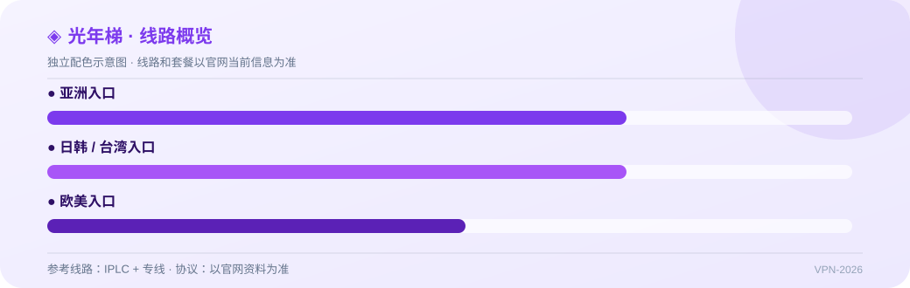

---

### 37. 大哥云 —— 大哥云是拥有 5 年口碑的老品牌机场，支持 Netflix 等多家流媒体解锁，支持 YouTube 8K 流畅观看。全线采用 IPLC 线路，提…

**19.9元 100GB/月 起** · 线路：IPLC · 协议：以官网资料为准 · 优惠码：`—`

大哥云是拥有 5 年口碑的老品牌机场，支持 Netflix 等多家流媒体解锁，支持 YouTube 8K 流畅观看。全线采用 IPLC 线路，提供免费试用名额，连接极为可靠。峰值带宽高达 1000 Mbps，满足高清直播和游戏加速需求。支持支付宝付款，新用户可先试后买。

📌 **资料口径：**主站公开资料整理（价格、入口和介绍均来自 clash-jichang.com/airport/）

👉 **[官网注册](https://airportgo.org/go.php) · [完整评测](https://clash-jichang.com/airport/dageyun)**

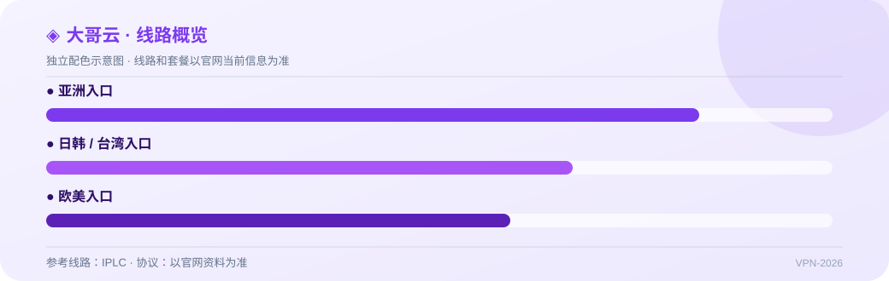

---

### 38. 龙猫云 —— 龙猫云采用 IPLC 深港、沪美、沪日级跨境专线，节点质量极高。所有套餐均不限制设备，晚高峰时期毫不降速。原生解锁全平台流媒体，支持 TikTo…

**15元 150GB/月 起** · 线路：IPLC + 专线 · 协议：以官网资料为准 · 优惠码：`—`

龙猫云采用 IPLC 深港、沪美、沪日级跨境专线，节点质量极高。所有套餐均不限制设备，晚高峰时期毫不降速。原生解锁全平台流媒体，支持 TikTok 本土运营和直播。适合对节点稳定性有高要求、需要高带宽的用户群体。

📌 **资料口径：**主站公开资料整理（价格、入口和介绍均来自 clash-jichang.com/airport/）

👉 **[官网注册](https://airportgo.org/go.php) · [完整评测](https://clash-jichang.com/airport/longmaoyun)**

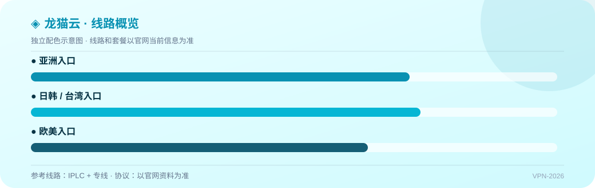

---

### 39. 飞鸟机场 —— 飞鸟机场是业界有口皆碑的高品质老牌机房，通过巧妙搭配中转 and IEPL 专线，取得了极佳的速度与稳定性平衡。日常带宽余量大，晚高峰跑满百兆宽…

**15元 100GB/月 起** · 线路：中转 + IEPL + 专线 · 协议：以官网资料为准 · 优惠码：`—`

飞鸟机场是业界有口皆碑的高品质老牌机房，通过巧妙搭配中转 and IEPL 专线，取得了极佳的速度与稳定性平衡。日常带宽余量大，晚高峰跑满百兆宽带、秒开 4K 甚至 8K 视频毫无压力。套餐不限设备，支持季付、半年付、年付多种周期折扣。

📌 **资料口径：**主站公开资料整理（价格、入口和介绍均来自 clash-jichang.com/airport/）

👉 **[官网注册](https://airportgo.org/go.php) · [完整评测](https://clash-jichang.com/airport/feiniaojichang)**

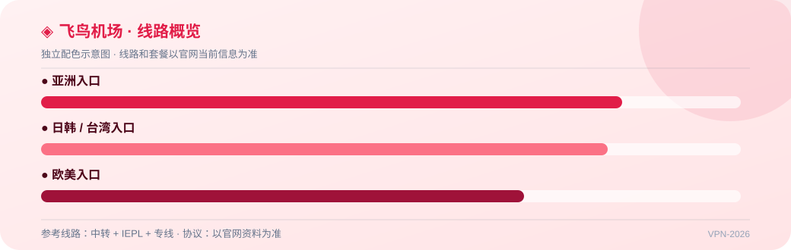

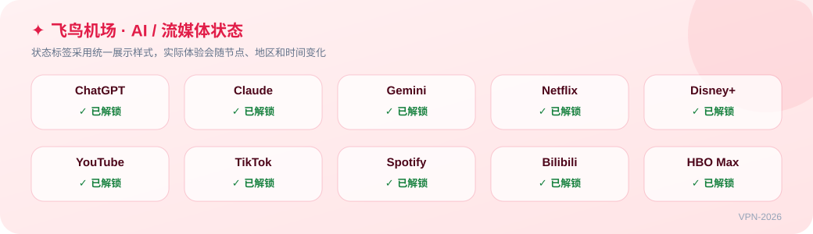

---

### 41. 花云 (FlowerCloud) —— FlowerCloud 成立于 2020 年，是业内公认的老牌高质量机场之一。采用 BGP 入口专线网络，多线自动优选回程，有效降低延迟和丢包。…

**128元/年 20GB/月 起** · 线路：BGP + 专线 · 协议：以官网资料为准 · 优惠码：`—`

FlowerCloud 成立于 2020 年，是业内公认的老牌高质量机场之一。采用 BGP 入口专线网络，多线自动优选回程，有效降低延迟和丢包。节点覆盖港、台、日、新、美、欧等热门地区，可完美解锁 Netflix、Disney+、TikTok、ChatGPT。近期推出了"全球计划"，为用户提供更多国际节点与高带宽专线选择，长期保持着良好口碑。

📌 **资料口径：**主站公开资料整理（价格、入口和介绍均来自 clash-jichang.com/airport/）

👉 **[官网注册](https://clash-jichang.com/go/huayunjichang) · [完整评测](https://clash-jichang.com/airport/huayunjichang)**

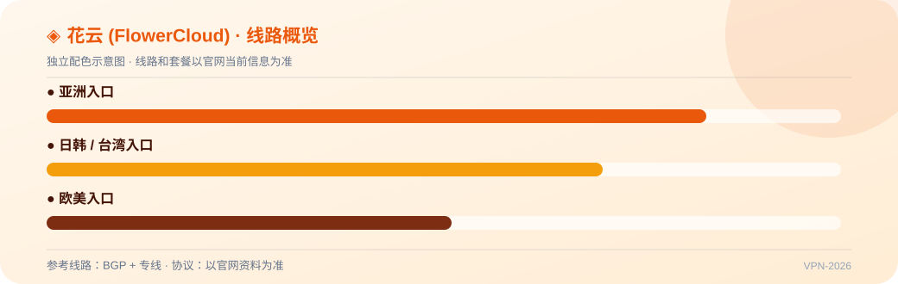

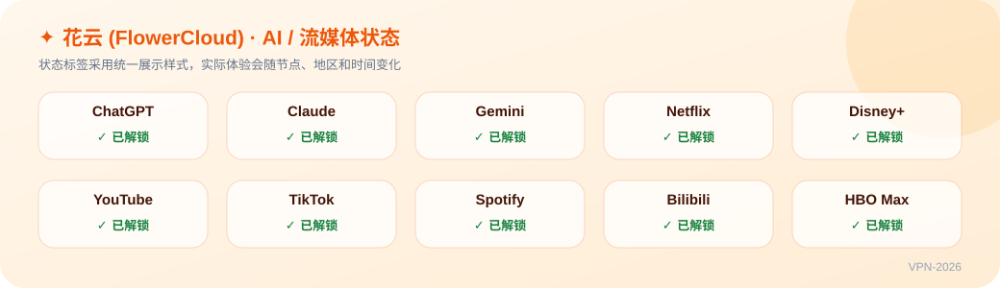

---

## 💸 性价比机场（21 家）

### 1. 极连云 —— 极连云提供高性价比的 IEPL 专线 VPN 服务，支持 Trojan 和 Shadowsocks 协议，全线解锁 Netflix、YouTub…

**8元 60GB/月 起** · 线路：IEPL + 专线 · 协议：Trojan / Shadowsocks · 优惠码：`JLY888`

极连云提供高性价比的 IEPL 专线 VPN 服务，支持 Trojan 和 Shadowsocks 协议，全线解锁 Netflix、YouTube、ChatGPT、Gemini 等主流平台。套餐无倍率、不限速、不限制设备数量，支持支付宝、微信、USDT 支付。拥有 7×24 小时多渠道售后支持，海外技术团队实时维护巡检，节点状态异常会自动切换，是专线路线中性价比较高的选择。本站长期 8 折优惠码： JLY888 。

📌 **资料口径：**主站公开资料整理（价格、入口和介绍均来自 clash-jichang.com/airport/）

👉 **[官网注册](https://clash-jichang.com/go/jilianyun) · [完整评测](https://clash-jichang.com/airport/jilianyun)**

---

- **2. [光年梯](#光年梯)** —— 光年梯是由资深团队运营的高品质翻墙机场，拥有多年稳定运营历史和丰富技术经验。全线采用 IPLC 专线，高峰期满速不降速。其自有机房和全球节点网络…（7.5元 50GB/月（年付） · 📝 资料整理）
### 6. 极速cloud —— 极速cloud是一家提供高性价比科学上网服务的机场，采用优质线路，支持解锁主流流媒体平台及AI服务。提供灵活的套餐选择，包括体验套餐、月付套餐和…

**8.9元 100GB/月 起** · 线路：以主站介绍为准 · 协议：以官网资料为准 · 优惠码：`—`

极速cloud是一家提供高性价比科学上网服务的机场，采用优质线路，支持解锁主流流媒体平台及AI服务。提供灵活的套餐选择，包括体验套餐、月付套餐和超值的限时优惠套餐，满足不同用户的需求。

- ✅ 无脑下单即可，24H保证稳定
- ✅ 三网优化精品线路，保证24h流畅
- ✅ 解锁Netflix、Disney+、YouTube等流媒体
- ✅ 支持ChatGPT等AI平台访问
- ✅ 三网优化线路

📌 **资料口径：**主站公开资料整理（价格、入口和介绍均来自 clash-jichang.com/airport/）

👉 **[官网注册](https://august.jsjc456789.com) · [完整评测](https://clash-jichang.com/airport/#%E6%9E%81%E9%80%9Fcloud)**

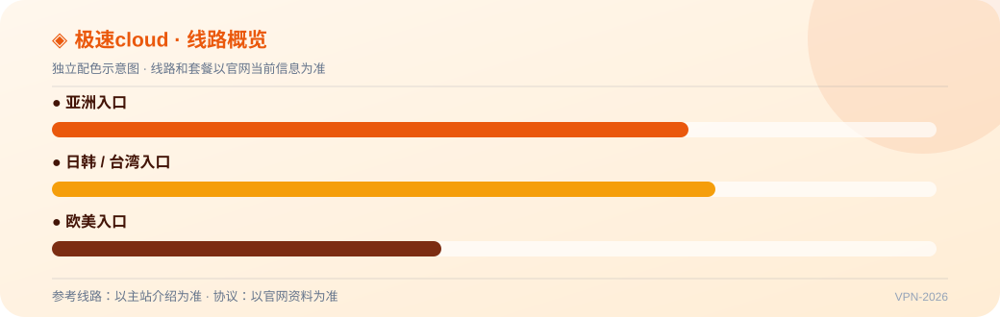

---

### 7. 九云机场 —— 九云机场是一家采用海外中转线路的高性价比机场服务，使用 VLESS 协议，节点覆盖香港、日本、台湾、新加坡、美国等常用地区。网络方面，主打日常上…

**6元 150GB/月 起** · 线路：中转 · 协议：VLESS · 优惠码：`—`

九云机场是一家采用海外中转线路的高性价比机场服务，使用 VLESS 协议，节点覆盖香港、日本、台湾、新加坡、美国等常用地区。网络方面，主打日常上网、流媒体以及 AI 服务使用，支持 ChatGPT、Gemini 等常见 AI 平台，同时提供 Netflix、YouTube 等常规流媒体解锁。视频体验方面，晚高峰测试下 YouTube 4K 播放依然保持较好的流畅度，适合日常影音娱乐及海外网站访问。套餐价格相对亲民，月付低至 6 元，提供 150GB/月流量，对于日常使用来说，性价比比较突出。

- ✅ 采用海外中转线路，VLESS 协议
- ✅ 完美解锁 Netflix、YouTube 等流媒体及 ChatGPT、Gemini 等 AI 平台
- ✅ 晚高峰 YouTube 4K 流畅播放
- ✅ 节点覆盖香港、日本、台湾、新加坡、美国等热门地区

📌 **资料口径：**主站公开资料整理（价格、入口和介绍均来自 clash-jichang.com/airport/）

👉 **[官网注册](https://daoyi.jiuyyq.com) · [完整评测](https://clash-jichang.com/airport/#%E4%B9%9D%E4%BA%91)**

---

### 8. 可信云 —— 可信云是一家提供极高性价比与高稳定性的 IEPL 专线机场，支持通用订阅，不限速且不限制设备数量。全线解锁 Netflix、Disney+ 等主…

**8元 60GB/月（年付） 起** · 线路：IEPL + 专线 · 协议：以官网资料为准 · 优惠码：`—`

可信云是一家提供极高性价比与高稳定性的 IEPL 专线机场，支持通用订阅，不限速且不限制设备数量。全线解锁 Netflix、Disney+ 等主流流媒体以及 ChatGPT 等 AI 平台，拥有 60+ 顶级专线节点，覆盖港、台、日、美等热门地区，客服全天候高效响应。

- ✅ 全 IEPL 专线，低延迟稳定连接，晚高峰毫不降速
- ✅ 完美解锁 Netflix、Disney+ 等流媒体及 ChatGPT 等平台
- ✅ 所有套餐均无设备限制、不限速
- ✅ 覆盖港、台、日、美、新等多地区，原生 IP 节点多

📌 **资料口径：**主站公开资料整理（价格、入口和介绍均来自 clash-jichang.com/airport/）

👉 **[官网注册](https://clash-jichang.com/go/kexinyun) · [完整评测](https://clash-jichang.com/airport/kexinyun)**

---

### 9. 速界 —— 速界（Speed World）是一家专注于高速稳定代理服务的机场，线路表现出色，特别适合大流量下载和视频流媒体播放。不仅支持 Clash 订阅导…

**7.5元 50GB/月（年付） 起** · 线路：以主站介绍为准 · 协议：以官网资料为准 · 优惠码：`—`

速界（Speed World）是一家专注于高速稳定代理服务的机场，线路表现出色，特别适合大流量下载和视频流媒体播放。不仅支持 Clash 订阅导入，更提供了官方一键登录 of 自研客户端，无需复杂配置，对小白极其友好。

- ✅ 高速节点架构，不限速不限制设备数量
- ✅ 完美解锁各大流媒体与 AI 工具
- ✅ 官方提供专属自研客户端，一键极速连接
- ✅ 60+ 节点广泛覆盖港、台、日、美、马来西亚等多地区

📌 **资料口径：**主站公开资料整理（价格、入口和介绍均来自 clash-jichang.com/airport/）

👉 **[官网注册](https://clash-jichang.com/go/sujie) · [完整评测](https://clash-jichang.com/airport/sujie)**

---

### 10. 快狸 —— 快狸是一家致力于提供极高性价比与专属一键客户端的专线机场，拥有丰富的全球节点与良好的解锁能力。支持自研客户端，能够帮助新手用户一键跨越繁琐配置，…

**10元 30GB/月（年付） 起** · 线路：专线 · 协议：以官网资料为准 · 优惠码：`—`

快狸是一家致力于提供极高性价比与专属一键客户端的专线机场，拥有丰富的全球节点与良好的解锁能力。支持自研客户端，能够帮助新手用户一键跨越繁琐配置，并在敏感时期依然保持出色的连通率。

- ✅ 高速专线支持，全程不限速，稳定性强
- ✅ 专属自研客户端，一键安装连接
- ✅ 支持主流流媒体与热门 AI 软件 of 解锁访问
- ✅ 60+ 全球优质节点覆盖港、台、日、美、新等多地区

📌 **资料口径：**主站公开资料整理（价格、入口和介绍均来自 clash-jichang.com/airport/）

👉 **[官网注册](https://clash-jichang.com/go/kuaili) · [完整评测](https://clash-jichang.com/airport/kuaili)**

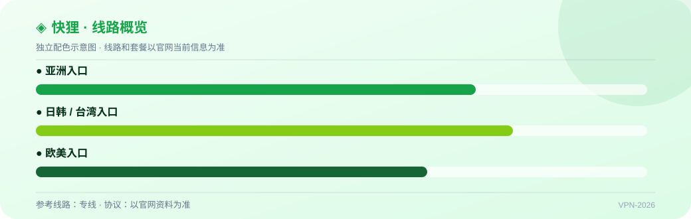

---

### 11. 边缘节点 —— 边缘节点（Edge Node）是一家专注于高性价比且节点覆盖全面的代理服务商，通过中转加速架构提供极为稳定的连接。不仅支持通用的 Clash 订…

**9元 45GB/月（年付） 起** · 线路：中转 · 协议：以官网资料为准 · 优惠码：`—`

边缘节点（Edge Node）是一家专注于高性价比且节点覆盖全面的代理服务商，通过中转加速架构提供极为稳定的连接。不仅支持通用的 Clash 订阅，还提供了专属自研客户端，并带有年付优惠方案。

- ✅ 稳定中转架构，最高不限速，支持多设备同时在线
- ✅ 60+ 节点广泛覆盖港、台、日、美、马来西亚等多地区
- ✅ 解锁主流流媒体与 ChatGPT 等 AI 工具
- ✅ 官方自研客户端，一键傻瓜式导入使用

📌 **资料口径：**主站公开资料整理（价格、入口和介绍均来自 clash-jichang.com/airport/）

👉 **[官网注册](https://clash-jichang.com/go/bianyuanjiedian) · [完整评测](https://clash-jichang.com/airport/bianyuanjiedian)**

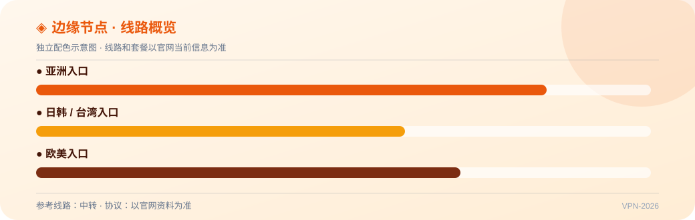

---

### 13. 光速云 —— 光速云是专注于稳定流媒体与跨境业务的 IEPL 专线机场。全线解锁 Netflix、Disney+、YouTube、ChatGPT、Gemini…

**8.25元 59GB/月 起** · 线路：IEPL + 专线 · 协议：以官网资料为准 · 优惠码：`—`

光速云是专注于稳定流媒体与跨境业务的 IEPL 专线机场。全线解锁 Netflix、Disney+、YouTube、ChatGPT、Gemini 等主流平台，适合跨境电商、直播运营和流媒体重度用户。节点覆盖港台、日美新及欧美地区，延迟极低。另提供 1T 大流量永久套餐，适合长期大流量用户一次性购买。

📌 **资料口径：**主站公开资料整理（价格、入口和介绍均来自 clash-jichang.com/airport/）

👉 **[官网注册](https://clash-jichang.com/go/guangshuyun) · [完整评测](https://clash-jichang.com/airport/guangshuyun)**

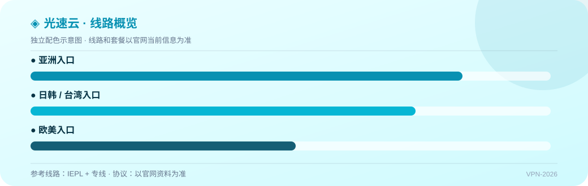

---

### 16. Nice加速 —— Nice加速是站长长期自用的一款机场，机场运营超过2年，平时极少掉线，专线出口，有专门的纯净AI节点，热门地区都有家宽，高峰期电信联通移动都比较…

**10元 40G/月（年付） 起** · 线路：专线 + IEPL · 协议：以官网资料为准 · 优惠码：`—`

Nice加速是站长长期自用的一款机场，机场运营超过2年，平时极少掉线，专线出口，有专门的纯净AI节点，热门地区都有家宽，高峰期电信联通移动都比较友好，服务器带宽充足，看高清视频非常流畅，如果你不想经常更换机场，Nice加速可以作为长期主力考虑，非常推荐。

- ✅ IEPL南北双通道专线，不管身处何地都能有一个稳定的延迟连接
- ✅ 完美解锁ChatGPT Claude Gemini Gork等AI平台
- ✅ 所有套餐均为专线
- ✅ 覆盖香港、台湾、日本、新加坡、美国、英国、德国家宽线路套餐

📌 **资料口径：**主站公开资料整理（价格、入口和介绍均来自 clash-jichang.com/airport/）

👉 **[官网注册](https://clash-jichang.com/go/nice) · [完整评测](https://clash-jichang.com/airport/nice)**

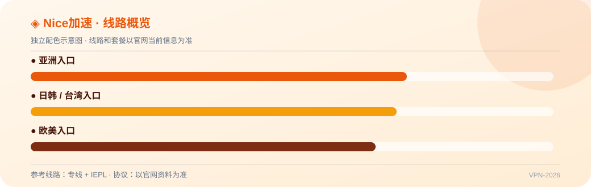

---

### 20. 瞬云机场 —— 瞬云机场支持解锁各大流媒体，解锁 ChatGPT、Gemini 等 AI 服务，轻松满足跨境电商、直播运营、远程办公及日常冲浪等多场景需求。网络…

**8.25元 59GB/月 起** · 线路：直连 + 专线 + ANYCAST · 协议：以官网资料为准 · 优惠码：`—`

瞬云机场支持解锁各大流媒体，解锁 ChatGPT、Gemini 等 AI 服务，轻松满足跨境电商、直播运营、远程办公及日常冲浪等多场景需求。网络采用直连加专线架构，搭配主流国家 ANYCAST 高速节点，确保连接的低延迟与高稳定性。套餐均承诺无倍率、不限速，且价格透明实在，是专线路线中不可多得的高性价比之选。

- ✅ 直连+全节点专线加速，采用 ANYCAST 高速节点，低延迟稳定连接
- ✅ 完美解锁 Netflix、Disney+ 等流媒体及 ChatGPT、Gemini 等 AI 平台
- ✅ 采用底层稳定的协议，安全可靠，保护用户隐私
- ✅ 全线套餐无倍率、不限制峰值速率（不限速）
- ✅ 规范设备限制（仅限个人使用），严格把控滥用，保障整体网络环境的高品质

📌 **资料口径：**主站公开资料整理（价格、入口和介绍均来自 clash-jichang.com/airport/）

👉 **[官网注册](https://clash-jichang.com/go/shunyun) · [完整评测](https://clash-jichang.com/airport/shunyun)**

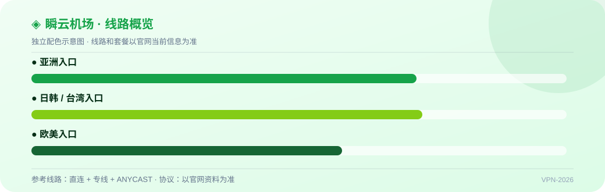

---

### 22. Lumina —— Lumina（Lumina Airport）是一家提供直连大带宽与高速中转的多协议混合机场。针对不同需求，提供基于 xTom 数据中心优质网络直…

**10元 200GB/月 起** · 线路：直连 + 中转 · 协议：Hysteria2 / AnyTLS · 优惠码：`—`

Lumina（Lumina Airport）是一家提供直连大带宽与高速中转的多协议混合机场。针对不同需求，提供基于 xTom 数据中心优质网络直连（Hysteria2 协议）以及 GoMAMI HK（香港）中转入口（AnyTLS 协议）的多种节点，不限制设备在线数量，限速达 1000Mbps。

- ✅ GoMAMI HK 中转 AnyTLS 与 xTom 数据中心 Hysteria2 直连
- ✅ 无在线设备数量限制，最高 1000Mbps 带宽保证
- ✅ 完美解锁 Netflix、Disney+、ChatGPT 等主流平台
- ✅ 节点丰富，覆盖香港、台湾、日本、美国、德国等地区

📌 **资料口径：**主站公开资料整理（价格、入口和介绍均来自 clash-jichang.com/airport/）

👉 **[官网注册](https://clash-jichang.com/go/lumina) · [完整评测](https://clash-jichang.com/airport/lumina)**

---

### 23. 拼好连 —— 拼好连（原 Runway Cloud）是一家主打拼团共享的高性价比机场。全线采用优质 BGP 高速线路与 BGP+IEPL 专线，不限制设备连接…

**9.9元 100GB/月 起** · 线路：BGP + IEPL + 专线 · 协议：以官网资料为准 · 优惠码：`—`

拼好连（原 Runway Cloud）是一家主打拼团共享的高性价比机场。全线采用优质 BGP 高速线路与 BGP+IEPL 专线，不限制设备连接数量。网络延迟极低，提供 200M/400M 甚至不限速的带宽保证，晚高峰 4K/8K 视频秒加载。

- ✅ BGP+IEPL 高速线路保障，SLA 在线率 99.99%
- ✅ 不限客户端连接数量，带宽高达 200Mbps - 无限速
- ✅ 完美解锁 Netflix、YouTube 等流媒体

📌 **资料口径：**主站公开资料整理（价格、入口和介绍均来自 clash-jichang.com/airport/）

👉 **[官网注册](https://clash-jichang.com/go/pinhaolian) · [完整评测](https://clash-jichang.com/airport/pinhaolian)**

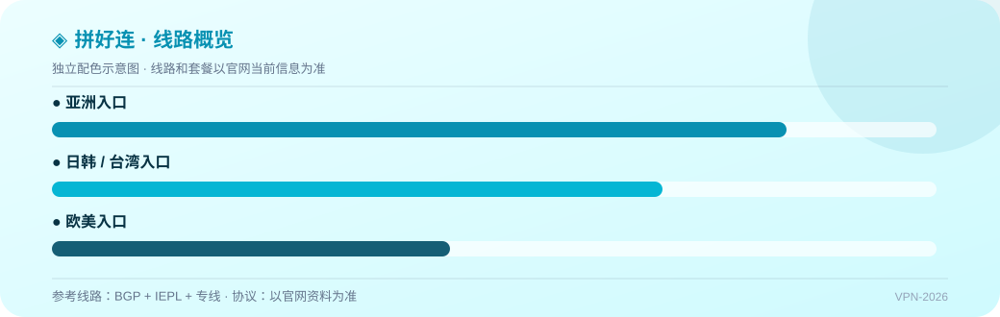

---

### 24. 99吧 —— 99吧是一家专注于极高性价比与高设备数量上限的 SS 加密代理机场，同时登陆设备数可达 99 台。全线节点限速高达 999Mbps，解锁各大流媒…

**7.5元 66GB/月（年付） 起** · 线路：以主站介绍为准 · 协议：SS · 优惠码：`—`

99吧是一家专注于极高性价比与高设备数量上限的 SS 加密代理机场，同时登陆设备数可达 99 台。全线节点限速高达 999Mbps，解锁各大流媒体以及 ChatGPT、Gemini、Grok 等国外主流 AI 平台。

- ✅ SS 协议与加密通道，限速 999Mbps
- ✅ 同时登录设备数可达 99 台，无设备受限烦恼
- ✅ 解锁 ChatGPT、Gemini、Grok 及各种主流流媒体
- ⚠️ 仅限内地使用，校园网、新疆地区用户请试用后购买，不支持退款

📌 **资料口径：**主站公开资料整理（价格、入口和介绍均来自 clash-jichang.com/airport/）

👉 **[官网注册](https://clash-jichang.com/go/99bar) · [完整评测](https://clash-jichang.com/airport/99bar)**

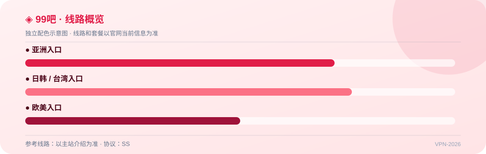

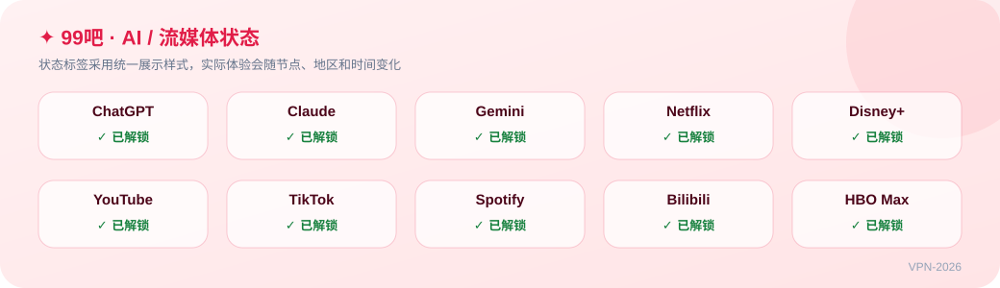

---

### 25. 锦云 —— 锦云机场提供极致性价比的科学上网服务，支持流媒体与AI工具解锁，线路优化稳定，提供多种特惠月付、季付与年付套餐。套餐不限速，拥有活跃的专属社群。

**6元 50GB/月 起** · 线路：以主站介绍为准 · 协议：以官网资料为准 · 优惠码：`—`

锦云机场提供极致性价比的科学上网服务，支持流媒体与AI工具解锁，线路优化稳定，提供多种特惠月付、季付与年付套餐。套餐不限速，拥有活跃的专属社群。

- ✅ 极致性价比，月付低至 6 元
- ✅ 解锁 Netflix 等主流流媒体与 ChatGPT/Claude 平台
- ✅ 季付 6台设备，年付最高 10台设备同时在线
- ✅ 专属 TG 群组及 24 小时工单支持

📌 **资料口径：**主站公开资料整理（价格、入口和介绍均来自 clash-jichang.com/airport/）

👉 **[官网注册](https://clash-jichang.com/go/jinyun) · [完整评测](https://clash-jichang.com/airport/jinyun)**

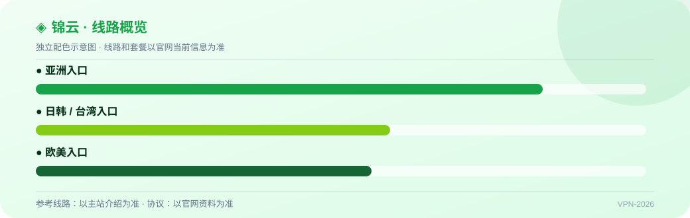

---

### 26. 极速云机场 —— 极速云机场是一家高性价比的优质机场，中轮·高速流媒体节点，GPT NFT等流媒体全解锁，解锁全门国家，工单24小时内回复，节点备用6组。支持支付…

**8.25元 800GB/月（年付） 起** · 线路：以主站介绍为准 · 协议：以官网资料为准 · 优惠码：`jisu666`

极速云机场是一家高性价比的优质机场，中轮·高速流媒体节点，GPT NFT等流媒体全解锁，解锁全门国家，工单24小时内回复，节点备用6组。支持支付宝付款，提供多种套餐选择。本站长期 8 折优惠码： jisu666 。

- ✅ 中轮+高速流媒体节点
- ✅ GPT、NFT 等流媒体全解锁
- ✅ 解锁全门国家
- ✅ 工单 24 小时内回复
- ✅ 节点备用 6 组

📌 **资料口径：**主站公开资料整理（价格、入口和介绍均来自 clash-jichang.com/airport/）

👉 **[官网注册](https://clash-jichang.com/go/jisuyun) · [完整评测](https://clash-jichang.com/airport/jisuyun)**

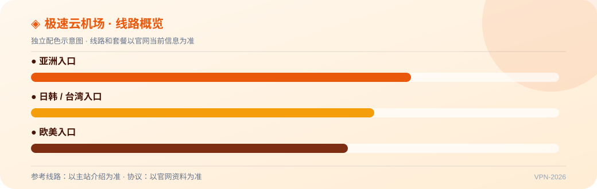

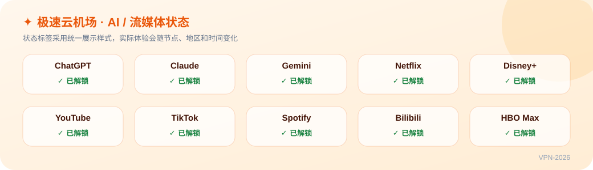

---

### 31. 可达加速器 —— 可达加速器是一家专注于高速稳定出海体验的代理服务商，采用 SD-WAN 网络架构，覆盖全球多个节点，不限速使用，适合日常科学上网及流媒体需求。套…

**10元 100GB/月 起** · 线路：SD-WAN · 协议：以官网资料为准 · 优惠码：`—`

可达加速器是一家专注于高速稳定出海体验的代理服务商，采用 SD-WAN 网络架构，覆盖全球多个节点，不限速使用，适合日常科学上网及流媒体需求。套餐分为 Basic、Standard、Premium 三档，支持月付、季付、半年付、年付、两年付多种付款周期，灵活满足不同预算需求。

- ✅ SD-WAN 智能网络，全球节点分布
- ✅ 全套餐不限速度
- ✅ 支持流媒体解锁
- ✅ 多种付款周期灵活选择（月付/季付/半年付/年付/两年付）

📌 **资料口径：**主站公开资料整理（价格、入口和介绍均来自 clash-jichang.com/airport/）

👉 **[官网注册](https://clash-jichang.com/go/keda) · [完整评测](https://clash-jichang.com/airport/keda)**

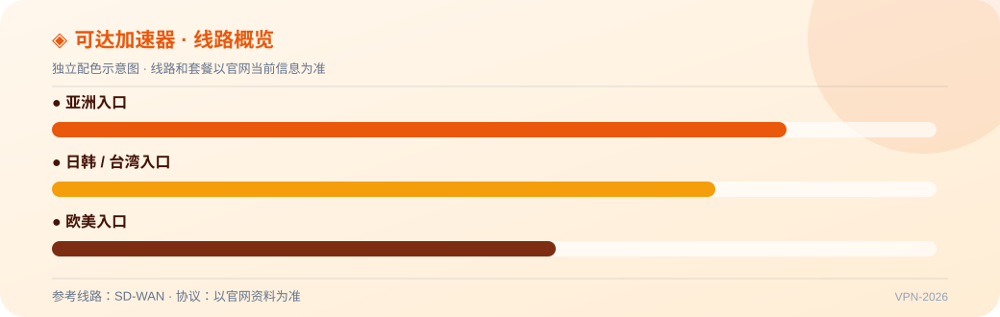

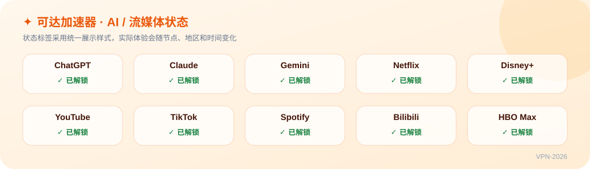

---

### 34. 山海机场 —— 山海机场采用中转 + 专线 + 直连综合架构，价格极其亲民，是入门用户性价比最高的选择之一。能够流畅解锁主流影视流媒体以及 ChatGPT 等 …

**6元 45GB/月 起** · 线路：中转 + 专线 + 直连 · 协议：以官网资料为准 · 优惠码：`—`

山海机场采用中转 + 专线 + 直连综合架构，价格极其亲民，是入门用户性价比最高的选择之一。能够流畅解锁主流影视流媒体以及 ChatGPT 等 AI 对话工具。多档位套餐满足从轻度到重度的各类需求，大流量用户最高可选 8192G/月套餐。支持支付宝支付。

📌 **资料口径：**主站公开资料整理（价格、入口和介绍均来自 clash-jichang.com/airport/）

👉 **[官网注册](https://clash-jichang.com/go/shanhai) · [完整评测](https://clash-jichang.com/airport/shanhai)**

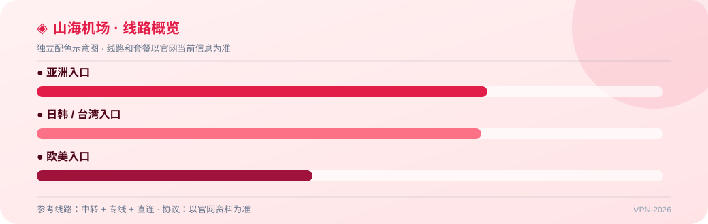

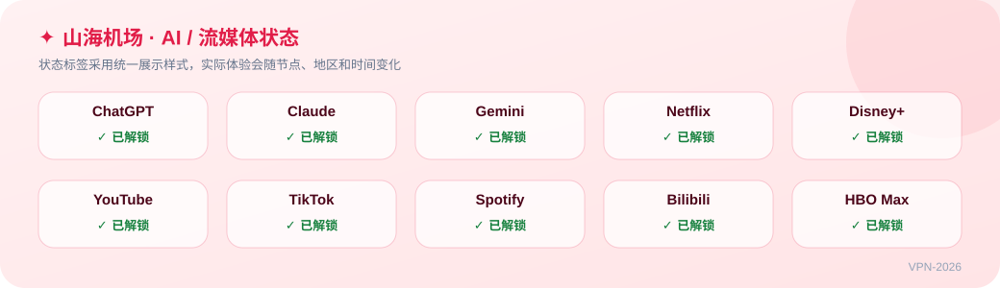

---

### 35. LiZione —— LiZione 致力于提供极高性价比的中转与专线服务。全节点支持流媒体解锁（Netflix、Disney+、YouTube）以及 ChatGPT…

**10元 100GB/月 起** · 线路：中转 + 专线 · 协议：以官网资料为准 · 优惠码：`—`

LiZione 致力于提供极高性价比的中转与专线服务。全节点支持流媒体解锁（Netflix、Disney+、YouTube）以及 ChatGPT 等 AI 工具。提供购买日自动重置流量机制，确保用户使用体验的连贯性。拥有活跃的 Telegram 社区，售后响应及时，是追求低预算、高稳定性的不二之选。

📌 **资料口径：**主站公开资料整理（价格、入口和介绍均来自 clash-jichang.com/airport/）

👉 **[官网注册](https://clash-jichang.com/go/lizione) · [完整评测](https://clash-jichang.com/airport/lizione)**

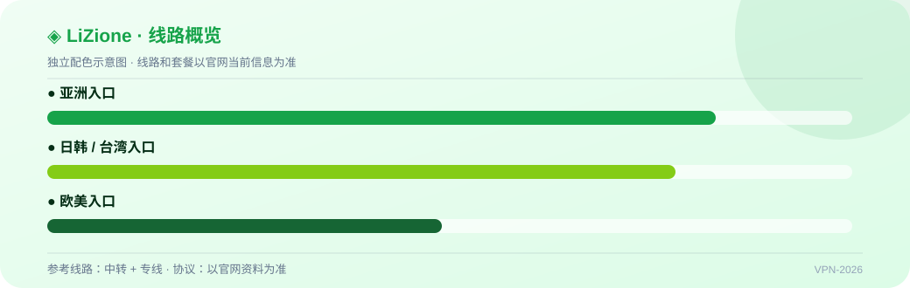

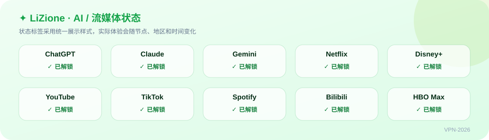

---

### 36. 哆啦A梦 —— 哆啦A梦机场提供极具性价比的科学上网服务，线路覆盖全球多个核心地区。采用先进的中转与加速技术，确保晚高峰时期依然能够流畅播放 4K 视频。支持多…

**10元 100GB/月 起** · 线路：中转 · 协议：以官网资料为准 · 优惠码：`—`

哆啦A梦机场提供极具性价比的科学上网服务，线路覆盖全球多个核心地区。采用先进的中转与加速技术，确保晚高峰时期依然能够流畅播放 4K 视频。支持多种主流代理协议，全线解锁 Netflix、Disney+ 等流媒体及 ChatGPT、Gemini 等 AI 平台。不限速、不限设备数量，是追求高性价比与多设备支持用户的理想选择。

📌 **资料口径：**主站公开资料整理（价格、入口和介绍均来自 clash-jichang.com/airport/）

👉 **[官网注册](https://clash-jichang.com/go/duolaameng) · [完整评测](https://clash-jichang.com/airport/duolaameng)**

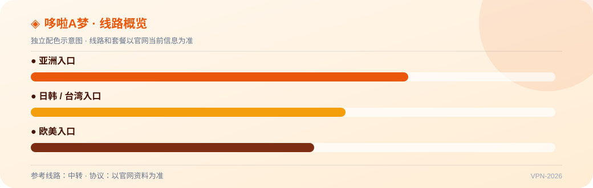

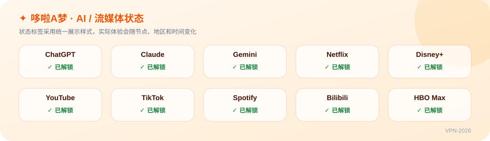

---

### 40. 青云梯 —— 青云梯主打全 IPLC 专线，顶级国际出口线路，最大提供 2.5GBps 超大带宽，无惧网络波动，所有套餐均不限制同时在线设备数量，全家或全公司…

**8元 60GB/月 起** · 线路：IPLC + 专线 · 协议：以官网资料为准 · 优惠码：`—`

青云梯主打全 IPLC 专线，顶级国际出口线路，最大提供 2.5GBps 超大带宽，无惧网络波动，所有套餐均不限制同时在线设备数量，全家或全公司共用无压力。节点一律 x1 倍率，买卖透明，原生支持各端主流代理客户端，全线解锁 Netflix、Disney+ TikTok 等流媒体服务。提供 24 小时工单支持及在线客服。

📌 **资料口径：**主站公开资料整理（价格、入口和介绍均来自 clash-jichang.com/airport/）

👉 **[官网注册](https://airportgo.org/go.php) · [完整评测](https://clash-jichang.com/airport/qingyunti)**

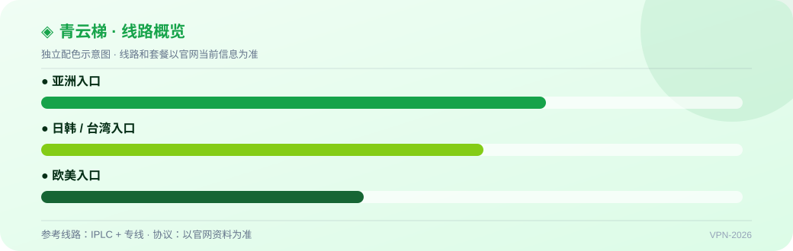

---

## 🛡️ 稳定机场（36 家）

- **1. [极连云](#极连云)** —— 极连云提供高性价比的 IEPL 专线 VPN 服务，支持 Trojan 和 Shadowsocks 协议，全线解锁 Netflix、YouTub…（8元 60GB/月 · 📝 资料整理）
- **2. [光年梯](#光年梯)** —— 光年梯是由资深团队运营的高品质翻墙机场，拥有多年稳定运营历史和丰富技术经验。全线采用 IPLC 专线，高峰期满速不降速。其自有机房和全球节点网络…（7.5元 50GB/月（年付） · 📝 资料整理）
### 3. 飞猫云 —— 飞猫云采用全 IPLC 专线网络，提供最高 2.5Gbps 稳定速率，原生 IP 线路，轻松解锁 Netflix、Disney+、ChatGPT…

**25元 150GB/月 起** · 线路：IPLC + 专线 · 协议：以官网资料为准 · 优惠码：`—`

飞猫云采用全 IPLC 专线网络，提供最高 2.5Gbps 稳定速率，原生 IP 线路，轻松解锁 Netflix、Disney+、ChatGPT、TikTok 等服务，高峰时段不降速。套餐不限制设备连接数量，支持多端同时登录使用，并具备智能流量分配与路由优化功能。支持支付宝付款，提供年付 8 折、两年付 7 折、三年付 6 折的长期优惠。

- ✅ 全 IPLC 专线网络，最高 2.5Gbps 稳定速率
- ✅ 原生 IP 线路，解锁 Netflix、Disney+、ChatGPT、TikTok 等
- ✅ 所有节点 x1 倍率，高峰时段不降速
- ✅ 不限制设备连接数量，多端同时登录
- ✅ 智能流量分配与路由优化

📌 **资料口径：**主站公开资料整理（价格、入口和介绍均来自 clash-jichang.com/airport/）

👉 **[官网注册](https://flycat.flycatvipaff.cc/#/?code=1arEKHqh) · [完整评测](https://clash-jichang.com/airport/feimaoyun)**

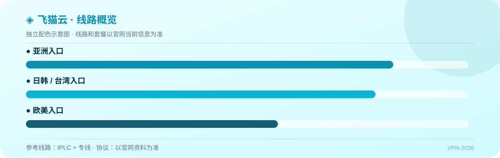

---

### 4. 云图机场 —— 云图机场是一家高品质 of 科学上网服务商，线路传输采用金融级专线，提供无脑下单即可的高质量稳定节点。全线完美解锁 Netflix、Disney…

**20元 150GB/月 起** · 线路：专线 · 协议：以官网资料为准 · 优惠码：`yt88`

云图机场是一家高品质 of 科学上网服务商，线路传输采用金融级专线，提供无脑下单即可的高质量稳定节点。全线完美解锁 Netflix、Disney+ , YouTube、ChatGPT、TikTok 等主流流媒体及 AI 平台，支持原生 IP，全节点均为 1 倍率（无高倍率扣费陷阱）。提供工单 24 小时内快速回复，无脑下单即可，24H 保证稳定，金融级专线传输，保证 24H 高速流畅。本站专属八折优惠码： yt88 。

📌 **资料口径：**主站公开资料整理（价格、入口和介绍均来自 clash-jichang.com/airport/）

👉 **[官网注册](https://clash-jichang.com/go/yuntu) · [完整评测](https://clash-jichang.com/airport/yuntu)**

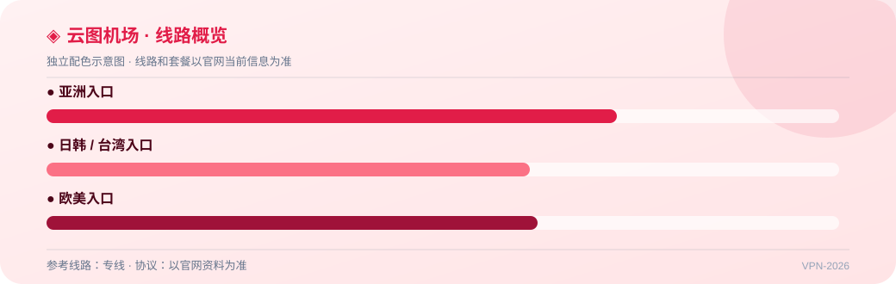

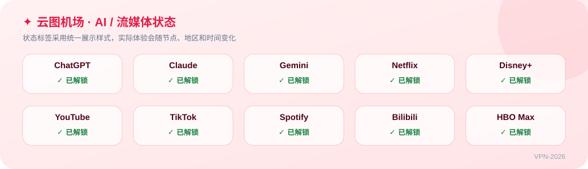

---

### 5. 鲲鹏加速 —— 鲲鹏加速提供全球多国原生节点与冷门地区线路，全站节点统一 1.0 倍率扣费，绝无暗扣。完美支持 ChatGPT AI 工具及 Netflix、Y…

**12元 99GB/月 起** · 线路：以主站介绍为准 · 协议：以官网资料为准 · 优惠码：`—`

鲲鹏加速提供全球多国原生节点与冷门地区线路，全站节点统一 1.0 倍率扣费，绝无暗扣。完美支持 ChatGPT AI 工具及 Netflix、YouTube、Disney+ 等主流海外流媒体解锁。晚高峰体验稳定，提供 24 小时全天候工单响应。

📌 **资料口径：**主站公开资料整理（价格、入口和介绍均来自 clash-jichang.com/airport/）

👉 **[官网注册](https://clash-jichang.com/go/kunpeng) · [完整评测](https://clash-jichang.com/airport/kunpeng)**

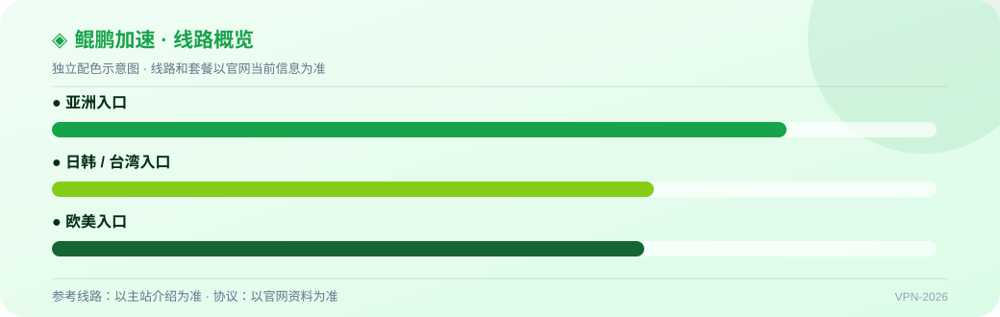

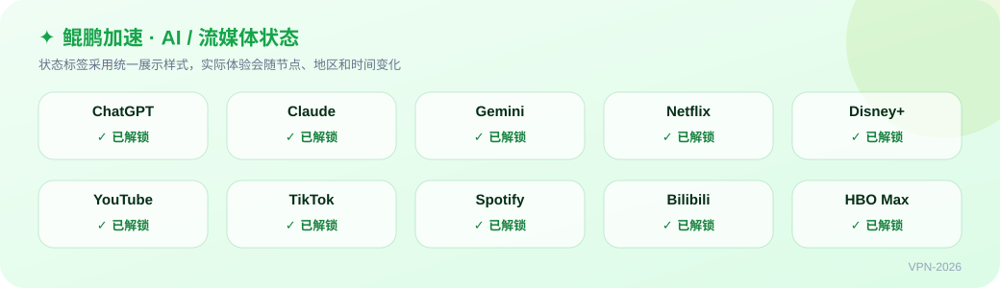

---

- **6. [极速cloud](#极速cloud)** —— 极速cloud是一家提供高性价比科学上网服务的机场，采用优质线路，支持解锁主流流媒体平台及AI服务。提供灵活的套餐选择，包括体验套餐、月付套餐和…（8.9元 100GB/月 · 📝 资料整理）
- **7. [九云机场](#九云机场)** —— 九云机场是一家采用海外中转线路的高性价比机场服务，使用 VLESS 协议，节点覆盖香港、日本、台湾、新加坡、美国等常用地区。网络方面，主打日常上…（6元 150GB/月 · 📝 资料整理）
- **8. [可信云](#可信云)** —— 可信云是一家提供极高性价比与高稳定性的 IEPL 专线机场，支持通用订阅，不限速且不限制设备数量。全线解锁 Netflix、Disney+ 等主…（8元 60GB/月（年付） · 📝 资料整理）
- **9. [速界](#速界)** —— 速界（Speed World）是一家专注于高速稳定代理服务的机场，线路表现出色，特别适合大流量下载和视频流媒体播放。不仅支持 Clash 订阅导…（7.5元 50GB/月（年付） · 📝 资料整理）
- **10. [快狸](#快狸)** —— 快狸是一家致力于提供极高性价比与专属一键客户端的专线机场，拥有丰富的全球节点与良好的解锁能力。支持自研客户端，能够帮助新手用户一键跨越繁琐配置，…（10元 30GB/月（年付） · 📝 资料整理）
- **11. [边缘节点](#边缘节点)** —— 边缘节点（Edge Node）是一家专注于高性价比且节点覆盖全面的代理服务商，通过中转加速架构提供极为稳定的连接。不仅支持通用的 Clash 订…（9元 45GB/月（年付） · 📝 资料整理）
### 12. 灯塔机场 —— 灯塔机场（灯塔加速器）全平台节点可用，提供高达 300Mbps 的高带宽速率。不仅拥有高性价比的轻量与 VIP/SVIP 套餐，还针对重度流量用…

**16.6元 120GB/月（年付） 起** · 线路：以主站介绍为准 · 协议：以官网资料为准 · 优惠码：`—`

灯塔机场（灯塔加速器）全平台节点可用，提供高达 300Mbps 的高带宽速率。不仅拥有高性价比的轻量与 VIP/SVIP 套餐，还针对重度流量用户推出了 1TB 个人无限流量年付套餐，支持多设备同时在线与 24 小时退款保障机制。

- ✅ 全平台所有节点可用，支持通用 Clash 订阅及多端一键导入
- ✅ 提供 150Mbps - 300Mbps 高速带宽与最高 6 台设备同时在线
- ✅ VIP及SVIP套餐提供 24 小时退款保障（流量使用不超过 10%）
- ✅ 推出 1TB/年 不限时/限速续航版专属大流量套餐

📌 **资料口径：**主站公开资料整理（价格、入口和介绍均来自 clash-jichang.com/airport/）

👉 **[官网注册](https://clash-jichang.com/go/dengta) · [完整评测](https://clash-jichang.com/airport/dengta)**

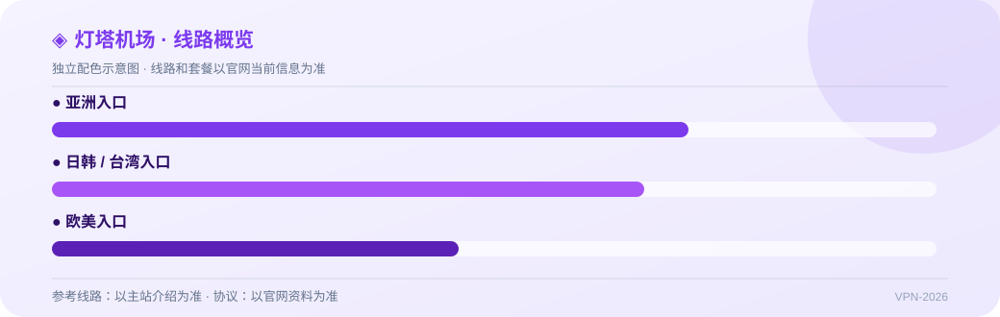

---

- **13. [光速云](#光速云)** —— 光速云是专注于稳定流媒体与跨境业务的 IEPL 专线机场。全线解锁 Netflix、Disney+、YouTube、ChatGPT、Gemini…（8.25元 59GB/月 · 📝 资料整理）
### 14. 影子 —— 影子是一家专注于高端 IEPL 跨境专线的机场服务商。其采用企业级专线过境，具有极低延迟和极低丢包的表现，能完美绕过敏感时期的封锁，对 Netf…

**18.8元 150GB/月 起** · 线路：IEPL + 专线 · 协议：以官网资料为准 · 优惠码：`—`

影子是一家专注于高端 IEPL 跨境专线的机场服务商。其采用企业级专线过境，具有极低延迟和极低丢包的表现，能完美绕过敏感时期的封锁，对 Netflix、Disney+、TikTok、ChatGPT 做到全线原生解锁。

- ✅ 全高速专线 IEPL 跨境，稳定性高、延迟低
- ✅ 完美解锁 Netflix, Disney+, Tiktok, ChatGPT
- ✅ 仅限个人使用，无退款政策，介意勿买

📌 **资料口径：**主站公开资料整理（价格、入口和介绍均来自 clash-jichang.com/airport/）

👉 **[官网注册](https://clash-jichang.com/go/yingzi) · [完整评测](https://clash-jichang.com/airport/yingzi)**

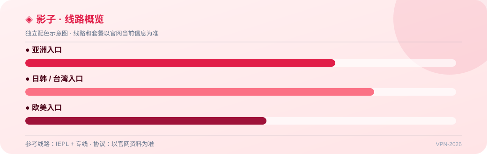

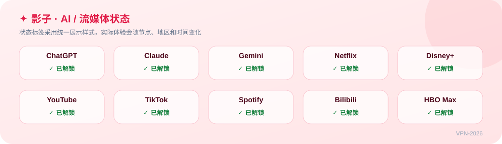

---

### 15. 边界云 —— 边界云是一家专注高性价比科学上网服务的机场，采用 IEPL 优化线路，提供 50+ 全球节点覆盖。全套餐支持 UDP 协议，主流流媒体（Netf…

**12.33元 50GB/月（年付） 起** · 线路：IEPL · 协议：以官网资料为准 · 优惠码：`—`

边界云是一家专注高性价比科学上网服务的机场，采用 IEPL 优化线路，提供 50+ 全球节点覆盖。全套餐支持 UDP 协议，主流流媒体（Netflix / Hulu）全线解锁，最高带宽可达 1000Mbps。所有套餐均附带 3 天无理由全额退款保证，支持支付宝等国内常见支付方式。

- ✅ IEPL 优化线路，50+ 全球节点
- ✅ 最高 1000Mbps 带宽
- ✅ 解锁 Netflix / Hulu 及主流流媒体
- ✅ 支持 UDP 协议
- ✅ 3 天无理由全额退款保证

📌 **资料口径：**主站公开资料整理（价格、入口和介绍均来自 clash-jichang.com/airport/）

👉 **[官网注册](https://clash-jichang.com/go/bianjiyun) · [完整评测](https://clash-jichang.com/airport/bianjiyun)**

---

- **16. [Nice加速](#nice加速)** —— Nice加速是站长长期自用的一款机场，机场运营超过2年，平时极少掉线，专线出口，有专门的纯净AI节点，热门地区都有家宽，高峰期电信联通移动都比较…（10元 40G/月（年付） · 📝 资料整理）
### 17. 灵猫网络 —— 灵猫网络是一家主打高性价比企业级全 IPLC 专线的高速机场。所有套餐均采用 IPLC 物理专线，不限制客户端，不限速，最大提供 1000 Mb…

**85元/年（45G/月） 起** · 线路：IPLC + 专线 · 协议：以官网资料为准 · 优惠码：`—`

灵猫网络是一家主打高性价比企业级全 IPLC 专线的高速机场。所有套餐均采用 IPLC 物理专线，不限制客户端，不限速，最大提供 1000 Mbps 带宽。特别提供了原生 IP 解锁，支持解锁 Netflix、Hulu、HBO、Disney+ 等流媒体以及 ChatGPT、Gemini、TikTok 等热门服务。最便宜的年付小包仅需 85 元/年，包含每月 45GB 的专线流量，支持订单日自动重置流量或购买加油包，是极具性价比的长期主力/备份选择。

📌 **资料口径：**主站公开资料整理（价格、入口和介绍均来自 clash-jichang.com/airport/）

👉 **[官网注册](https://clash-jichang.com/go/lingmao) · [完整评测](https://clash-jichang.com/airport/lingmao)**

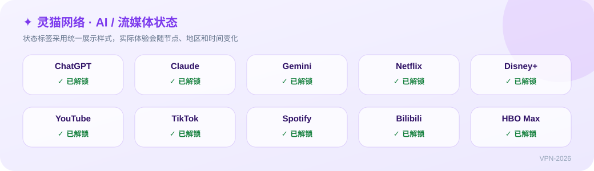

---

### 18. 星岛梦 —— 星岛梦是专选 IEPL 专线的高品质机场，提供 Trojan/SS 协议，全线解锁 Netflix、Disney+、YouTube、ChatGP…

**16元 100GB/月 起** · 线路：IEPL + 专线 · 协议：Trojan / SS · 优惠码：`—`

星岛梦是专选 IEPL 专线的高品质机场，提供 Trojan/SS 协议，全线解锁 Netflix、Disney+、YouTube、ChatGPT、Gemini 等平台与 AI 服务，并支持 TikTok 跨区运营。晚高峰不降速是其核心竞争力，适合对稳定性要求高、需要大流量的用户。提供永久不限时 1TB 流量包选项。

📌 **资料口径：**主站公开资料整理（价格、入口和介绍均来自 clash-jichang.com/airport/）

👉 **[官网注册](https://clash-jichang.com/go/xingdaomeng) · [完整评测](https://clash-jichang.com/airport/xingdaomeng)**

---

### 19. 全球云 —— 全球云专注于提供顶级出海加速体验，凭借稳定的网络入口和超低延迟过境节点，不仅是重度游戏爱好者的加速利器，更是享受 4K/8K 流媒体视觉盛宴的绝…

**20元 120GB/月 起** · 线路：BGP · 协议：以官网资料为准 · 优惠码：`—`

全球云专注于提供顶级出海加速体验，凭借稳定的网络入口和超低延迟过境节点，不仅是重度游戏爱好者的加速利器，更是享受 4K/8K 流媒体视觉盛宴的绝佳选择。采用 BGP 智能多线路调度，白天与夜间晚高峰均保持稳定带宽。支持 ChatGPT、Claude 等 AI 平台商用级解锁。

📌 **资料口径：**主站公开资料整理（价格、入口和介绍均来自 clash-jichang.com/airport/）

👉 **[官网注册](https://clash-jichang.com/go/quanqiuyun) · [完整评测](https://clash-jichang.com/airport/quanqiuyun)**

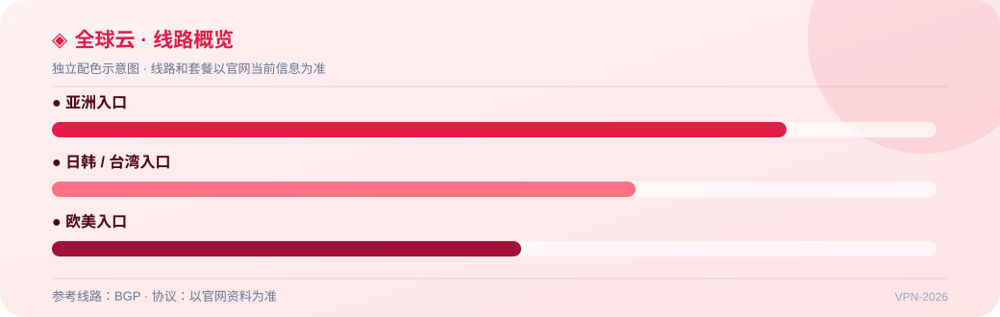

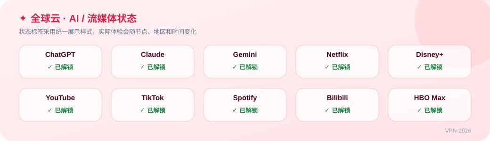

---

- **20. [瞬云机场](#瞬云机场)** —— 瞬云机场支持解锁各大流媒体，解锁 ChatGPT、Gemini 等 AI 服务，轻松满足跨境电商、直播运营、远程办公及日常冲浪等多场景需求。网络…（8.25元 59GB/月 · 📝 资料整理）
### 21. 寰宇云 —— 寰宇云机场采用全 IEPL 专线+直连双线路架构，最大提供 2.5Gbps 超大带宽，全线解锁 Netflix、Disney+、Gemini、C…

**89元/年 60GB/月 起** · 线路：IEPL + 专线 + 直连 · 协议：以官网资料为准 · 优惠码：`—`

寰宇云机场采用全 IEPL 专线+直连双线路架构，最大提供 2.5Gbps 超大带宽，全线解锁 Netflix、Disney+、Gemini、ChatGPT、TikTok 等主流平台，原生 IP 解锁各大流媒体。不限速、不限制同时使用客户端数量，支持支付宝付款，高效客服全天响应，是追求高性价比专线机场的稳定之选。

- ✅ 全 IEPL 专线，最大 2.5Gbps 带宽，低延迟稳定连接
- ✅ 解锁 Netflix、Disney+、ChatGPT、Gemini、TikTok 等全主流平台
- ✅ 原生 IP，流媒体解锁无障碍
- ✅ 不限速、不限制同时使用客户端数量
- ✅ 高效客服响应，支持支付宝付款

📌 **资料口径：**主站公开资料整理（价格、入口和介绍均来自 clash-jichang.com/airport/）

👉 **[官网注册](https://clash-jichang.com/go/huanyuyun) · [完整评测](https://clash-jichang.com/airport/huanyuyun)**

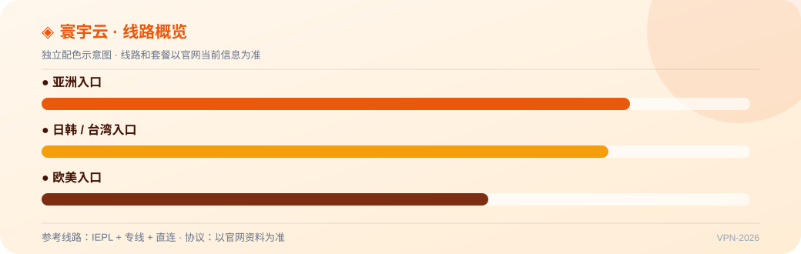

---

- **23. [拼好连](#拼好连)** —— 拼好连（原 Runway Cloud）是一家主打拼团共享的高性价比机场。全线采用优质 BGP 高速线路与 BGP+IEPL 专线，不限制设备连接…（9.9元 100GB/月 · 📝 资料整理）
- **25. [锦云](#锦云)** —— 锦云机场提供极致性价比的科学上网服务，支持流媒体与AI工具解锁，线路优化稳定，提供多种特惠月付、季付与年付套餐。套餐不限速，拥有活跃的专属社群。（6元 50GB/月 · 📝 资料整理）
### 27. 山水云 —— 山水云是一家专注高性价比代理服务的机场，采用中转+直连节点架构，支持解锁 GPT、TikTok 等全流媒体。提供轻星套餐和月付套餐两大系列，轻星…

**14.99元 100GB/月 起** · 线路：中转+直连 · 协议：以官网资料为准 · 优惠码：`—`

山水云是一家专注高性价比代理服务的机场，采用中转+直连节点架构，支持解锁 GPT、TikTok 等全流媒体。提供轻星套餐和月付套餐两大系列，轻星系列按年/半年/季付，月付系列灵活按月计费，并提供永久不限时流量包。配有专属 Telegram 群组和频道，支持支付宝等国内支付方式，客服工单24小时响应。

- ✅ 中转+直连节点，稳定高速
- ✅ 全流媒体解锁：GPT、TikTok、Netflix、Disney+ 等
- ✅ 支持同时在线 3~10 个设备
- ✅ 解锁全球众多冷门国家
- ✅ 客服+工单 24小时响应

📌 **资料口径：**主站公开资料整理（价格、入口和介绍均来自 clash-jichang.com/airport/）

👉 **[官网注册](https://clash-jichang.com/go/shanshuiyun) · [完整评测](https://clash-jichang.com/airport/shanshuiyun)**

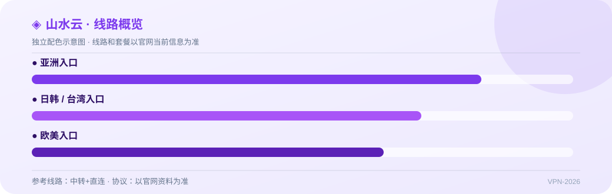

---

### 28. 秒秒云 —— 秒秒云是一家专注于高性价比出海体验的机场服务商，采用中转高速节点，全面解锁全球众多国家 and GPT、TikTok 等多媒体平台。提供特惠年付…

**14元 128GB/月 起** · 线路：中转 · 协议：以官网资料为准 · 优惠码：`—`

秒秒云是一家专注于高性价比出海体验的机场服务商，采用中转高速节点，全面解锁全球众多国家 and GPT、TikTok 等多媒体平台。提供特惠年付套餐 and 灵活月付套餐，以及不限时永久流量包，满足不同预算和使用习惯的用户需求。多媒体 GPT 解锁服务支持24小时实时客服响应，并设有专属 Telegram 群组和频道。

- ✅ 中转高速节点，高效稳定
- ✅ 多媒体 GPT 解锁服务
- ✅ 解锁全球众多冷门国家
- ✅ 支持24小时实时客服响应
- ✅ 仅支持官方静态网：秒秒.com

📌 **资料口径：**主站公开资料整理（价格、入口和介绍均来自 clash-jichang.com/airport/）

👉 **[官网注册](https://clash-jichang.com/go/miaomiaoyun) · [完整评测](https://clash-jichang.com/airport/miaomiaoyun)**

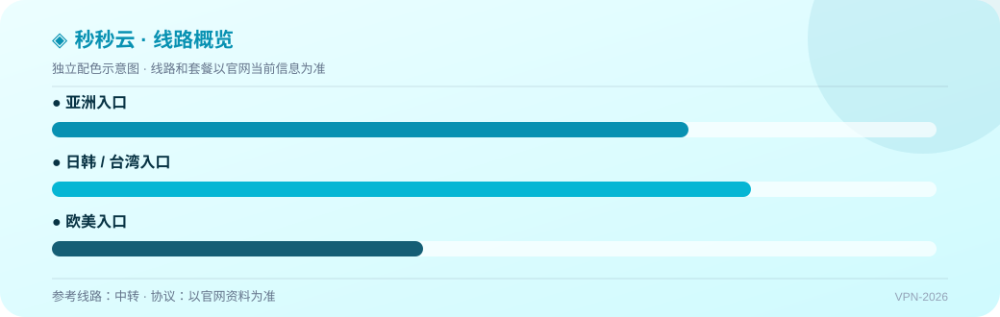

---

### 29. 迅达VPN —— 迅达VPN是一家专注高质量跨境代理服务的机场，采用多地BGP跨境企业级专线，支持流媒体无障碍解锁，包括 Netflix、Disney+、Chat…

**15元 150GB/月 起** · 线路：BGP + 专线 · 协议：以官网资料为准 · 优惠码：`—`

迅达VPN是一家专注高质量跨境代理服务的机场，采用多地BGP跨境企业级专线，支持流媒体无障碍解锁，包括 Netflix、Disney+、ChatGPT 等主流平台。套餐灵活，支持月付/季付/年付，并提供一次性流量包选项，适合轻度至重度用户。技术支持7x24小时工单在线，个人使用稳定可靠。

- ✅ 多地BGP跨境企业级专线，低延迟高稳定
- ✅ 流媒体无障碍，解锁 Netflix / ChatGPT / Disney+
- ✅ 支持月付/季付/年付及一次性流量包
- ✅ 支持 5~20 台设备同时使用
- ✅ 7x24 小时工单技术支持

📌 **资料口径：**主站公开资料整理（价格、入口和介绍均来自 clash-jichang.com/airport/）

👉 **[官网注册](https://clash-jichang.com/go/xundavpn) · [完整评测](https://clash-jichang.com/airport/xundavpn)**

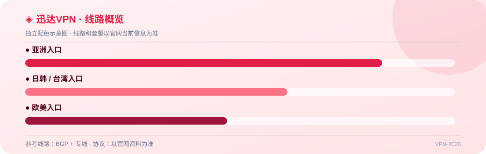

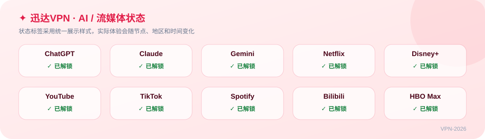

---

### 30. Edge-X机场 —— Edge-X 是一家专注于高品质 IEPL 内网专线的机场服务商，采用企业级线路架构，提供稳定的内外网混合加速体验。节点高峰期 1 倍率，闲时 …

**16.8元 100GB/月 起** · 线路：IEPL + 专线 · 协议：以官网资料为准 · 优惠码：`—`

Edge-X 是一家专注于高品质 IEPL 内网专线的机场服务商，采用企业级线路架构，提供稳定的内外网混合加速体验。节点高峰期 1 倍率，闲时 0.5 倍率，全面解锁 Netflix、Disney+、YouTube 等主流流媒体及 ChatGPT、Claude 等 AI 服务。仅限个人及家庭使用，支持境外接入，支持 12 小时合理情况退款保障，是追求稳定专线与高性价比的优质选择。

- ✅ 内网 IEPL 专线，高峰 1 倍率 / 闲时 0.5 倍率
- ✅ 解锁主流流媒体（Netflix、Disney+）与 AI 服务（ChatGPT 等）
- ✅ 每月订单日重置流量
- ✅ 支持境外接入使用
- ✅ 可选周期：月度 \| 季度 \| 半年 \| 年度

📌 **资料口径：**主站公开资料整理（价格、入口和介绍均来自 clash-jichang.com/airport/）

👉 **[官网注册](https://clash-jichang.com/go/edge-x) · [完整评测](https://clash-jichang.com/airport/edge-x)**

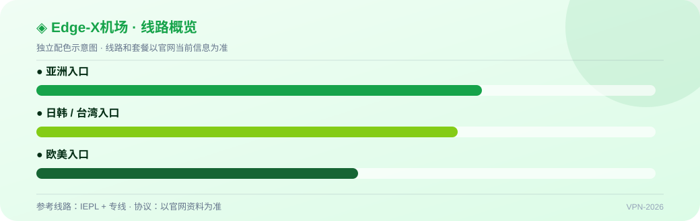

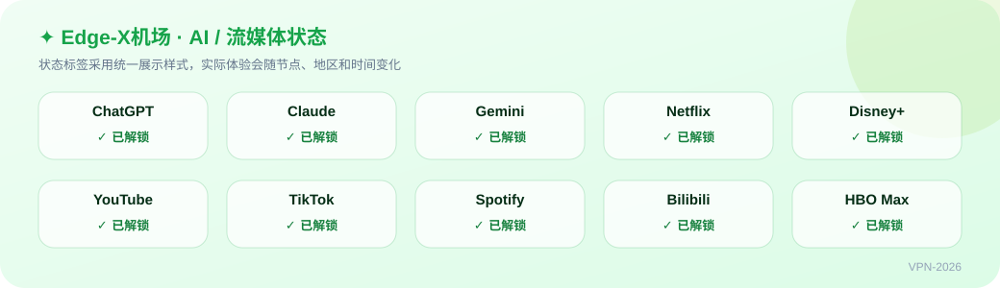

---

- **31. [可达加速器](#可达加速器)** —— 可达加速器是一家专注于高速稳定出海体验的代理服务商，采用 SD-WAN 网络架构，覆盖全球多个节点，不限速使用，适合日常科学上网及流媒体需求。套…（10元 100GB/月 · 📝 资料整理）
- **34. [山海机场](#山海机场)** —— 山海机场采用中转 + 专线 + 直连综合架构，价格极其亲民，是入门用户性价比最高的选择之一。能够流畅解锁主流影视流媒体以及 ChatGPT 等 …（6元 45GB/月 · 📝 资料整理）
- **35. [LiZione](#lizione)** —— LiZione 致力于提供极高性价比的中转与专线服务。全节点支持流媒体解锁（Netflix、Disney+、YouTube）以及 ChatGPT…（10元 100GB/月 · 📝 资料整理）
- **36. [哆啦A梦](#哆啦a梦)** —— 哆啦A梦机场提供极具性价比的科学上网服务，线路覆盖全球多个核心地区。采用先进的中转与加速技术，确保晚高峰时期依然能够流畅播放 4K 视频。支持多…（10元 100GB/月 · 📝 资料整理）
- **37. [大哥云](#大哥云)** —— 大哥云是拥有 5 年口碑的老品牌机场，支持 Netflix 等多家流媒体解锁，支持 YouTube 8K 流畅观看。全线采用 IPLC 线路，提…（19.9元 100GB/月 · 📝 资料整理）
- **38. [龙猫云](#龙猫云)** —— 龙猫云采用 IPLC 深港、沪美、沪日级跨境专线，节点质量极高。所有套餐均不限制设备，晚高峰时期毫不降速。原生解锁全平台流媒体，支持 TikTo…（15元 150GB/月 · 📝 资料整理）
- **39. [飞鸟机场](#飞鸟机场)** —— 飞鸟机场是业界有口皆碑的高品质老牌机房，通过巧妙搭配中转 and IEPL 专线，取得了极佳的速度与稳定性平衡。日常带宽余量大，晚高峰跑满百兆宽…（15元 100GB/月 · 📝 资料整理）
- **40. [青云梯](#青云梯)** —— 青云梯主打全 IPLC 专线，顶级国际出口线路，最大提供 2.5GBps 超大带宽，无惧网络波动，所有套餐均不限制同时在线设备数量，全家或全公司…（8元 60GB/月 · 📝 资料整理）
- **41. [花云 (FlowerCloud)](#花云-flowercloud)** —— FlowerCloud 成立于 2020 年，是业内公认的老牌高质量机场之一。采用 BGP 入口专线网络，多线自动优选回程，有效降低延迟和丢包。…（128元/年 20GB/月 · 📝 资料整理）

## 👑 高端机场（13 家）

- **3. [飞猫云](#飞猫云)** —— 飞猫云采用全 IPLC 专线网络，提供最高 2.5Gbps 稳定速率，原生 IP 线路，轻松解锁 Netflix、Disney+、ChatGPT…（25元 150GB/月 · 📝 资料整理）
- **4. [云图机场](#云图机场)** —— 云图机场是一家高品质 of 科学上网服务商，线路传输采用金融级专线，提供无脑下单即可的高质量稳定节点。全线完美解锁 Netflix、Disney…（20元 150GB/月 · 📝 资料整理）
- **14. [影子](#影子)** —— 影子是一家专注于高端 IEPL 跨境专线的机场服务商。其采用企业级专线过境，具有极低延迟和极低丢包的表现，能完美绕过敏感时期的封锁，对 Netf…（18.8元 150GB/月 · 📝 资料整理）
- **15. [边界云](#边界云)** —— 边界云是一家专注高性价比科学上网服务的机场，采用 IEPL 优化线路，提供 50+ 全球节点覆盖。全套餐支持 UDP 协议，主流流媒体（Netf…（12.33元 50GB/月（年付） · 📝 资料整理）
- **17. [灵猫网络](#灵猫网络)** —— 灵猫网络是一家主打高性价比企业级全 IPLC 专线的高速机场。所有套餐均采用 IPLC 物理专线，不限制客户端，不限速，最大提供 1000 Mb…（85元/年（45G/月） · 📝 资料整理）
- **18. [星岛梦](#星岛梦)** —— 星岛梦是专选 IEPL 专线的高品质机场，提供 Trojan/SS 协议，全线解锁 Netflix、Disney+、YouTube、ChatGP…（16元 100GB/月 · 📝 资料整理）
- **21. [寰宇云](#寰宇云)** —— 寰宇云机场采用全 IEPL 专线+直连双线路架构，最大提供 2.5Gbps 超大带宽，全线解锁 Netflix、Disney+、Gemini、C…（89元/年 60GB/月 · 📝 资料整理）
- **29. [迅达VPN](#迅达vpn)** —— 迅达VPN是一家专注高质量跨境代理服务的机场，采用多地BGP跨境企业级专线，支持流媒体无障碍解锁，包括 Netflix、Disney+、Chat…（15元 150GB/月 · 📝 资料整理）
- **30. [Edge-X机场](#edge-x机场)** —— Edge-X 是一家专注于高品质 IEPL 内网专线的机场服务商，采用企业级线路架构，提供稳定的内外网混合加速体验。节点高峰期 1 倍率，闲时 …（16.8元 100GB/月 · 📝 资料整理）
- **37. [大哥云](#大哥云)** —— 大哥云是拥有 5 年口碑的老品牌机场，支持 Netflix 等多家流媒体解锁，支持 YouTube 8K 流畅观看。全线采用 IPLC 线路，提…（19.9元 100GB/月 · 📝 资料整理）
- **38. [龙猫云](#龙猫云)** —— 龙猫云采用 IPLC 深港、沪美、沪日级跨境专线，节点质量极高。所有套餐均不限制设备，晚高峰时期毫不降速。原生解锁全平台流媒体，支持 TikTo…（15元 150GB/月 · 📝 资料整理）
- **39. [飞鸟机场](#飞鸟机场)** —— 飞鸟机场是业界有口皆碑的高品质老牌机房，通过巧妙搭配中转 and IEPL 专线，取得了极佳的速度与稳定性平衡。日常带宽余量大，晚高峰跑满百兆宽…（15元 100GB/月 · 📝 资料整理）
- **41. [花云 (FlowerCloud)](#花云-flowercloud)** —— FlowerCloud 成立于 2020 年，是业内公认的老牌高质量机场之一。采用 BGP 入口专线网络，多线自动优选回程，有效降低延迟和丢包。…（128元/年 20GB/月 · 📝 资料整理）

## ⚠️ 风险预警（2 家）

### 32. 奈云 —— 暂无详细介绍，购买前请以主站和官网实时信息为准。

**10.6元 168GB/月 起** · 线路：以主站介绍为准 · 协议：以官网资料为准 · 优惠码：`—`

已确认跑路，主站提示停止充值和续费。暂无详细介绍，购买前请以主站和官网实时信息为准。

📌 **资料口径：**主站风险提示：已确认跑路，主站提示停止充值和续费

👉 **⚠️ [风险说明](https://clash-jichang.com/airport/naiyun)**

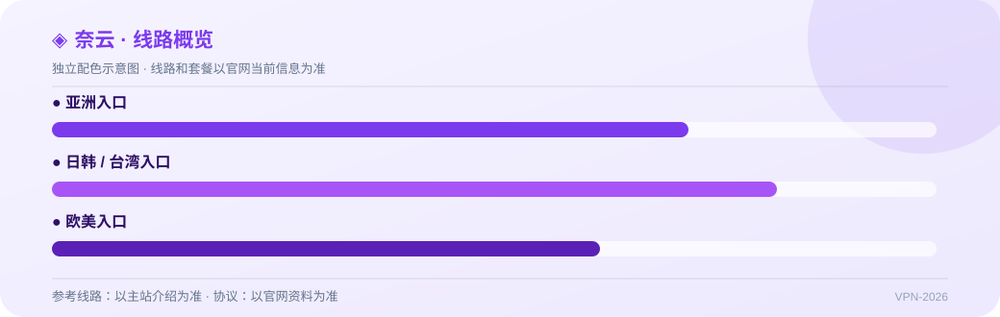

---

### 33. 隐云 —— 暂无详细介绍，购买前请以主站和官网实时信息为准。

**25元 150GB/月 起** · 线路：以主站介绍为准 · 协议：以官网资料为准 · 优惠码：`—`

高风险，主站提示停止续费并更换备用机场。暂无详细介绍，购买前请以主站和官网实时信息为准。

📌 **资料口径：**主站风险提示：高风险，主站提示停止续费并更换备用机场

👉 **⚠️ [风险说明](https://clash-jichang.com/airport/yinyun)**

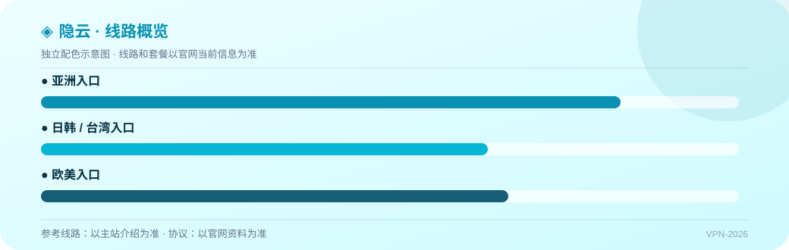

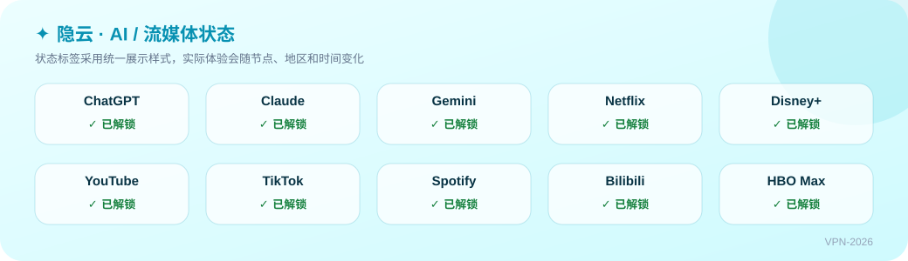

---

## 🔄 数据如何自动更新

1. `.github/workflows/daily-sync.yml` 按北京时间每天 00:30 运行，也支持在 Actions 页面手动运行。
2. 工作流先执行 `node scripts/sync-main-site.mjs`，从主站机场页提取当前顺序、价格、介绍和注册入口，写入 `data/services.json`；再执行 `node scripts/build-readme.mjs` 生成 README 和全部 SVG 示意图。
3. 脚本重新生成 `README.md`，更新日期、数量徽章和表格；文件有变化时，Actions 自动提交。

### 接入外部 JSON 接口

如果以后改用 JSON 接口，可在 GitHub 仓库的 Settings → Secrets and variables → Actions → Variables 中添加 `DATA_URL`。接口可以直接返回数组，也可以返回 `{"updatedAt": "...", "services": [...]}`；未配置时仍使用仓库内的 `data/services.json`。

> 参考仓库的链接本质上是 JSON 数据里的 URL 字段被生成器写成 Markdown `[文字](https://...)`，并不是 GitHub 自动生成的特殊链接。

## 📱 客户端建议

- Windows / macOS：Clash Verge Rev、v2rayN、sing-box
- Android：Clash Meta for Android、v2rayNG
- iOS：Shadowrocket、Stash（请通过官方渠道获取）
- 导入订阅前确认链接来源，订阅地址不要公开发送。

## ❓ 常见问题

**没有外部接口可以运行吗？** 可以。保持 `DATA_URL` 未设置，脚本会使用 `data/services.json`。

**如何手动更新？** 打开仓库的 Actions，选择 `每日同步 README`，点击 `Run workflow`。

## 📌 更新与声明

本清单只做公开资料整理和技术演示。价格、优惠活动、线路、IP 质量、速度、解锁状态和服务存续都可能变化；除明确标注的记录外，不应把表格内容理解为独立实测结论。部分链接可能包含推广参数，是否使用由你自行决定。

⭐ 如果这个仓库对你有帮助，欢迎 Star；发现过期资料请提交 Issue。
