# 2026 机场推荐清单｜老牌 / 性价比 / 稳定 / 高端（32 家，每日自动同步）

   

这是 [clash-jichang.com](https://clash-jichang.com/) 品牌库的 GitHub 镜像：**32 家机场按老牌 / 性价比 / 稳定 / 高端四类整理**，每家给出套餐价格、优惠码、线路口径、资料来源和注册入口。
> 价格、优惠码、线路和可用性会变化，购买前请在官网核验，并优先月付试用。
>
> 订阅链接等同账号密码，请勿公开粘贴或提交到 Issues、日志和截图中。请遵守所在地法律法规及服务条款。

**数据更新时间：2026-10-27（Asia/Shanghai）** · [主站](https://clash-jichang.com/) · [对比总表](https://clash-jichang.com/compare/) · [品牌库](https://clash-jichang.com/brands/) · [Telegram](https://t.me/jichangcha)

这是围绕 **2026 机场推荐、机场梯子、老牌机场、性价比机场、稳定机场、高端机场、ChatGPT / Claude、Clash、Sing-box、V2Ray、Shadowsocks、Trojan、IEPL / IPLC** 等搜索需求整理的资料页。表格用于快速对比价格、优惠码、线路、协议和注册入口，具体可用性以官网和自行测试为准。
每家资料均配有独立配色的线路概览图和 AI / 流媒体状态图，图片只用于阅读导航和版式展示。

## 📋 目录

- [本期更新](#update) · [本期主推](#top) · [快速选择指南](#guide) · [全部机场速览](#all)
- [老牌机场](#老牌机场) · [性价比机场](#性价比机场) · [稳定机场](#稳定机场) · [高端机场](#高端机场)
- [数据如何自动更新](#数据如何自动更新) · [客户端建议](#客户端建议) · [常见问题](#常见问题) · [更新与声明](#更新与声明)

## 📢 本期更新（2026-10-27）

- 当前收录 **32 家机场**，其中有站长实测记录的品牌 **4 家**。
- 本期主推 **[星岛梦](#xingdaomeng)、[飞猫云](#feimao)、[微风网络](#breezenet)**；价格、优惠码和入口以 [clash-jichang.com/airport/](https://clash-jichang.com/airport/) 为准。
- 排名是资料整理的参考顺序，不代表任何时段的速度、稳定性或解锁保证。

## 🏆 本期主推

| 位置 | 机场 | 最低套餐 | 优惠码 | 一句话 | 资料口径 | 入口 |
| :---: | :--- | :--- | :---: | :--- | :--- | :--- |
| 🥇 主推 | [星岛梦](#xingdaomeng) | 8 元/月 60GB(年付) | `nmw888` | 六年老牌,企业级内网专线,套餐种类丰富 | ✅ 有实测记录 | [官网注册](https://clash-jichang.com/go/xingdaomeng/) · [完整评测](https://clash-jichang.com/brands/xingdaomeng/) |
| 🥈 次推 | [飞猫云](#feimao) | 7 元/月 50GB(年付) | `flycat888` | IEPL 专线性价比之选,流媒体与 AI 全解锁 | ✅ 有实测记录 | [官网注册](https://clash-jichang.com/go/feimao/) · [完整评测](https://clash-jichang.com/brands/feimao/) |
| 🥉 次推 | [微风网络](#breezenet) | 11.4 元/月 100GB(年付 137 元) | `—` | IPLC + VLESS,不限速不限设备,站长实测香港速度突出 | ✅ 有实测记录 | [官网注册](https://clash-jichang.com/go/breezenet/) · [完整评测](https://clash-jichang.com/brands/breezenet/) |

## ⚡ 快速选购指南

| 使用需求 | 优先查看 | 选择建议 |
| :--- | :--- | :--- |
| **第一次买 / 预算敏感** | [星岛梦](#xingdaomeng)、[光速云](#guangsu)、[宇宙云](#yuzhou) | 优先月付试水，确认流量有效期、退款规则和入口稳定性 |
| **求稳 / 打算长期用** | [星岛梦](#xingdaomeng)、[飞猫云](#feimao)、[微风网络](#breezenet) | 先体验完整晚高峰，再考虑季付或年付优惠 |
| **ChatGPT / Claude 等 AI 工具** | [星岛梦](#xingdaomeng)、[飞猫云](#feimao)、[微风网络](#breezenet) | 优先查看原生 IP、协议和实测日期，逐个节点验证 |
| **大流量 / 重度下载** | [U1S1](#u1s1)、[全球云](#quanqiu)、[宇宙云](#yuzhou) | 比较流量单价和周期规则，避免只看月付起步价 |
| **高端专线 / 套餐层级完整** | [星岛梦](#xingdaomeng)、[暮光网络](#twilight)、[光速云](#guangsu) | 重点核对 IEPL / IPLC 口径、退款政策和长期套餐限制 |

> 💡 选购纪律：第一个月月付试水，体验完整晚高峰后再考虑长期套餐；手头保留一条备用机场，避免完全失联。

## 📊 全部机场速览（32 家，按榜单排序）

| 排名 | 机场 | 分类 | 最低套餐 | 优惠码 | 资料口径 | 入口 |
| :---: | :--- | :--- | :--- | :---: | :--- | :--- |
| 1 | [星岛梦](#xingdaomeng) | 老牌机场 / 性价比机场 / 稳定机场 / 高端机场 | 8 元/月 60GB(年付) | `nmw888` | ✅ 有实测记录 | [官网注册](https://clash-jichang.com/go/xingdaomeng/) · [完整评测](https://clash-jichang.com/brands/xingdaomeng/) |
| 2 | [飞猫云](#feimao) | 老牌机场 | 7 元/月 50GB(年付) | `flycat888` | ✅ 有实测记录 | [官网注册](https://clash-jichang.com/go/feimao/) · [完整评测](https://clash-jichang.com/brands/feimao/) |
| 3 | [微风网络](#breezenet) | 稳定机场 | 11.4 元/月 100GB(年付 137 元) | `—` | ✅ 有实测记录 | [官网注册](https://clash-jichang.com/go/breezenet/) · [完整评测](https://clash-jichang.com/brands/breezenet/) |
| 4 | [暮光网络](#twilight) | 高端机场 | 9.1 元/月 70GB(年付 109 元) | `—` | 📋 套餐已核验 | [官网注册](https://clash-jichang.com/go/twilight/) · [完整评测](https://clash-jichang.com/brands/twilight/) |
| 5 | [无忧](#worryfree) | 稳定机场 | 6.6 元/月 40GB(年付 79 元) | `—` | 📋 套餐已核验 | [官网注册](https://clash-jichang.com/go/worryfree/) · [完整评测](https://clash-jichang.com/brands/worryfree/) |
| 6 | [光速云](#guangsu) | 老牌机场 / 性价比机场 / 稳定机场 / 高端机场 | 17 元/月 110GB | `AMM` | 📋 套餐已核验 | [官网注册](https://clash-jichang.com/go/guangsu/) · [完整评测](https://clash-jichang.com/brands/guangsu/) |
| 7 | [唯兔云](#weitu) | 老牌机场 | 14.9 元/月 100GB | `rabbit` | 📋 套餐已核验 | [官网注册](https://clash-jichang.com/go/weitu/) · [完整评测](https://clash-jichang.com/brands/weitu/) |
| 8 | [灵动云](#lingdong) | 高端机场 | 8.3 元/月 70GB(年付 99 元) | `—` | ✅ 有实测记录 | [官网注册](https://clash-jichang.com/go/lingdong/) · [完整评测](https://clash-jichang.com/brands/lingdong/) |
| 9 | [U1S1](#u1s1) | 老牌机场 | 20 元/月 120GB | `—` | 📋 套餐已核验 | [官网注册](https://clash-jichang.com/go/u1s1/) · [完整评测](https://clash-jichang.com/brands/u1s1/) |
| 10 | [极连云](#jilian) | 老牌机场 | 18 元/月 100GB | `—` | 📋 套餐已核验 | [官网注册](https://clash-jichang.com/go/jilian/) · [完整评测](https://clash-jichang.com/brands/jilian/) |
| 11 | [全球云](#quanqiu) | 老牌机场 | 20 元/月 120GB | `—` | 📋 套餐已核验 | [官网注册](https://clash-jichang.com/go/quanqiu/) · [完整评测](https://clash-jichang.com/brands/quanqiu/) |
| 12 | [光年梯](#guangnian) | 老牌机场 | 18 元/月 110GB | `—` | 📋 套餐已核验 | [官网注册](https://clash-jichang.com/go/guangnian/) · [完整评测](https://clash-jichang.com/brands/guangnian/) |
| 13 | [宇宙云](#yuzhou) | 性价比机场 | 14.9 元/月 100GB | `YUZHOU553` | 📝 资料整理 | [官网注册](https://clash-jichang.com/go/yuzhou/) · [完整评测](https://clash-jichang.com/brands/yuzhou/) |
| 14 | [sogo云](#sogo) | 性价比机场 | 25 元/月 150GB | `SOGO10000` | 📝 资料整理 | [官网注册](https://clash-jichang.com/go/sogo/) · [完整评测](https://clash-jichang.com/brands/sogo/) |
| 15 | [二猫云](#ermao) | 性价比机场 | 20 元/月 130GB | `ermao888` | 📝 资料整理 | [官网注册](https://clash-jichang.com/go/ermao/) · [完整评测](https://clash-jichang.com/brands/ermao/) |
| 16 | [一翻云](#yifan) | 性价比机场 | 20 元/月 150GB | `1FLYYUN` | 📝 资料整理 | [官网注册](https://clash-jichang.com/go/yifan/) · [完整评测](https://clash-jichang.com/brands/yifan/) |
| 17 | [edgenova](#edgenova) | 性价比机场 | 20 元/月 100GB | `TH888` | 📝 资料整理 | [官网注册](https://clash-jichang.com/go/edgenova/) · [完整评测](https://clash-jichang.com/brands/edgenova/) |
| 18 | [可信云](#kexin) | 性价比机场 | 25 元/月 150GB | `—` | 📝 资料整理 | [官网注册](https://clash-jichang.com/go/kexin/) · [完整评测](https://clash-jichang.com/brands/kexin/) |
| 19 | [速界](#sujie) | 性价比机场 | 25 元/月 150GB | `sujie888` | 📝 资料整理 | [官网注册](https://clash-jichang.com/go/sujie/) · [完整评测](https://clash-jichang.com/brands/sujie/) |
| 20 | [快狸](#kuaili) | 性价比机场 | 25 元/月 150GB | `theo66` | 📝 资料整理 | [官网注册](https://clash-jichang.com/go/kuaili/) · [完整评测](https://clash-jichang.com/brands/kuaili/) |
| 21 | [优信云](#youxin) | 性价比机场 | 15 元/月 100GB | `yx51666` | 📝 资料整理 | [官网注册](https://clash-jichang.com/go/youxin/) · [完整评测](https://clash-jichang.com/brands/youxin/) |
| 22 | [杨帆云](#yangfan) | 性价比机场 | 年付 6.9 折起 · 码 yf6189 | `yf6189` | 📝 资料整理 | [官网注册](https://clash-jichang.com/go/yangfan/) · [完整评测](https://clash-jichang.com/brands/yangfan/) |
| 23 | [疾风云](#jifeng) | 性价比机场 | 年付 6.9 折起 · 码 jf5169 | `jf5169` | 📝 资料整理 | [官网注册](https://clash-jichang.com/go/jifeng/) · [完整评测](https://clash-jichang.com/brands/jifeng/) |
| 24 | [尔湾云](#erwan) | 性价比机场 | 年付低至 69 折 · 码 year69 | `year69` | 📝 资料整理 | [官网注册](https://clash-jichang.com/go/erwan/) · [完整评测](https://clash-jichang.com/brands/erwan/) |
| 25 | [灵猫](#civet) | 稳定机场 | 7.1 元/月 45GB(年付 85 元) | `—` | 📋 套餐已核验 | [官网注册](https://clash-jichang.com/go/civet/) · [完整评测](https://clash-jichang.com/brands/civet/) |
| 26 | [闪跃](#flashleap) | 稳定机场 | 8 元/月 60GB(年付 96 元) | `shanyue` | 📋 套餐已核验 | [官网注册](https://clash-jichang.com/go/flashleap/) · [完整评测](https://clash-jichang.com/brands/flashleap/) |
| 27 | [飞为](#firefly) | 稳定机场 | 8 元/月 60GB(年付 96 元) | `firefly` | 📋 套餐已核验 | [官网注册](https://clash-jichang.com/go/firefly/) · [完整评测](https://clash-jichang.com/brands/firefly/) |
| 28 | [跨界](#kuajie) | 稳定机场 | 8 元/月 60GB(年付 96 元) | `—` | 📋 套餐已核验 | [官网注册](https://clash-jichang.com/go/kuajie/) · [完整评测](https://clash-jichang.com/brands/kuajie/) |
| 29 | [飞V](#flyv) | 高端机场 | 8.3 元/月 65GB(年付 99 元) | `—` | 📋 套餐已核验 | [官网注册](https://clash-jichang.com/go/flyv/) · [完整评测](https://clash-jichang.com/brands/flyv/) |
| 30 | [梯子云](#laddercloud) | 高端机场 | 7.4 元/月 60GB(年付 89 元) | `—` | 📋 套餐已核验 | [官网注册](https://clash-jichang.com/go/laddercloud/) · [完整评测](https://clash-jichang.com/brands/laddercloud/) |
| 31 | [浪网](#wavenet) | 高端机场 | 9.9 元/月 80GB(年付 119 元) | `—` | 📋 套餐已核验 | [官网注册](https://clash-jichang.com/go/wavenet/) · [完整评测](https://clash-jichang.com/brands/wavenet/) |
| 32 | [隐形人](#invisible) | 高端机场 | 9.1 元/月 80GB(年付 109 元) | `—` | 📋 套餐已核验 | [官网注册](https://clash-jichang.com/go/invisible/) · [完整评测](https://clash-jichang.com/brands/invisible/) |

## 🏛️ 老牌机场（8 家）

### 1. 星岛梦 —— 六年老牌,企业级内网专线,套餐种类丰富

**8 元/月 60GB(年付) 起** · 线路：企业级内网专线 · 协议：以官网资料为准 · 优惠码：`nmw888`

星岛梦以十年机房、六年运营和 IEPL/IPLC 专线为卖点,套餐灵活、含不限时买断,2026-06 站长实测速度与解锁都在线,是本站主推,适合看重老牌稳定和长期使用的用户。

- 六年老牌,运营稳定
- 企业级内网专线
- 套餐种类多,支持不限时套餐
- 解锁丰富,流媒体 + AI 覆盖广
- 支持订阅导入(需联系在线客服)

📌 **资料口径：**站长实测；价格与优惠码来自站长品牌清单;速度与解锁有 2026-06 站长实测(珠海联通 9Gbps,60 节点):香港平均下载约 375–424MB/s,美国 313–370MB/s,日台 70–130MB/s;NF/D+ 港日新美解锁,OpenAI 多数可用;页面图表仍为模拟示例。

👉 **[官网注册](https://clash-jichang.com/go/xingdaomeng/) · [完整评测](https://clash-jichang.com/brands/xingdaomeng/)**

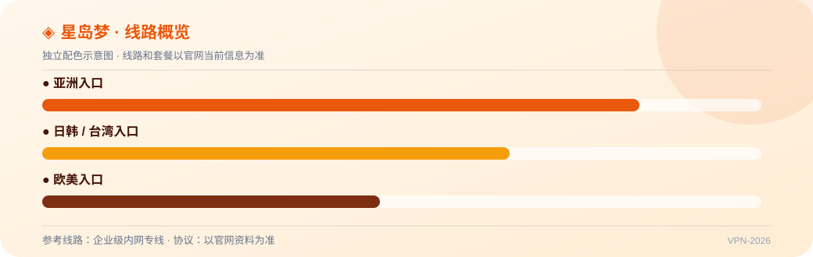

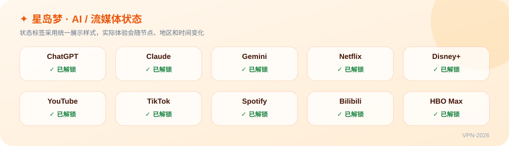

---

### 2. 飞猫云 —— IEPL 专线性价比之选,流媒体与 AI 全解锁

**7 元/月 50GB(年付) 起** · 线路：IEPL 专线 + 高性价比小包套餐 · 协议：以官网资料为准 · 优惠码：`flycat888`

飞猫云是本站 2026 年的主推机场:IEPL 专线保证晚高峰稳定,小包套餐把价格门槛压到很低,流媒体和 AI 解锁都在线,是新手入门与日常自用的均衡之选。

- IEPL 专线 + 高性价比小包套餐
- 流媒体全解锁,4K 不卡顿
- ChatGPT / Claude 等 AI 工具全解锁
- 自研客户端,新手一键上手
- 支持订阅导入(需联系在线客服)

📌 **资料口径：**站长实测；价格与优惠码来自站长品牌清单;速度与解锁有 2026-07 站长实测(长沙电信 2Gbps,49 测速 / 48 解锁):美/港/韩 130–158MB/s、峰值 200MB/s+,日本偏弱;OpenAI/Gemini/Claude 基本可用;页面图表仍为模拟示例。

👉 **[官网注册](https://clash-jichang.com/go/feimao/) · [完整评测](https://clash-jichang.com/brands/feimao/)**

---

### 6. 光速云 —— BGP 中转入口,低延迟游戏优化

**17 元/月 110GB 起** · 线路：BGP 优化中转入口 · 协议：以官网资料为准 · 优惠码：`AMM`

光速云以 BGP 中转和低延迟为特色,晚高峰不限速对游戏和实时应用友好,适合看重延迟和高峰稳定的用户。

- BGP 优化中转入口
- 低延迟,兼顾游戏加速
- 晚高峰不限速策略
- 支持不限时套餐
- Netflix / Disney+ 解锁

📌 **资料口径：**套餐已核验；套餐按 2026-08-09 截图核验;速度、晚高峰与解锁尚无独立实测,页面图表为模拟示例。

👉 **[官网注册](https://clash-jichang.com/go/guangsu/) · [完整评测](https://clash-jichang.com/brands/guangsu/)**

---

### 7. 唯兔云 —— VLESS 协议 + 三网优化,节点覆盖广

**14.9 元/月 100GB 起** · 线路：三网优化线路 · 协议：VLESS 协议,抗封锁能力强 · 优惠码：`rabbit`

唯兔云主打 VLESS 协议与 60+ 节点覆盖,三网优化和智能负载让线路选择更省心,适合对协议抗封锁和节点丰富度有要求的进阶用户。

- VLESS 协议,抗封锁能力强
- 节点覆盖 60+
- 三网优化线路
- 智能负载均衡

📌 **资料口径：**套餐已核验；套餐按 2026-08-09 截图核验;线路、节点与解锁尚无独立实测,页面图表为模拟示例。

👉 **[官网注册](https://clash-jichang.com/go/weitu/) · [完整评测](https://clash-jichang.com/brands/weitu/)**

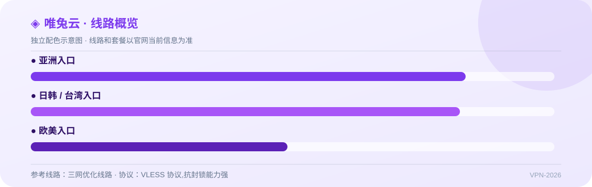

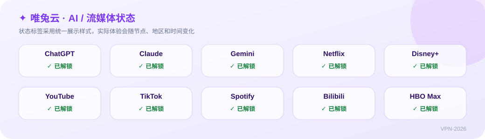

---

### 9. U1S1 —— 主打稳定不虚标,原生 IP 解锁

**20 元/月 120GB 起** · 线路：以官网资料为准 · 协议：以官网资料为准 · 优惠码：`—`

U1S1 走「真实不虚标」路线,带宽标注实在、稳定性口碑不错,适合被虚标机场坑过、追求踏实体验的长期用户。

- 真实回报测速,不虚标带宽
- 主打长期稳定
- 原生 IP 解锁流媒体
- 多客户端订阅支持
- 适合长期自用

📌 **资料口径：**套餐已核验；套餐按 2026-08-09 截图核验;线路、节点与解锁尚无独立实测,页面图表为模拟示例。

👉 **[官网注册](https://clash-jichang.com/go/u1s1/) · [完整评测](https://clash-jichang.com/brands/u1s1/)**

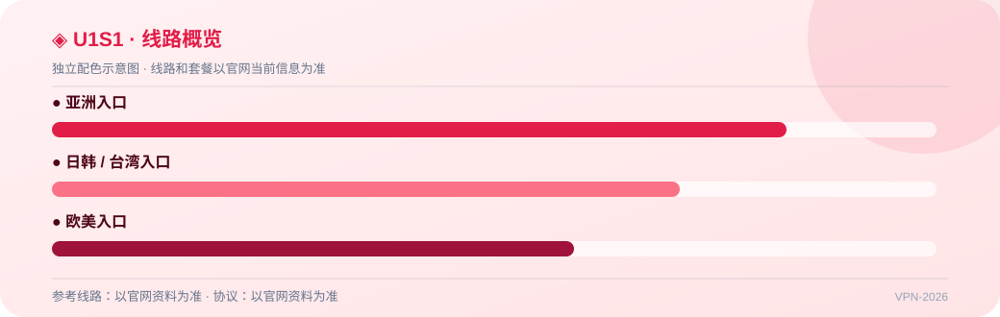

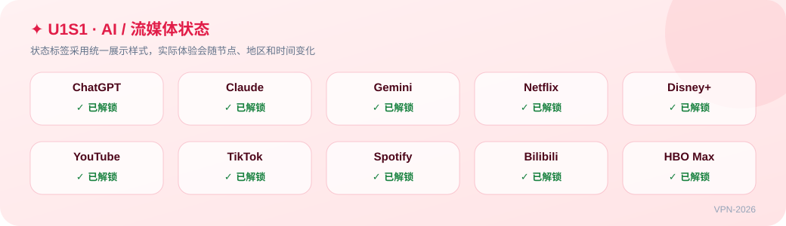

---

### 10. 极连云 —— IPLC 内网专线,抗封锁能力强

**18 元/月 100GB 起** · 线路：IPLC 内网专线；企业级线路品质 · 协议：以官网资料为准 · 优惠码：`—`

极连云主打 IPLC 内网专线,抗封锁和防 QoS 能力突出,配合低延迟和全解锁,适合敏感时期仍要稳定连通的用户。

- IPLC 内网专线
- 抗封锁能力强,防 QoS
- 香港 / 日本低延迟
- AI 与流媒体全解锁
- 企业级线路品质

📌 **资料口径：**套餐已核验；套餐按 2026-08-09 截图核验(截图套餐名为「极速云」,品牌归属待确认);中转 Trojan;速度与解锁尚无独立实测,页面图表为模拟示例。

👉 **[官网注册](https://clash-jichang.com/go/jilian/) · [完整评测](https://clash-jichang.com/brands/jilian/)**

---

### 11. 全球云 —— 全球多地区节点,智能分流大流量

**20 元/月 120GB 起** · 线路：以官网资料为准 · 协议：以官网资料为准 · 优惠码：`—`

全球云胜在节点地区覆盖最全、计费灵活,TikTok 与短视频体验友好,适合需要多国出口 IP 的外贸和内容用户。

- 全球多地区节点
- TikTok / YouTube 4K 流畅
- 智能分流规则
- 按量与月付灵活
- 大流量高性价比

📌 **资料口径：**套餐已核验；套餐按 2026-08-09 截图核验;「BGP 智能优化」为套餐名口径;速度与解锁尚无独立实测,页面图表为模拟示例。

👉 **[官网注册](https://clash-jichang.com/go/quanqiu/) · [完整评测](https://clash-jichang.com/brands/quanqiu/)**

---

### 12. 光年梯 —— 新手友好客户端,一键订阅导入

**18 元/月 110GB 起** · 线路：三网优化线路 · 协议：以官网资料为准 · 优惠码：`—`

光年梯把「新手友好」做到位,一键订阅导入和简洁客户端降低了上手门槛,适合第一次接触机场、只用主流节点的用户。

- 新手友好客户端
- 一键订阅导入
- 三网优化线路
- ChatGPT 原生解锁
- 稳定月付套餐

📌 **资料口径：**套餐已核验；套餐按 2026-08-09 截图核验;线路、节点与解锁尚无独立实测,页面图表为模拟示例。

👉 **[官网注册](https://clash-jichang.com/go/guangnian/) · [完整评测](https://clash-jichang.com/brands/guangnian/)**

---

## 💸 性价比机场（14 家）

- **1. [星岛梦](#xingdaomeng)** —— 六年老牌,企业级内网专线,套餐种类丰富（8 元/月 60GB(年付) · ✅ 有实测记录）
- **6. [光速云](#guangsu)** —— BGP 中转入口,低延迟游戏优化（17 元/月 110GB · 📋 套餐已核验）
### 13. 宇宙云 —— 全球节点覆盖广,多协议三网中转

**14.9 元/月 100GB 起** · 线路：三网优化中转线路 · 协议：Trojan / VLESS 多协议支持 · 优惠码：`YUZHOU553`

宇宙云走「全球节点 + 大流量性价比」路线,多协议和三网中转让兼容性不错,适合需要广覆盖节点和较大流量的日常用户。

- 全球多地区节点覆盖
- Trojan / VLESS 多协议支持
- 三网优化中转线路
- 流媒体与 ChatGPT 解锁
- 大流量高性价比套餐

📌 **资料口径：**资料整理；价格与优惠码来自站长品牌清单;页面测速与解锁图为统一口径的模拟示例,非站长实测。

👉 **[官网注册](https://clash-jichang.com/go/yuzhou/) · [完整评测](https://clash-jichang.com/brands/yuzhou/)**

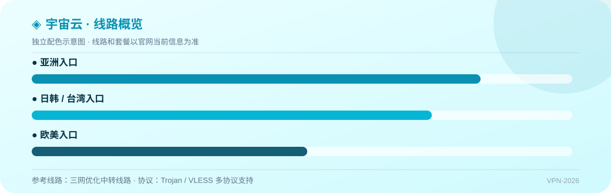

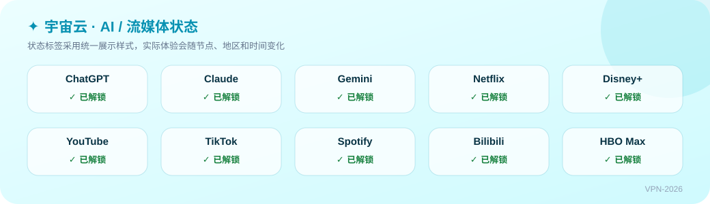

---

### 14. sogo云 —— 全球节点 + 专线,4K 流媒体多设备

**25 元/月 150GB 起** · 线路：全球节点 + 专线线路 · 协议：以官网资料为准 · 优惠码：`SOGO10000`

sogo云以全球节点 + 专线和多设备在线为卖点,4K 流媒体与 AI 解锁都在线,适合多设备、重流媒体的家庭或团队用户。

- 全球节点 + 专线线路
- 4K 流媒体流畅
- ChatGPT / Claude 解锁
- 多设备在线
- 稳定大流量套餐

📌 **资料口径：**资料整理；价格与优惠码来自站长品牌清单;页面测速与解锁图为统一口径的模拟示例,非站长实测。

👉 **[官网注册](https://clash-jichang.com/go/sogo/) · [完整评测](https://clash-jichang.com/brands/sogo/)**

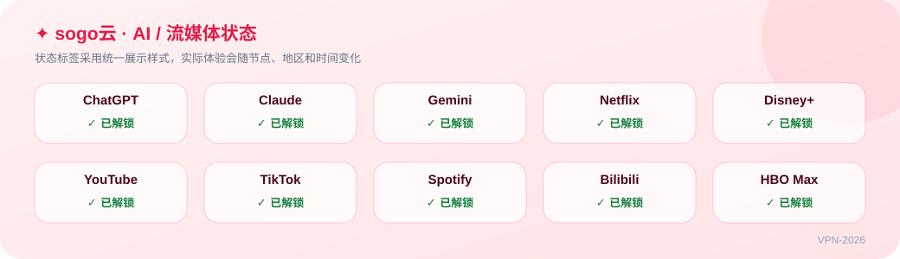

---

### 15. 二猫云 —— 中转 + 专线混合,原生 IP 解锁

**20 元/月 130GB 起** · 线路：中转 + 专线混合线路 · 协议：以官网资料为准 · 优惠码：`ermao888`

二猫云用「中转 + 专线」混合线路平衡成本与稳定,原生 IP 解锁齐全(含 HBO Max),适合流媒体需求高、预算适中的用户。

- 中转 + 专线混合线路
- 晚高峰稳定
- 原生 IP 节点
- Netflix / Disney+ / HBO 解锁
- 订阅导入方便

📌 **资料口径：**资料整理；价格与优惠码来自站长品牌清单;页面测速与解锁图为统一口径的模拟示例,非站长实测。

👉 **[官网注册](https://clash-jichang.com/go/ermao/) · [完整评测](https://clash-jichang.com/brands/ermao/)**

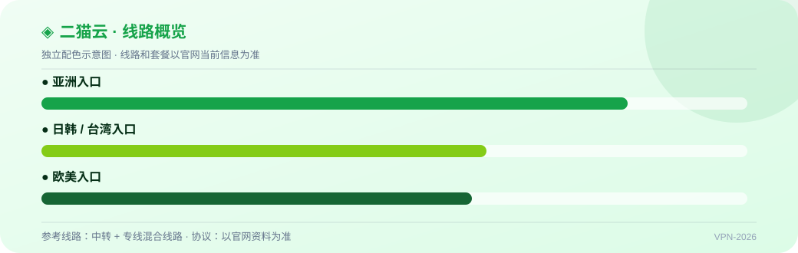

---

### 16. 一翻云 —— 超大流量 150G,VLESS + Reality 抗封锁

**20 元/月 150GB 起** · 线路：以官网资料为准 · 协议：VLESS + Reality 协议 · 优惠码：`1FLYYUN`

一翻云用 150G 超大流量和 VLESS + Reality 协议主打「量大又抗封」,适合下载/流媒体消耗大、又想要新协议抗封锁的重度用户。

- 超大流量 150G 套餐
- VLESS + Reality 协议
- 多平台客户端支持
- 流媒体全解锁
- 高性价比年付

📌 **资料口径：**资料整理；价格与优惠码来自站长品牌清单;页面测速与解锁图为统一口径的模拟示例,非站长实测。

👉 **[官网注册](https://clash-jichang.com/go/yifan/) · [完整评测](https://clash-jichang.com/brands/yifan/)**

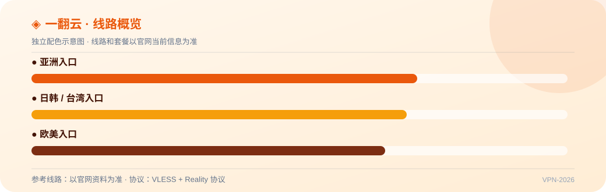

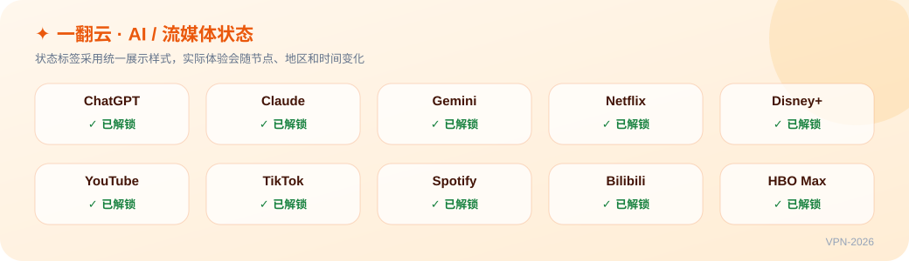

---

### 17. edgenova —— 海外团队运营,Reality 协议抗封锁

**20 元/月 100GB 起** · 线路：以官网资料为准 · 协议：Reality 协议抗封锁 · 优惠码：`TH888`

edgenova 由海外团队运营,Reality 协议 + 原生 IP 让抗封锁和 AI 解锁(含 Gemini)表现突出,适合能接受英文界面的进阶用户。

- 海外团队运营
- Reality 协议抗封锁
- 原生 IP 节点
- AI 工具全解锁
- 面向进阶用户

📌 **资料口径：**资料整理；价格与优惠码来自站长品牌清单;页面测速与解锁图为统一口径的模拟示例,非站长实测。

👉 **[官网注册](https://clash-jichang.com/go/edgenova/) · [完整评测](https://clash-jichang.com/brands/edgenova/)**

---

### 18. 可信云 —— 主打信任与长期稳定,IEPL 专线全平台

**25 元/月 150GB 起** · 线路：IEPL 专线线路 · 协议：以官网资料为准 · 优惠码：`—`

可信云把「信任」写在名字里,IEPL 专线 + 完善售后是其核心卖点,适合愿意为稳定和服务多付一点、打算长期使用的用户。

- 主打信任与长期稳定
- IEPL 专线线路
- 全平台客户端支持
- 流媒体与 AI 解锁
- 售后与客服完善

📌 **资料口径：**资料整理；仅确认品牌名称与独立入口;套餐、线路、节点尚未核验,页面图表为模拟示例。

👉 **[官网注册](https://clash-jichang.com/go/kexin/) · [完整评测](https://clash-jichang.com/brands/kexin/)**

---

### 19. 速界 —— 高带宽 IPLC 专线,晚高峰满速

**25 元/月 150GB 起** · 线路：高带宽 IPLC 专线 · 协议：以官网资料为准 · 优惠码：`sujie888`

速界主打高带宽 IPLC 专线,晚高峰满速、4K/8K 流媒体无压力,适合对带宽和高峰稳定要求最高、预算充足的重度用户。

- 高带宽 IPLC 专线
- 晚高峰满速不掉档
- 4K / 8K 流媒体
- 低延迟表现
- 适合重度用户

📌 **资料口径：**资料整理；价格与优惠码来自站长品牌清单;页面测速与解锁图为统一口径的模拟示例,非站长实测。

👉 **[官网注册](https://clash-jichang.com/go/sujie/) · [完整评测](https://clash-jichang.com/brands/sujie/)**

---

### 20. 快狸 —— 中转优化线路,上手简单三网直连

**25 元/月 150GB 起** · 线路：中转优化线路；三网直连优化 · 协议：以官网资料为准 · 优惠码：`theo66`

快狸走中转优化 + 简单上手路线,三网直连和月付大流量让它成为好用的日常备选,适合偏好月付、不想折腾配置的用户。

- 中转优化线路
- 上手简单,配置友好
- 三网直连优化
- 流媒体解锁
- 月付大流量高性价比

📌 **资料口径：**资料整理；价格与优惠码来自站长品牌清单;页面测速与解锁图为统一口径的模拟示例,非站长实测。

👉 **[官网注册](https://clash-jichang.com/go/kuaili/) · [完整评测](https://clash-jichang.com/brands/kuaili/)**

---

### 21. 优信云 —— 隧道中转 + IPLC 线路,支持 24 小时不满意退款

**15 元/月 100GB 起** · 线路：隧道中转 + IPLC 专线,兼顾速度与稳定 · 协议：以官网资料为准 · 优惠码：`yx51666`

优信云是 2024 年的新兴 Shadowsocks 服务,隧道中转 + IPLC 线路解锁 ChatGPT/TikTok,最大亮点是 24 小时不满意退款,试错成本低;作为新场建议先月付试水一个完整晚高峰周期再考虑年付。

- 隧道中转 + IPLC 专线,兼顾速度与稳定
- ChatGPT / TikTok / YouTube 解锁
- 套餐分档清晰:15/20/30 元月付对应 100/200/350GB
- 24 小时不满意退款,降低试错成本
- 年付 69 折码 yx51666、两年付 65 折码 yx51888

📌 **资料口径：**资料整理；价格与优惠码来自站长品牌清单;页面测速与解锁图为统一口径的模拟示例,非站长实测。

👉 **[官网注册](https://clash-jichang.com/go/youxin/) · [完整评测](https://clash-jichang.com/brands/youxin/)**

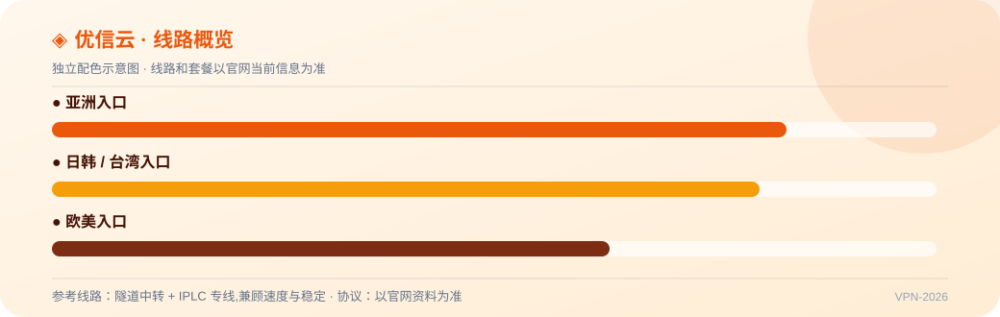

---

### 22. 杨帆云 —— 速鹰旗下,StrongVPN 大厂与新加坡团队联合运营

**年付 6.9 折起 · 码 yf6189 起** · 线路：以官网资料为准 · 协议：以官网资料为准 · 优惠码：`yf6189`

杨帆云背靠速鹰 / StrongVPN 大厂与新加坡团队,主打 IP 稳定高速与 24 小时客服,节点覆盖八大地区且持续扩展;具体套餐价格以官网为准,新场同样建议月付先验证晚高峰表现。

- 速鹰旗下,StrongVPN 大厂与新加坡团队共建
- 24 小时客服在线,响应快
- IP 稳定高速,节点持续扩展
- 覆盖美日新台法马港韩八大地区
- 年付 6.9 折码 yf6189、两年付 6.5 折码 yf6185

📌 **资料口径：**资料整理；价格与优惠码来自站长品牌清单;页面测速与解锁图为统一口径的模拟示例,非站长实测。

👉 **[官网注册](https://clash-jichang.com/go/yangfan/) · [完整评测](https://clash-jichang.com/brands/yangfan/)**

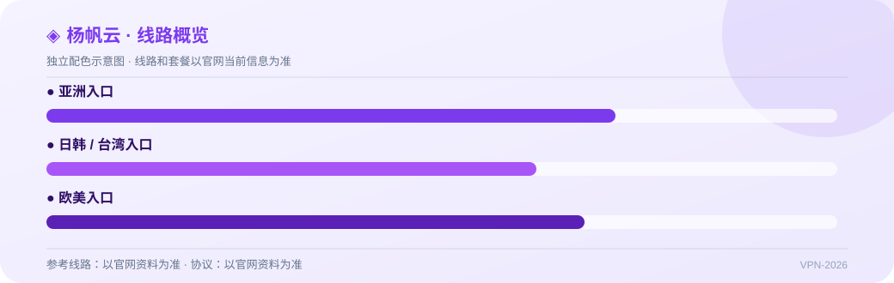

---

### 23. 疾风云 —— 隧道中转 + IPLC 专线混合,BGP 中转优化多协议

**年付 6.9 折起 · 码 jf5169 起** · 线路：隧道中转 + IPLC 专线混合架构；BGP 中转优化线路 · 协议：兼容 SSR / V2Ray / Trojan 多协议 · 优惠码：`jf5169`

疾风云是 2024 年成立的新机场,隧道中转 + IPLC 专线混合叠加 BGP 优化,多协议多客户端兼容性好,优惠码档位齐全;作为新场口碑尚待时间验证,建议月付试水后再上长期套餐。

- 隧道中转 + IPLC 专线混合架构
- BGP 中转优化线路
- 兼容 SSR / V2Ray / Trojan 多协议
- 支持 Clash / Shadowrocket / Surge 客户端
- 年付 6.9 折 jf5169、两年 6.5 折 jff5165、半年 9 折 JF888

📌 **资料口径：**资料整理；价格与优惠码来自站长品牌清单;页面测速与解锁图为统一口径的模拟示例,非站长实测。

👉 **[官网注册](https://clash-jichang.com/go/jifeng/) · [完整评测](https://clash-jichang.com/brands/jifeng/)**

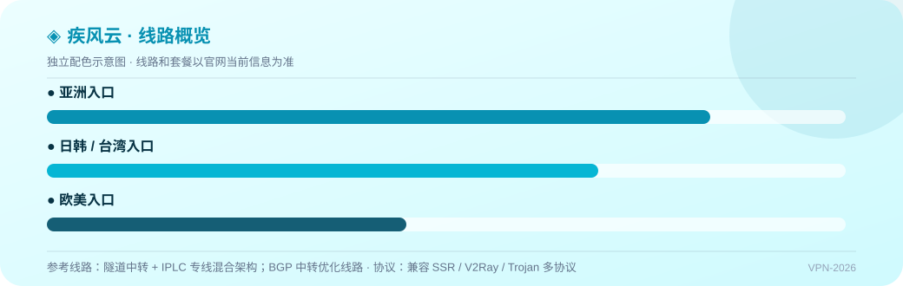

---

### 24. 尔湾云 —— 全平台客户端,支持微信 / 支付宝付款

**年付低至 69 折 · 码 year69 起** · 线路：以官网资料为准 · 协议：提供 Shadowsocks 与 V2Ray 节点 · 优惠码：`year69`

尔湾云是 2024 年成立的新机场,主打全平台客户端与微信 / 支付宝付款便利,节点覆盖 8 个地区,长期套餐折扣力度大;流媒体与 AI 解锁属基础水平,适合对付款方式和多端覆盖有需求的日常用户,建议先月付验证。

- 提供 Shadowsocks 与 V2Ray 节点
- 安卓 / iOS / macOS / Windows / 路由器全平台客户端
- 覆盖马来西亚、韩国、法国、香港、日本、台湾等 8 地区
- 支持微信支付与支付宝,付款方便
- 年付 69 折 year69、两年 65 折 2year65、三年 60 折 3year60

📌 **资料口径：**资料整理；价格与优惠码来自站长品牌清单;页面测速与解锁图为统一口径的模拟示例,非站长实测。

👉 **[官网注册](https://clash-jichang.com/go/erwan/) · [完整评测](https://clash-jichang.com/brands/erwan/)**

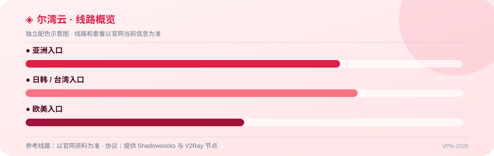

---

## 🛡️ 稳定机场（8 家）

- **1. [星岛梦](#xingdaomeng)** —— 六年老牌,企业级内网专线,套餐种类丰富（8 元/月 60GB(年付) · ✅ 有实测记录）
### 3. 微风网络 —— IPLC + VLESS,不限速不限设备,站长实测香港速度突出

**11.4 元/月 100GB(年付 137 元) 起** · 线路：IPLC 专线 + VLESS 协议 · 协议：IPLC 专线 + VLESS 协议 · 优惠码：`—`

微风网络在站长 2026-07 实测里香港速度和流媒体解锁都很能打,美国方向偏弱、AI 未测;新开且与飞鸟一云梯同源,建议月付试水后再上年付。

- IPLC 专线 + VLESS 协议
- 不限速、不限设备
- 2026-07-19 站长实测:香港平均 510–546MB/s,峰值 600MB/s+
- YouTube / Netflix / Disney+ 50 个节点全部解锁(实测)
- 周期订阅与 270G / 570G 不限时流量并存

📌 **资料口径：**站长实测；套餐按 2026-08-08 截图核验;速度与流媒体解锁为 2026-07-19 站长实测(珠海联通 9Gbps,50 节点);AI 解锁未测;暂无图表。

👉 **[官网注册](https://clash-jichang.com/go/breezenet/) · [完整评测](https://clash-jichang.com/brands/breezenet/)**

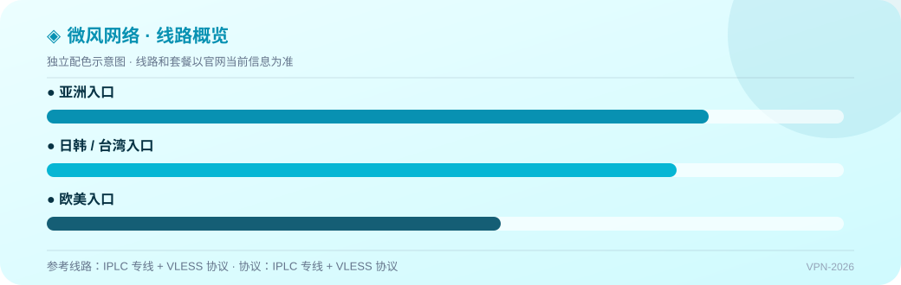

---

### 5. 无忧 —— 40G 年付小包 79 元起,周期套餐与永久不限时流量并存

**6.6 元/月 40GB(年付 79 元) 起** · 线路：以官网资料为准 · 协议：以官网资料为准 · 优惠码：`—`

无忧目前只有套餐价格经过核验,便宜的年付小包和永久不限时流量是它的卖点;线路和实测都还是空白,适合作为低成本备用而不是主力。

- MINI 40G 年付 79 元,入门门槛低
- 100G 月付 19 元起,最高 1000G/月
- 100G / 300G 永久不限时流量
- 月付到三年付周期齐全

📌 **资料口径：**套餐已核验；套餐名称、流量与价格按 2026-08-08 截图核验;线路/协议、节点、支付、设备限制未公开;速度与解锁尚无独立实测;暂无图表。

👉 **[官网注册](https://clash-jichang.com/go/worryfree/) · [完整评测](https://clash-jichang.com/brands/worryfree/)**

---

- **6. [光速云](#guangsu)** —— BGP 中转入口,低延迟游戏优化（17 元/月 110GB · 📋 套餐已核验）
### 25. 灵猫 —— 套餐结构简单:45G 年付小包,150G / 300G 按月季年直接选

**7.1 元/月 45GB(年付 85 元) 起** · 线路：以官网资料为准 · 协议：以官网资料为准 · 优惠码：`—`

灵猫的优点是套餐简单、价格不高;缺点是除了价格什么都还没核验,线路和实测都是空白,适合月付试试,不建议直接年付。

- 45G 年付小包 85 元
- 150G 月付 25 元 / 季付 65 元 / 年付 195 元
- 300G 月付 45 元 / 季付 125 元 / 年付 295 元
- 套餐只有三档,不用纠结

📌 **资料口径：**套餐已核验；套餐名称、流量与价格按 2026-08-08 截图核验;线路/协议、节点、支付、设备限制未公开;速度与解锁尚无独立实测;暂无图表。

👉 **[官网注册](https://clash-jichang.com/go/civet/) · [完整评测](https://clash-jichang.com/brands/civet/)**

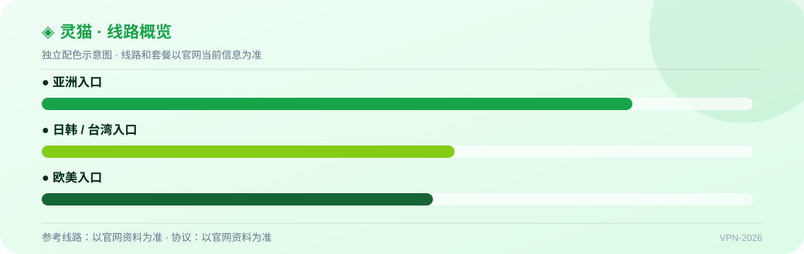

---

### 26. 闪跃 —— IPLC 纯专线、全套餐一倍率的 2026 年新机场

**8 元/月 60GB(年付 96 元) 起** · 线路：IPLC 纯专线(官网口径) · 协议：以官网资料为准 · 优惠码：`shanyue`

闪跃的 IPLC + 一倍率定位和价格都有吸引力,但成立才半年,又没有独立实测,属于先短期验证再考虑的新机场。

- IPLC 纯专线(官网口径)
- 全套餐 1 倍率
- 60G 年付 96 元,150G 月付 24 元起
- 官网标注支持 ChatGPT / Claude / Gemini
- 新用户优惠码 shanyue 8 折

📌 **资料口径：**套餐已核验；套餐按 2026-08-08 截图核验;线路定位来自官网资料;速度与解锁尚无独立实测;暂无图表。

👉 **[官网注册](https://clash-jichang.com/go/flashleap/) · [完整评测](https://clash-jichang.com/brands/flashleap/)**

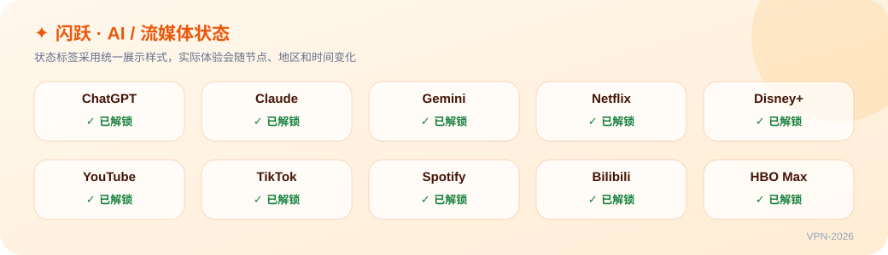

---

### 27. 飞为 —— IPLC + VLESS,原生 IP,不限速不限设备

**8 元/月 60GB(年付 96 元) 起** · 线路：IPLC 专线 + VLESS 协议(官网口径) · 协议：IPLC 专线 + VLESS 协议(官网口径) · 优惠码：`firefly`

飞为和微风是同一系的分站,套餐网格也一致;微风有实测、飞为没有,两家里优先看微风,飞为适合作为同系备用。

- IPLC 专线 + VLESS 协议(官网口径)
- 原生 IP,官网标注支持 ChatGPT / Gemini / Meta AI
- 60G 年付 96 元,150G 月付 25 元起
- 100G 不限时流量 100 元
- 新用户优惠码 firefly 8 折,年付 8 折

📌 **资料口径：**套餐已核验；套餐按 2026-08-08 截图核验;协议、线路与支付信息来自既有资料;速度与解锁尚无独立实测;暂无图表。

👉 **[官网注册](https://clash-jichang.com/go/firefly/) · [完整评测](https://clash-jichang.com/brands/firefly/)**

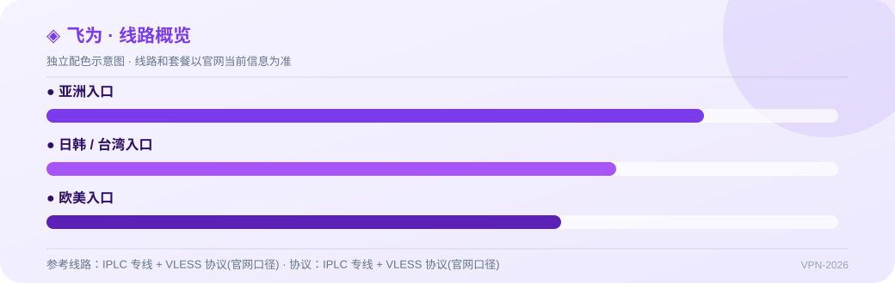

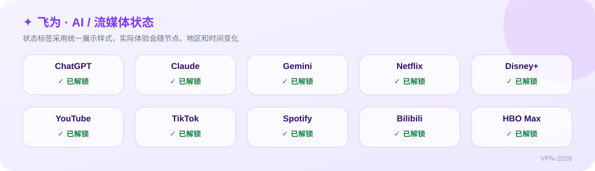

---

### 28. 跨界 —— 60G 年付小包起步,最高 1800G/月的大流量档

**8 元/月 60GB(年付 96 元) 起** · 线路：以官网资料为准 · 协议：以官网资料为准 · 优惠码：`—`

跨界的流量单价在同价位里很低,尤其 1800G 档;但线路和实测都还没有,大流量用户可以月付试一档看看。

- 60G 年付 96 元
- 120G 月付 20 元起
- 无界档 1800G/月 130 元,流量单价低
- 月付到三年付周期齐全

📌 **资料口径：**套餐已核验；套餐名称、流量与价格按 2026-08-08 截图核验;线路/协议、节点、支付、设备限制未公开;速度与解锁尚无独立实测;暂无图表。

👉 **[官网注册](https://clash-jichang.com/go/kuajie/) · [完整评测](https://clash-jichang.com/brands/kuajie/)**

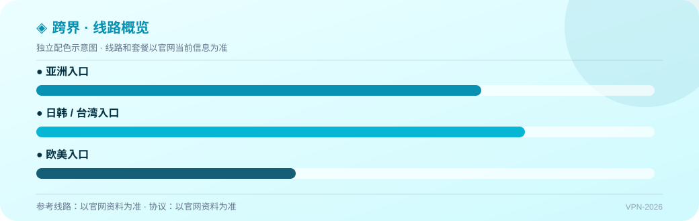

---

## 👑 高端机场（8 家）

- **1. [星岛梦](#xingdaomeng)** —— 六年老牌,企业级内网专线,套餐种类丰富（8 元/月 60GB(年付) · ✅ 有实测记录）
### 4. 暮光网络 —— IEPL 专线,基础到至尊四档周期套餐,另有不限时流量包与私人定制节点

**9.1 元/月 70GB(年付 109 元) 起** · 线路：IEPL 专线(官网标注) · 协议：以官网资料为准 · 优惠码：`—`

暮光网络的套餐结构在高端档里算完整,IEPL 专线定位明确;目前只有价格与套餐经过核验,速度和解锁还没有独立实测,先月付验证再决定长期套餐。

- IEPL 专线(官网标注)
- 120G 月付 20 元起,基础 / 标准 / 旗舰 / 至尊四档
- 150G / 400G / 800G 三档不限时流量包
- 年付轻量版 70G 109 元
- 可选独享私人定制节点

📌 **资料口径：**套餐已核验；套餐名称、流量与价格按 2026-08-08 截图核验(部分流量与设备限制被遮挡);速度、晚高峰、稳定性与解锁尚无独立实测;暂无图表。

👉 **[官网注册](https://clash-jichang.com/go/twilight/) · [完整评测](https://clash-jichang.com/brands/twilight/)**

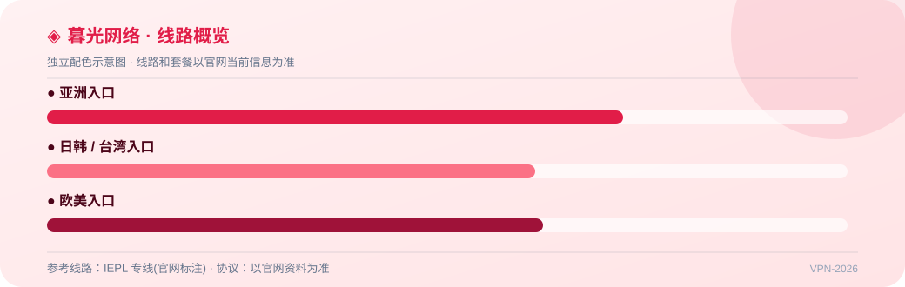

---

- **6. [光速云](#guangsu)** —— BGP 中转入口,低延迟游戏优化（17 元/月 110GB · 📋 套餐已核验）
### 8. 灵动云 —— VLESS 专线机场,站长实测 OpenAI 各地区基本全解锁

**8.3 元/月 70GB(年付 99 元) 起** · 线路：IEPL 专线 + VLESS(实测协议) · 协议：IEPL 专线 + VLESS(实测协议) · 优惠码：`—`

灵动云在站长 2026-07 实测里最突出的是 OpenAI 解锁,速度属于够用而非顶尖,TikTok 和部分 YouTube 节点有短板;用 AI 为主可以考虑,追求高速另选。

- IEPL 专线 + VLESS(实测协议)
- 不限速、不限设备
- 2026-07-20/21 站长实测:速度 20–80MB/s,够用级
- OpenAI 各地区基本全解锁(实测亮点)
- 100G 月付 20 元起,另有 150G–800G 单次流量包与私人定制

📌 **资料口径：**站长实测；套餐按 2026-08-08 截图核验;速度与解锁为 2026-07-20/21 站长实测(珠海联通 9Gbps,60 测速 / 60 解锁);暂无图表。

👉 **[官网注册](https://clash-jichang.com/go/lingdong/) · [完整评测](https://clash-jichang.com/brands/lingdong/)**

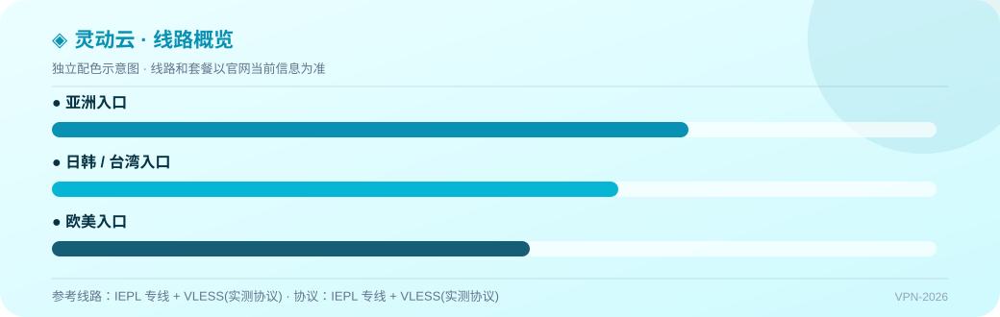

---

### 29. 飞V —— IEPL 专线,入门到商业四档,另有单次流量包与原生 IP 独享专线

**8.3 元/月 65GB(年付 99 元) 起** · 线路：IEPL 专线(官网标注)；可选原生 IP 独享黄金专线 · 协议：以官网资料为准 · 优惠码：`—`

飞V 的套餐层级和流量包选择都完整,IEPL 定位明确;价格已核验,实测为空,先月付或买小流量包验证。

- IEPL 专线(官网标注)
- 150G 月付 25 元起,最高 1843G/月
- 130G / 380G / 600G 单次流量包
- 年付标准轻量版 65G 99 元
- 可选原生 IP 独享黄金专线

📌 **资料口径：**套餐已核验；套餐名称、流量与价格按 2026-08-08 截图核验(部分被遮挡);速度、晚高峰、稳定性与解锁尚无独立实测;暂无图表。

👉 **[官网注册](https://clash-jichang.com/go/flyv/) · [完整评测](https://clash-jichang.com/brands/flyv/)**

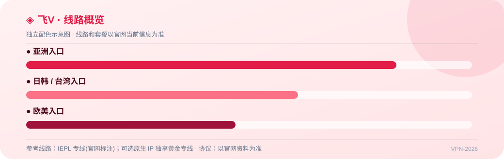

---

### 30. 梯子云 —— 企业级 IEPL + VLESS,智能负载均衡与三网入口优化,自研客户端

**7.4 元/月 60GB(年付 89 元) 起** · 线路：企业级 IEPL 纯专线 + VLESS(资料口径) · 协议：企业级 IEPL 纯专线 + VLESS(资料口径)；自研全平台客户端,兼容 Shadowrocket / Clash / V2Ray / Trojan / Sing-box · 优惠码：`—`

梯子云资料显示是速鹰旗下、与大哥云同门的专线品牌,线路与客户端口径完整;实测材料尚未核验,先按资料价参考,等实测补上再看排名。

- 企业级 IEPL 纯专线 + VLESS(资料口径)
- 智能负载均衡 + 三网入口优化
- 自研全平台客户端,兼容 Shadowrocket / Clash / V2Ray / Trojan / Sing-box
- 资料记录 60+ 节点(港日新美台)、2Gbps+ 独立带宽
- 125G 月付 25 元起,另有 120G–700G 永不限时买断

📌 **资料口径：**套餐已核验；套餐按 2026-08-08 截图核验(部分流量遮挡);线路、节点、客户端为既有资料记录;此前收到的测速/解锁图与灵动云重复,归属待核验,暂不展示实测。

👉 **[官网注册](https://clash-jichang.com/go/laddercloud/) · [完整评测](https://clash-jichang.com/brands/laddercloud/)**

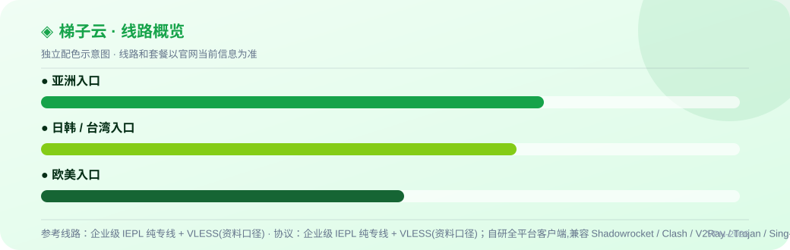

---

### 31. 浪网 —— IEPL 专线,入门到商业四档,流量包与定制线路补充

**9.9 元/月 80GB(年付 119 元) 起** · 线路：IEPL 专线(官网标注)；可选定制线路包 · 协议：以官网资料为准 · 优惠码：`—`

浪网的价格层级偏向中高用量用户,入门档比同类贵一点;目前只核验了价格,实测空白,建议先买流量包试用。

- IEPL 专线(官网标注)
- 150G 月付 30 元起,商业档 2000G/月
- 180G / 450G / 900G 一次性流量包
- 年付标准 80G 119 元
- 可选定制线路包

📌 **资料口径：**套餐已核验；套餐名称、流量与价格按 2026-08-08 截图核验(部分被遮挡);速度、晚高峰、稳定性与解锁尚无独立实测;暂无图表。

👉 **[官网注册](https://clash-jichang.com/go/wavenet/) · [完整评测](https://clash-jichang.com/brands/wavenet/)**

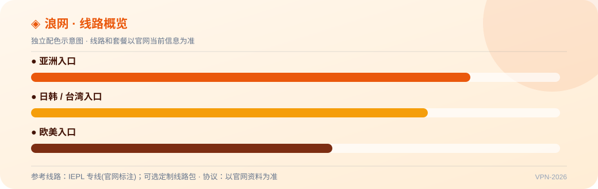

---

### 32. 隐形人 —— IEPL 专线,白银到钻石四档周期套餐,年付保活与一次性流量齐全

**9.1 元/月 80GB(年付 109 元) 起** · 线路：IEPL 专线(官网标注) · 协议：以官网资料为准 · 优惠码：`—`

隐形人的套餐设计和价格层级完整,IEPL 定位明确;和其他只核验了价格的品牌一样,先月付或买小流量包验证。

- IEPL 专线(官网标注)
- 144G 月付 24 元起,钻石档 1500G/月
- 160G / 420G / 1000G 一次性流量包
- 年付保活方案 80G 109 元
- 王者定制版 500G 600 元

📌 **资料口径：**套餐已核验；套餐名称、流量与价格按 2026-08-08 截图核验(部分被遮挡);速度、晚高峰、稳定性与解锁尚无独立实测;暂无图表。

👉 **[官网注册](https://clash-jichang.com/go/invisible/) · [完整评测](https://clash-jichang.com/brands/invisible/)**

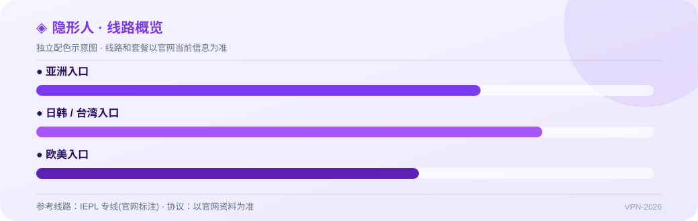

---

## 🔄 数据如何自动更新

1. `.github/workflows/daily-sync.yml` 按北京时间每天 00:30 运行，也支持在 Actions 页面手动运行。
2. 工作流执行 `node scripts/build-readme.mjs`。脚本优先读取 `DATA_URL` 指向的 HTTPS JSON；没有配置时使用仓库内的 `data/services.json`。当前资料结构参考 `clash-jichang.com/airport/`，注册与资料页统一使用 `clash-jichang.com` 域名。
3. 脚本重新生成 `README.md`，更新日期、数量徽章和表格；文件有变化时，Actions 自动提交。

### 接入外部 JSON 接口

在 GitHub 仓库的 Settings → Secrets and variables → Actions → Variables 中添加 `DATA_URL`。接口可以直接返回数组，也可以返回 `{"updatedAt": "...", "services": [...]}`。

> 参考仓库的链接本质上是 JSON 数据里的 URL 字段被生成器写成 Markdown `[文字](https://...)`，并不是 GitHub 自动生成的特殊链接。

## 📱 客户端建议

- Windows / macOS：Clash Verge Rev、v2rayN、sing-box
- Android：Clash Meta for Android、v2rayNG
- iOS：Shadowrocket、Stash（请通过官方渠道获取）
- 导入订阅前确认链接来源，订阅地址不要公开发送。

## ❓ 常见问题

**没有外部接口可以运行吗？** 可以。保持 `DATA_URL` 未设置，脚本会使用 `data/services.json`。

**如何手动更新？** 打开仓库的 Actions，选择 `每日同步 README`，点击 `Run workflow`。

## 📌 更新与声明

本清单只做公开资料整理和技术演示。价格、优惠活动、线路、IP 质量、速度、解锁状态和服务存续都可能变化；除明确标注的记录外，不应把表格内容理解为独立实测结论。部分链接可能包含推广参数，是否使用由你自行决定。

⭐ 如果这个仓库对你有帮助，欢迎 Star；发现过期资料请提交 Issue。
